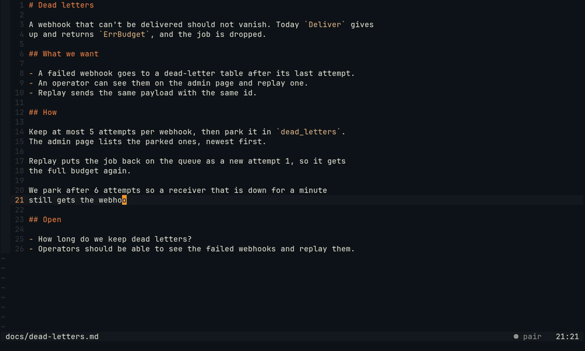
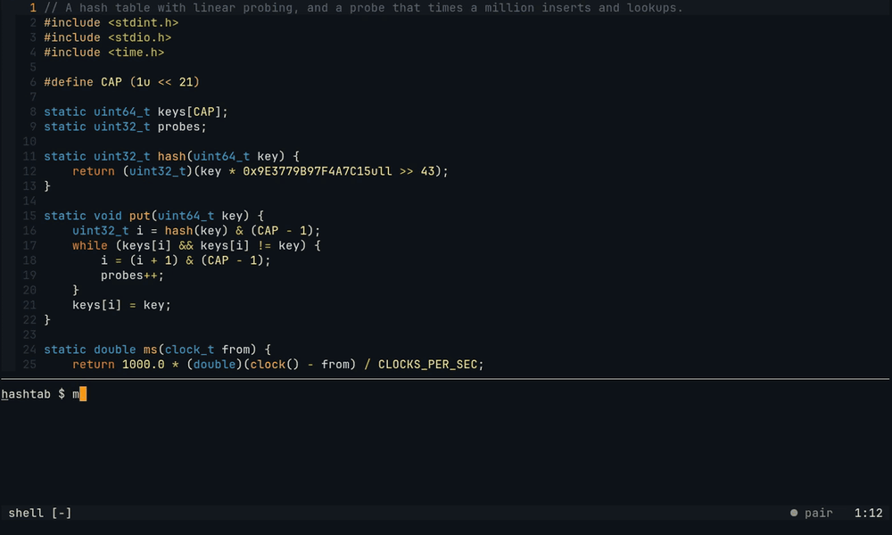

# pairing-buddy

An AI pairing partner that works inside your session instead of beside it.

Pair watches your editor (Neovim) and terminal ([herdr](https://herdr.dev)), talks with you in a chat pane, and acts
only through the tools you use. It never writes your files: its edits land unsaved in your buffer as one undo step,
and the disk changes only when you save.

https://github.com/user-attachments/assets/1a189e13-ff42-4710-a731-d5c493238cf9

*The three-minute tour: three moments in Neovim, the roles, the install and the keys. Its script and how to render it
again are in [docs/video](docs/video/). The website is at
[makefunstuff.github.io/pairing-buddy](https://makefunstuff.github.io/pairing-buddy/) (source in [`site/`](site/)).*

Version 0.9.

## Why

Most AI coding tools sit beside your work: you stop, describe the problem, and read a long answer. A good human pair
does something else. They notice when you start fixing the wrong file, run the tests you would skip, keep quiet while
you think, and take the keyboard only when you hand it over.

Pair aims for that:

- **It speaks rarely.** A small, fast model scores each moment first, and most moments are not worth a word. Remarks
  that can wait are held until your next break.
- **It shows, in place.** Its words appear under the line you are on, it points at the line it means, and a suggested
  change is one key to take.
- **It runs what you'd skip.** Save, and it runs the project's tests and tells you what your fix broke elsewhere.
- **You stay in charge.** It edits only when you hand over, you watch it type, and any key takes the wheel back.

## Quick start

You need Node.js 22.19+, Neovim 0.11+, herdr (Pair runs without it, but as Navigator only), and a model: a local OpenAI-compatible server, an Anthropic-compatible
API, or any provider [pi-ai](https://www.npmjs.com/package/@earendil-works/pi-ai) supports.

```sh
npm install -g github:makefunstuff/pairing-buddy   # puts `pair` on your PATH
pair setup                                         # writes the config, offers a login, installs the service
```

Add the plugin with lazy.nvim:

```lua
{
  'makefunstuff/pairing-buddy',
  main = 'pair',
  lazy = false,
  opts = {auto_connect = true},
}
```

Then set your model ([below](#configure-models)), open Neovim, run `pair` in the herdr pane next to it, and work: the
session takes its goal from the herdr board task of your branch, or the branch name, and asks only when there is
neither. `pair doctor` checks every part and says how to fix what is wrong.

Upgrading, installing from a clone, running without systemd or launchd, and the chat commands are in
[docs/install.md](docs/install.md).

## Configure models

Pair asks two models: the **Watcher**, which scores each moment with one number and must answer in about a second,
and the **Partner**, which thinks and writes what Pair says. One model can do both. The config is
`~/.config/pairing-buddy/config.json`, JSON with comments:

```jsonc
{
  "level": "normal",
  // One model for both roles: a local OpenAI-compatible server...
  "model": {"api": "openai", "baseUrl": "http://localhost:8080/v1", "model": "your-model"}
  // ...or a provider you logged in to with `pair auth login anthropic`:
  // "model": {"provider": "anthropic", "model": "your-cloud-model"}
}
```

The daemon takes a change as you save it, without a restart; run `pair doctor` to check the models. Every field, two
models, logins and keys, tips for local models and the talk levels are in [docs/config.md](docs/config.md).

## The Neovim plugin

Pair talks in Neovim with a few quiet marks in one accent colour taken from your colorscheme: its words under your
line, a lit line number where it reads, a `▎` where it points. The keys exist only while there is something for them
to do:

| Key | What it does |
| --- | --- |
| `Alt-j` | Go where Pair points (`Ctrl-O` comes back), or show a held remark now |
| `Alt-y` | Take Pair's suggested change, as your own edit |
| `Alt-t` (hold) | Ask aloud: [push-to-talk](docs/voice.md), when voice is set up |
| `Alt-u` / `Alt-n` | Tell Pair its last remark was useful / noise |
| `Alt-l` / `Alt-d` | In a Markdown note: open the code a mark names / log the decision on your line |
| `Alt-?` | The one idea worth keeping behind Pair's words under your line; again, open its link to the docs |
| `Alt-a` | Go to the agent whose news Pair relayed ([your other agents](docs/agents.md)) |
| any key | Take the wheel back while Pair drives |

The main commands are `:Pair ask <question>`, `:Pair drive [what]`, `:Pair scout`, `:Pair navigate`, `:Pair context`,
`:Pair today`, `:Pair agents`, `:Pair tasks` and `:Pair end`.
All options, commands, the statusline segment and the highlight groups are in [docs/neovim.md](docs/neovim.md), with
captures of each moment.

## Roles

Pair has one role at a time. It shows in the chat pane's prompt and in Neovim's statusline.

| Role | What Pair does | Switch with |
| --- | --- | --- |
| Navigator (default) | Watches, comments, answers, points at lines and suggests changes | `/navigate` in the chat, `:Pair navigate` |
| Scout | Also searches and runs commands (tests, builds, `git log`) in its own herdr pane, where you see everything | `/scout`, `:Pair scout` |
| Driver | Makes one change in your buffer while you watch, then hands back by itself | `:Pair drive`, `/drive`, or "you take it" / "your turn" in the chat |

What Scout may run is decided in code, not by the model: read-only commands, tests and builds run; writes and
installs ask you first; commits, pushes, the network and `sudo` are refused ([docs/scout.md](docs/scout.md)). The
Driver's edit is typed as ghost text, one undo step, never saved; with a test command for the project, Pair tests your
unsaved buffer before it hands back ([docs/driver.md](docs/driver.md)).

## What it does

**Speaks when it matters.** A remark starts from a moment such as a failed command you did not see, the same error
twice, or editing an unrelated file. Cheap rules drop plain noise, the Watcher scores the rest, and a budget limits
how often Pair talks. It never interrupts your typing. [docs/how-it-works.md](docs/how-it-works.md),
[docs/watcher.md](docs/watcher.md)

**Stops a wrong turn.** While a test is red and you edit a file the failure does not name, Pair traces the test and,
only if the cause is elsewhere, says so under your edit. [docs/neovim.md](docs/neovim.md#the-wrong-turn)

**Follows your search trail.** When you search in circles (three Telescope or snacks.picker searches, one of them
without a result you opened), Pair says where the thing is, in the code's own word. `:Pair trail` shows the searches it saw. [docs/neovim.md](docs/neovim.md#the-search-trail)

**Thinks in Markdown with you, never for you.** In a note, Pair puts at most five marks in the margin: `?` a question
the note leaves open, `≠` two lines that cannot both hold, `→` what the code it names really does, `◆` a decision,
and `≈` a paragraph that repeats an earlier one (a rule finds that one, not the model). A changed line loses its mark.
`Alt-d` logs a decision in `decisions.md` next to the note, as a buffer you save; `:Pair tasks` lists the note's work
and adds nothing until you press `y`. [docs/notes.md](docs/notes.md)



**Runs your tests on save.** Set a test command per project, and each save runs it in Pair's pane; a test your change
broke gets a remark and a suggested fix. [docs/tests-on-save.md](docs/tests-on-save.md)

**Sees a crash and a compiler error.** Builds and runs are read like test runs, from your terminal or a `make run` on
save: a segfault, a sanitizer report, a failed assert or a panic on the line of its frame in your code, and gcc, clang,
zig, odin and c3c errors and warnings on theirs, with `Alt-j` to the first. A warning your edit brought gets a word,
an old one stays quiet. [docs/builds.md](docs/builds.md)

**Holds a thought.** A remark that can wait waits for your next save or pause, with a `•` in the margin meanwhile.
[docs/neovim.md](docs/neovim.md#the-held-thought)

**Shows what it knows.** `:Pair context` shows, on one card, everything that goes with a remark or a question: the
goal, the board task of your branch (matched by repo and number), git, the commands you ran, your buffers, jumps and
searches. `x` takes a source out for the session. [docs/neovim.md](docs/neovim.md#what-it-knows-the-context-card)

**No ceremony.** A session starts with the goal of its board task or branch instead of asking, and ends by itself, with
its note, after 45 minutes without you or once its last Neovim closes. [docs/memory.md](docs/memory.md#no-ceremony-a-session-starts-and-ends-by-itself)

**Keeps a ledger.** `:Pair today` lists everything Pair did here today, one quiet line each: what it read, said,
pointed at, suggested, ran and typed, what it asked, and the moments it stayed quiet. `⏎` goes there or shows the
output, and `u` undoes one of its edits later, after your own edits too, which stay.
[docs/neovim.md](docs/neovim.md#the-ledger)

**Notices a green.** When the tests turn green after a red, the statusline lights up once and the test that turned
glows. After a long red or a regression, or when a number in your benchmark finally moved the right way, one line
says what is now true, then goes. Off by default: short sounds for the same moments, only while you are away from
Neovim. [docs/neovim.md](docs/neovim.md#when-it-goes-green)

**Keeps your other agents in one place.** When another herdr agent or a task on the
[Herdr Projects](https://github.com/eliasstravik/herdr-projects) board needs you, is ready to approve, failed or is
done, Pair says so in one line after its own in the statusline, at your next break and never while you type. `Alt-a`
brings that agent's pane to the front; `:Pair agents` (or `/agents`) lists them all, the ones that need you first. It
only reads the board and herdr. [docs/agents.md](docs/agents.md)



**Talks like a colleague.** The fact and its `file:line` first, the numbers, no praise, filler or emoji, and at most
30 words for a remark. Ask why (`Alt-?`, or `?` in the chat) and it gives the one idea worth keeping behind what it
said, with a link to the docs when it is sure of one. [docs/tone.md](docs/tone.md),
[docs/neovim.md](docs/neovim.md#the-idea-behind-it)

**Remembers and learns.** Each session ends with a short note the next one starts from, and your useful/noise verdicts
tune when Pair talks. `pair stats` shows the numbers. [docs/memory.md](docs/memory.md)

**Listens.** Hold `Alt-t` in Neovim, ask aloud, let go. whisper.cpp writes it down on your CPU, in about half a
second, and Pair answers under your line. An answer is read aloud only if you are away from the editor when it comes.
Off until you set `"voice"` in the config. [docs/voice.md](docs/voice.md)

## Documentation

- [Install and daily use](docs/install.md): requirements, setup, `pair doctor`, sessions in herdr, chat commands
- [Configuration](docs/config.md): models, logins and keys, local models, one model, talk levels
- [How it works](docs/how-it-works.md): what Pair sees, when it speaks, its tools per role
- [Neovim](docs/neovim.md): the visual language, the three moments, options, commands, statusline
- [Scout](docs/scout.md): Pair's pane, the command policy, test output parsing
- [Driver and suggestions](docs/driver.md): handing over, tests on the unsaved buffer, taking the wheel back
- [Tests on save](docs/tests-on-save.md)
- [Builds and crashes](docs/builds.md): crashes, compiler errors and new warnings, read from your runs
- [Notes in the margin](docs/notes.md): marks in a Markdown note, the decision log, tasks when asked
- [Tone](docs/tone.md): how Pair's words read, teaching on request, and the live tests that hold them
- [Push-to-talk](docs/voice.md): asking aloud, whisper.cpp, answers read aloud
- [The Watcher](docs/watcher.md): the speak gate, held thoughts, thinking, keep-warm
- [Memory and feedback](docs/memory.md): session notes, verdicts, tuning, `pair stats`
- [Your other agents](docs/agents.md): other agents' news at your breaks, `Alt-a`, `:Pair agents`
- [herdr](docs/herdr.md): what Pair gets from herdr and what is missing
- [Data and privacy](docs/data.md): what is stored where, and what leaves your machine
- [Tests](docs/testing.md): `npm test` and the live tests against real models

## Limitations

Known limitations are tracked as [GitHub issues](https://github.com/makefunstuff/pairing-buddy/issues/51).
