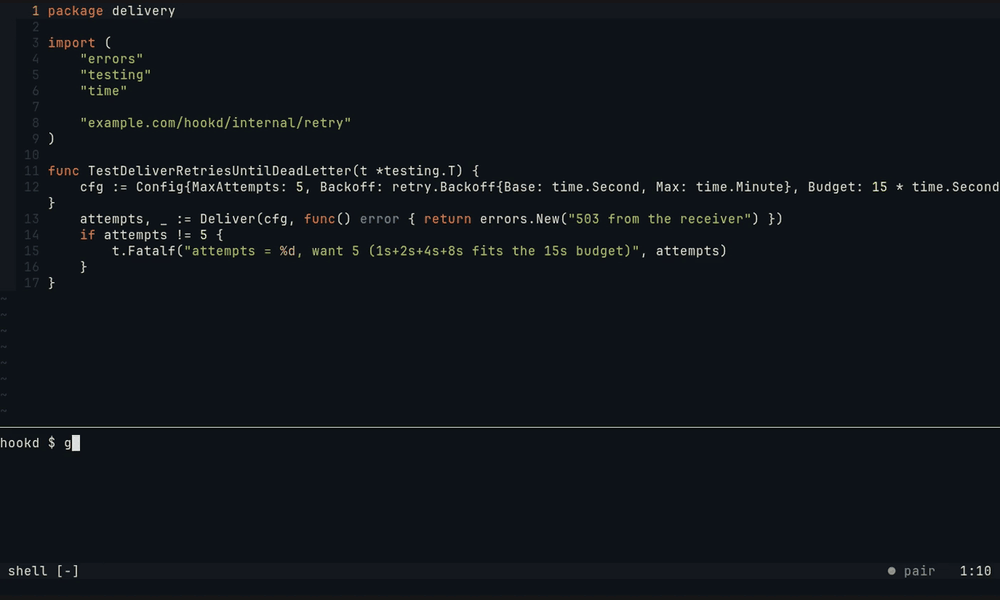
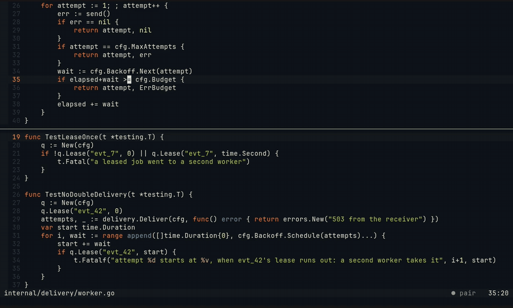
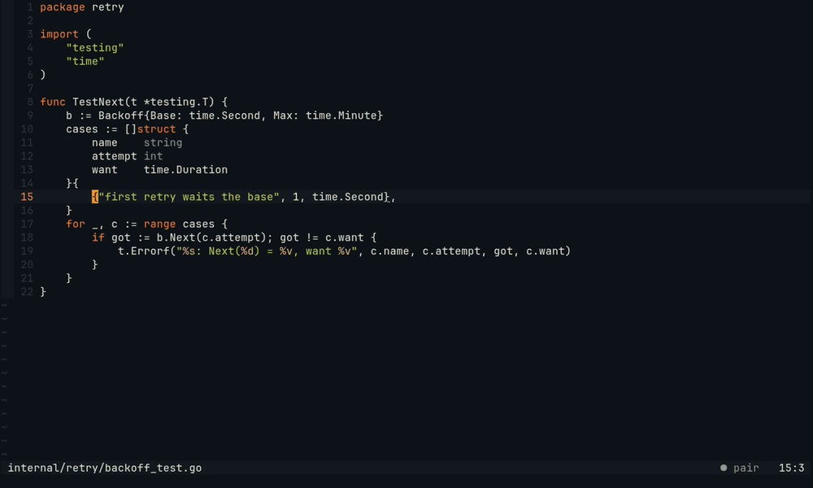
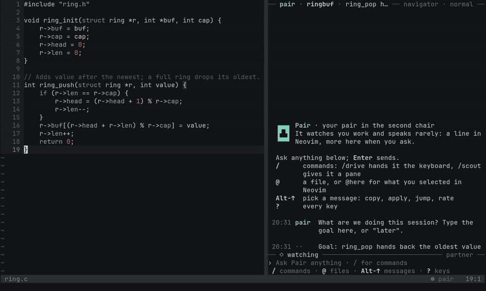
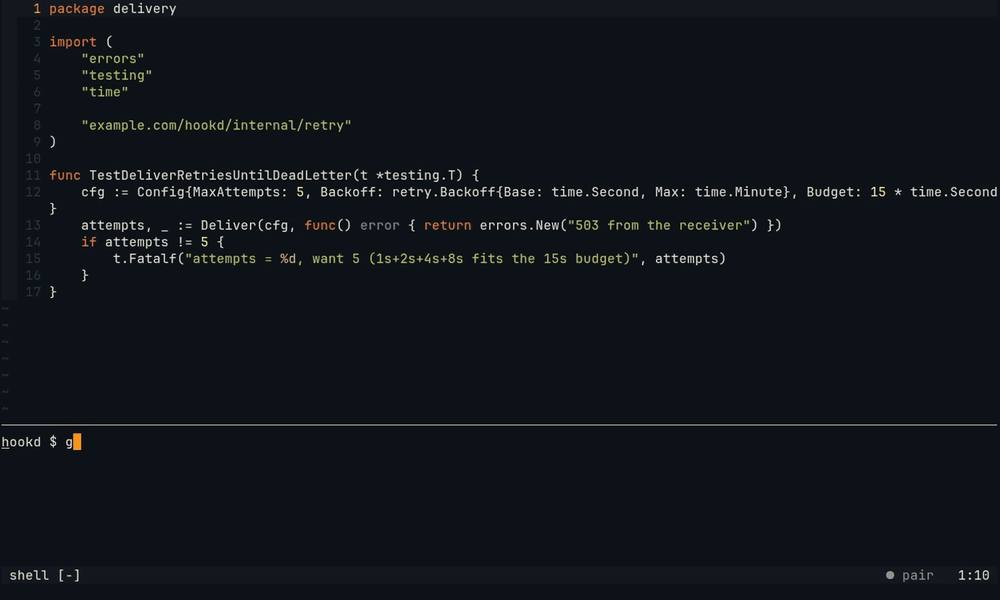
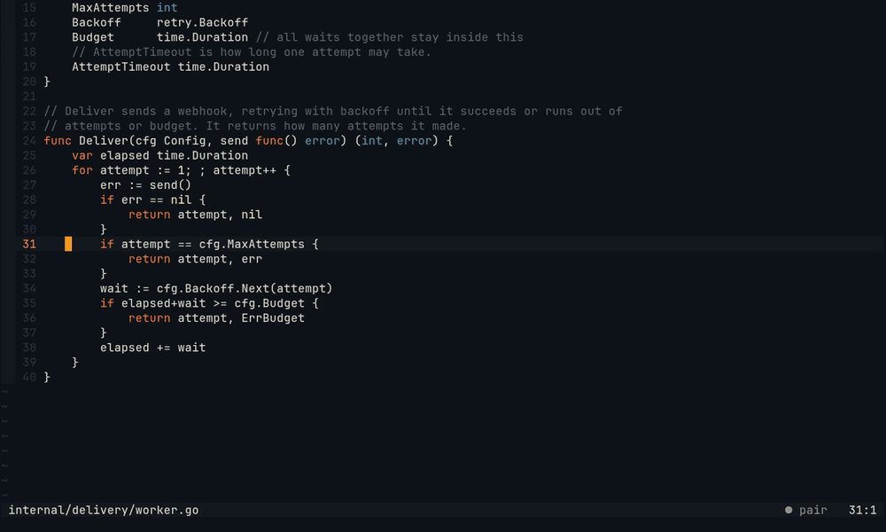

# pairing-buddy

An AI pairing partner that works inside your session instead of beside it.

It watches your editor (Neovim) and terminal (herdr), talks with you, and acts
only through the same tools you use: it never writes files on its own. Edits
land unsaved in your buffer as a single undo step; the disk changes only when
you save.

**Watch the three-minute tour**: the three moments in Neovim, the roles, install in two commands and the keys, with captions.

https://github.com/user-attachments/assets/1a189e13-ff42-4710-a731-d5c493238cf9



*Pair in Neovim, as shipped: a test is red and you start fixing the wrong file. Pair reads (its gaze crosses the
line numbers), says why under your edit, and `Alt-j` goes to the real cause. More in [docs/neovim.md](docs/neovim.md).
The captures are recorded from tapes in [docs/captures](docs/captures/), with only the models scripted.*



*It runs what you'd skip: you save a fix, and Pair runs the project's tests in its own pane. The statusline spins,
then names the test that fails, in another package; a `✗` marks it, Pair's words under your line say why, `Alt-j`
goes to its one-line fix and `Alt-y` takes it. Save again: `✓ 4 tests, 3 packages`. [Details](docs/neovim.md#it-runs-what-youd-skip).*



*The visible hand-over: you write the first case and say `:Pair drive the edge cases`. Pair types the rest while you
watch, a whole line at a time, runs `go test -overlay` on your unsaved buffer, and hands back with `✓` and a note.
It is one undo step, and any key halfway leaves no change at all. [Details](docs/neovim.md#the-visible-hand-over).*



*The held thought, and one look: a remark that can wait waits for your next break (here, a save), with a `•` in the
margin meanwhile, so Pair never breaks your train of thought for news that keeps. On a grey palette with one warm red,
Pair's teal is the one other colour, in Neovim and in the chat pane. [Details](docs/neovim.md#the-held-thought).*



*What it knows, on one card: `:Pair context` shows the goal (taken from the board task of the branch, so nothing
was asked), the board, git, the commands you ran and where you have been: buffers, jumps, and Telescope and `/`
searches with what you opened. It is exactly what goes with a remark or a question; `x` takes a source out.
[Details](docs/neovim.md#what-it-knows-the-context-card).*

**Website:** [makefunstuff.github.io/pairing-buddy](https://makefunstuff.github.io/pairing-buddy/): the concept, three moments in Neovim, roles, and install (source in [`site/`](site/)).

**Video** (3 min): the tour above, with its captures, script and how to render it again, is in [docs/video](docs/video/).

Roles:

- **Navigator** (default): watches, comments, points at code.
- **Scout**: investigates in its own terminal pane (search, tests, logs).
- **Driver**: makes one change in your buffer when you hand over, then hands back.

Runtime: a long-lived daemon on [pi-durable](https://www.npmjs.com/package/@earendil-works/pi-durable),
with a small local model deciding when a remark is worth making and a larger
local or cloud model doing the reasoning.

Status: **v0.9, Navigator, Scout and Driver, with inline suggestions; installed once, then always running; remembers the last session per project and learns from your feedback when to talk; a Watcher that scores each moment with one number, in under a second on the local models it was tested with; in Neovim, a quiet visual language in your colorscheme's colours, a pair that stops a wrong turn, runs your tests on save to find what your fix broke, and, when you hand over, types its change while you watch and tests your unsaved buffer; push-to-talk, heard by whisper.cpp on your CPU.**

**Push-to-talk:** hold `Alt-t` in Neovim, ask aloud, let go. whisper.cpp writes it down on your CPU, in about half a
second, and Pair answers under your line. An answer is read aloud only if you are away from the editor when it
comes. Off until you set `"voice"` in the config: [docs/voice.md](docs/voice.md).



## How it works

```
Neovim plugin ──┐                         ┌── Watcher model: is this worth a remark? (0-10)
chat pane ──────┼── pair daemon (socket) ─┤
shell hook ─────┤   events → session state└── Partner model: the words, and its role's tools
herdr panes ────┘   → triggers → speak gate + budget        │
                                                             ├── Pair's own herdr pane (Scout: search, run)
                                                             └── your buffer and terminal (Driver: edit, type)
```

- **Senses.** The Neovim plugin sends edits (about 2 s after you stop typing), the current file, cursor, selection and LSP diagnostics. The daemon watches your herdr panes for focus, commands and their output. The optional shell hook adds exit codes. Test output is parsed (cargo, go test, jest, vitest, pytest, `node --test`): which tests failed and the first error line. With `testOnSave` set for a project, saving a source file runs its tests in Pair's own pane; their JSON report (`go test -json`, `jest --json`, `vitest --reporter=json`) also says where each test is.
- **When it speaks.** A remark can come from: a failed command you are not looking at, the same error a second time, an error diagnostic in code you just wrote after you moved on, a stall after a failure, editing a file that looks unrelated to the session goal, the wrong turn: editing, while a test is red, a source file the failure does not name (a test and the code it tests, like `worker_test.go` and `worker.go`, count as one), or a regression: the tests Pair ran when you saved fail where its run before did not. A failed test run counts as failed even without an exit code, the same failing test twice is the same error, and the remark names the failed tests and the first error. A direct question in the chat is always answered.
- **The gate.** For anything unasked, cheap rules first drop what is plainly noise (a `grep` that finds nothing, a command you stopped, editing a file whose path shares a word with the goal), then the Watcher scores the moment from 0 to 10 with a single number. Only scores above the talk level's bar reach the Partner, and the budget limits how often Pair speaks ([details](docs/watcher.md)). Pair never speaks while you type in Neovim or the chat pane: a remark that is ready while you type waits for your next pause. One that can wait (drift, a stall, an error in code you moved on from) waits longer, for your next breakpoint: a save, a run that ended, a stop out of Insert mode, or a quiet stretch; meanwhile a `•` in Neovim's margin marks it, and `Alt-j` shows it early ([the held thought](docs/watcher.md#the-held-thought)).
- **Hands.** As Navigator, the Partner has five tools: `say` (chat message), `point` (mark lines in Neovim with a short note and the code it means; `Alt-j` goes there), `open` (show a file in a split, asking first while you type), `read` (read a file as the editor has it, or list a directory; Neovim shows where it reads) and `suggest` (show a change in place that you accept with one key or ignore). As Scout it also has `search` (ripgrep) and `run` (one command line), both typed and run in Pair's own herdr pane, where you see everything; their results go back to the model. As Driver, which Pair is only while you hand it the wheel, it also has `edit` (one change in your buffer, typed while you watch, one undo step) and `type` (one line into your terminal, after your yes, without Enter). The lists are enforced in code: each conversation is offered only its role's tools, and a `beforeTool` policy refuses any other name. Nothing in the daemon writes your files or saves buffers, and nothing is typed into your own panes except the Driver's `type`.
- **Context.** With each remark or question the Partner also gets the board task of your branch, git (branch, last commit, changed files, pull request) and where you have been in Neovim (buffers, jumps, searches), each within a budget. `:Pair context` shows all of it on one card, and `x` takes a source out for the session ([details](docs/neovim.md#what-it-knows-the-context-card)).
- **No ceremony.** A session starts with the goal of its board task (or its branch name) instead of asking, and ends by itself after 45 minutes without you or once its last Neovim is closed, with its note ([details](docs/memory.md#no-ceremony-a-session-starts-and-ends-by-itself)).
- **Memory.** Each project gets one long-lived Partner conversation, stored in SQLite by pi-durable, so a restart of the daemon keeps the session, its chat and its context. When a session ends, Pair writes a short note (goal, what changed, loose ends), and the next session in that project starts from it ([details](docs/memory.md)).
- **Feedback.** Every unasked remark can get your verdict, useful or noise, with one key in Neovim or `+`/`-` in the chat. Editing on after a remark counts as having seen it, neither useful nor noise; a remark you never see counts as noise. Your verdicts tune each trigger's bar and the speak budget within fixed bounds, and `pair stats` shows the numbers.

## Roles

Pair has one role at a time. It shows in the chat pane's prompt and in Neovim's statusline.

| Role | What Pair does | Switch with |
| --- | --- | --- |
| Navigator (default) | Watches, comments, answers and points at lines | `/navigate` in the chat, `:Pair navigate` |
| Scout | Also searches and runs commands in its own herdr pane: tests, builds, `git log`, `git diff` | `/scout` in the chat, `:Pair scout` |
| Driver | Makes one change in your buffer while you watch, then hands back by itself | You hand over: `:Pair drive`, `/drive`, or say "you take it" or "your turn" in the chat |

Switching to Scout opens Pair's pane below the chat pane; switching back closes it. The role is kept with the session, also across a daemon restart; the Driver role is not, since it lasts one answer.

In every role Pair can **suggest** a change: the old lines are struck through in your buffer, from their first character, and the new ones appear right under them, with a note. `Alt-y` (`<M-y>`, or `:Pair accept`) applies it as your own change; editing those lines yourself, `:Pair dismiss`, or the next suggestion drops it. Nothing changes until you accept.

**Driving** ([details](docs/driver.md)): hand over with `:Pair drive [what to do]` in Neovim, `/drive [what to do]` in the chat, or a chat line that is "you take it" or "your turn", alone or followed by punctuation and a request (`you take it: set the timeout to 30 s`; "your turn to explain ..." stays a question). Pair becomes the Driver for that one answer:

- It reads the code and makes one `edit`, typed into your buffer while you watch: ghost text with Pair's cursor, each line entering the buffer only when it is whole, all of it one undo step, so `u` takes it back. The buffer is not saved; the disk changes when you `:w`.
- With a [test command](#tests-on-save) for the project, Pair then runs it on your **unsaved** buffer (`go test -overlay`, or a scratch copy of the project for other runners) and tells the model how it went.
- It gets one edit per hand-over, says what it changed (and whether the tests pass), and then is Navigator again by itself, also when it answered without an edit. Its words stay under the lines it changed, with `✓` or `✗` in the margin, until your next edit.
- Any key you press in Neovim while Pair has the wheel takes it back at once: an edit still on its way is refused, and one it is still typing is undone, so a hand-over leaves one change or none. Scrolling or clicking to watch it does not.
- It may `type` one command line into your terminal pane (the one you last used), after you allow it in the chat. It never presses Enter, and never types what Scout's policy refuses (`git commit`, `git push`, ...).
- Ping-pong TDD: write a failing test, say "your turn", and Pair changes the code (not the test) to make it pass, then hands back. Run the tests, write the next one.

What Scout may run is decided in code, not by the model ([details](docs/scout.md)):

| Kind of command | Examples | What happens |
| --- | --- | --- |
| Read-only | `ls`, `cat`, `rg`, `grep`, `find`, `git status`, `git log`, `git diff`, `git show` | Runs |
| Tests and builds | `npm test`, `npm run build`, `cargo test`, `go test ./...`, `pytest`, `make test` | Runs |
| Writes, deletes or installs | `rm`, `mv`, `npm install`, `cargo fmt`, `git checkout`, `> file`, and flags that make a read write or run a program (`find -exec`, `fd -x`, `sort -o`, `jest -u`) | Asks you in the chat first (`y` to allow, anything else declines; no answer in a minute declines) |
| Anything not on the lists | `./deploy.sh`, `python script.py`, `bash -c ...`, paths outside the project | Asks you first |
| Git history, network, root, interactive | `git commit`, `git push`, `git reset` (whatever git options come first), `curl`, `ssh`, `sudo`, `less`, `vim` | Refused |

Scout runs commands only when you ask: for a remark nobody asked for, it may read and search but not run. It runs at most four searches or commands per question, one at a time; a command still running after two minutes is stopped with Ctrl-C.

## Requirements

- Node.js 22.19 or newer
- Neovim 0.11 or newer
- [herdr](https://herdr.dev) for the chat pane, terminal watching and Scout's pane (Pair also works without it, with the chat in any terminal, as Navigator only)
- For Scout: `bash` and [ripgrep](https://github.com/BurntSushi/ripgrep) (`rg`)
- Optional, for the [context card](docs/neovim.md#what-it-knows-the-context-card) and the goal: herdr's work board (`herdr-projects`) and GitHub's `gh` for the pull request
- A model: any OpenAI-compatible local server (for example llama.cpp or Ollama), an Anthropic-compatible API, or any provider [pi-ai](https://www.npmjs.com/package/@earendil-works/pi-ai) supports, with an API key or a subscription login. [One model](#one-model) can serve both roles, or each role has its own.

## Install

Once, in two parts: the daemon as an npm package, and the Neovim plugin with lazy.nvim. Both come from this GitHub repo.

```sh
npm install -g github:makefunstuff/pairing-buddy   # puts `pair` on your PATH
pair setup
```

`pair setup`:

1. Writes a commented config to `~/.config/pairing-buddy/config.json` if there is none yet. Set your models there (see below).
2. In a terminal, offers to log in to a model provider (a subscription or an API key; see [Logins and keys](#logins-and-keys)). Enter skips it.
3. Installs the daemon as a systemd user service, `pairing-buddy.service`: it starts at login and restarts when it fails.
4. Starts it, and prints the next steps.

Run it again after upgrading Node.js or pairing-buddy (`npm install -g github:makefunstuff/pairing-buddy` again): the unit names the Node.js binary it runs, and setup rewrites it and restarts the daemon. `pair uninstall` stops and removes the service and keeps the config and data.

Then add the plugin to your lazy.nvim specs:

```lua
{
  'makefunstuff/pairing-buddy',
  main = 'pair',
  lazy = false,
  opts = {auto_connect = true},
}
```

With `auto_connect`, every Neovim connects to the daemon at startup, so there is nothing to start by hand: open Neovim, run `pair` in a herdr pane next to it, and pair. Finally, check everything with `pair doctor` ([below](#check-it-pair-doctor)).

From a clone instead of the package: `npm ci && npm link` in it, then `pair setup` (the service then runs the clone's code), and `dir = '/path/to/clone'` in place of the GitHub name in the lazy.nvim spec.

Without systemd, skip `pair setup`: `pair` then starts the daemon in the background when it is not running, and `pair daemon` runs it in the foreground.

## Configure the models

Pair reads one file: `~/.config/pairing-buddy/config.json` (or the path in `$PAIR_CONFIG`; `$XDG_CONFIG_HOME` is respected). It is JSON with `//` and `/* */` comments. The first run of `pair setup`, `pair` or `pair daemon` writes it from [`config.example.json`](config.example.json), which explains each field. After a change, restart the daemon (`systemctl --user restart pairing-buddy`) and run `pair doctor`.

```jsonc
{
  "level": "normal",
  // One model for both roles (see "One model" below)
  "model": {"api": "openai", "baseUrl": "http://localhost:8080/v1", "model": "your-model", "contextWindow": 32768}
}
```

Or a model for each role, in place of `model`; `"watcher": "same as partner"` is the same as one `model`:

```jsonc
{
  "models": {
    // The Watcher scores every candidate remark with one number: it must be fast
    "watcher": {"api": "openai", "baseUrl": "http://localhost:8080/v1", "model": "your-small-model"},
    // A provider pi-ai knows, logged in to with `pair auth login`: a subscription or an API key
    "partner": {"provider": "anthropic", "model": "your-cloud-model"}
  }
}
```

A model entry says where its requests go in one of two ways:

- **A provider:** `"provider"` names one of pi-ai's providers (`pair auth list` lists them) and `"model"` one of its models (`pair auth models PROVIDER`). The provider brings its own API, endpoint and model details; the login or key comes from `pair auth login PROVIDER`, or from the provider's usual environment variable (for example `ANTHROPIC_API_KEY`).
- **An endpoint:** `"api"` and `"baseUrl"`, for a local server or any OpenAI- or Anthropic-compatible API. Its key comes from `"auth"` (a key stored with `pair auth login NAME`), `apiKey`, `apiKeyFile` or `apiKeyEnv`, or there is none.

| Field | Meaning |
| --- | --- |
| `provider` | A pi-ai provider id, for example `anthropic`, `openai`, `openai-codex`, `github-copilot`, `openrouter`, `mistral` (`pair auth list` lists all). Takes no `api`, `baseUrl` or key fields |
| `api` | `"openai"` (OpenAI-compatible chat completions) or `"anthropic"`, for an entry without a `provider` |
| `baseUrl` | The server's base URL, usually ending in `/v1`. Required for `openai`; `anthropic` defaults to the Anthropic API |
| `model` | The model id the provider or server expects |
| `auth` | The name of a key stored with `pair auth login NAME`, for an endpoint (a name pi-ai does not know stores a key for your own server; a provider's id uses that provider's stored key) |
| `apiKey`, `apiKeyFile`, `apiKeyEnv` | Or the key inline, in a file, or in an environment variable. A local server without a key needs none. The service does not see your shell's variables: with `apiKeyEnv`, add it with `systemctl --user edit pairing-buddy` (`[Service]` and `Environment=NAME=value`), or use `auth` or `apiKeyFile` |
| `contextWindow` | Tokens of conversation Pair keeps for this model (default 32768, also for a provider's model with a larger window; at least 16384 for the Partner); Pair compacts the conversation before it crowds out the reply |
| `maxTokens` | The Partner's longest answer, its thinking included (default 2048 plus room for its most thinking: 10240 with the default levels, and at most a third of `contextWindow`); the Watcher always answers with one number |
| `reasoning` | Whether Pair sets the model's thinking. The Partner's default is `true`, so it thinks as `thinking` says; set `false` for a model that cannot think. The Watcher's default is `false`: set `true` for a model that thinks by default, so Pair can switch its thinking off. A provider's model has it from pi-ai's catalog, whatever the role |
| `thinking` | The Partner only: how much it thinks, `off`, `minimal`, `low`, `medium`, `high` or `xhigh`. One level for every turn, or levels by kind of turn: `navigator` (answers to your questions), `scout`, `driver` and `remark` (what it says unasked). Default `{"navigator": "medium", "scout": "medium", "driver": "medium", "remark": "low"}`. On an OpenAI-compatible server a level is sent only with `compat.supportsReasoningEffort` or `compat.thinkingTokenBudgetField`; without them it only switches thinking on |
| `samplingParams` | Extra sampling fields sent with each request to an OpenAI-compatible server, for example `{"temperature": 0.3}` when the server's default is high |
| `compat` | OpenAI-compatibility flags passed to pi-ai (see its "OpenAI Compatibility Settings"): for example `thinkingFormat` for a model whose chat template has a thinking switch, `supportsReasoningEffort: true` for a server that takes the thinking level as `reasoning_effort`, or `thinkingTokenBudgetField` for one that takes a token budget |

The Partner thinks before it answers, and the Watcher never does: the Watcher only scores, on every candidate
remark, so it must stay under a second; the Partner's words are what you act on, and a few seconds of thinking make
them right far more often (a remark may come a little later; that is fine). `"thinking": {"remark": "medium"}` lets
remarks think more, `"thinking": "off"` switches it off everywhere. `pair doctor` checks that the Partner does think,
and that the Watcher does not. See [docs/watcher.md](docs/watcher.md#thinking-the-partner-not-the-watcher).

Other settings: `level` (`quiet`, `normal` or `chatty`), `autoTune` (your feedback tunes the bars and budget, default `true`; see [Memory and feedback](#memory-and-feedback)), `keepWarm` (while you work, ask the Watcher's model for one token every 4 min so a server that unloads idle models keeps it loaded; default `true` for an `openai` Watcher, `false` for an `anthropic` one; see [docs/watcher.md](docs/watcher.md)), `typingPauseMs` (how long after a keystroke you count as typing, default 2000), `socket` and `dataDir`.

### Logins and keys

`pair auth` keeps the logins and keys of every provider in one file, `auth.json` next to the config (or `$PAIR_AUTH`), readable by you only (mode 600). It holds the secrets in plain text, as other command-line tools do, and nothing ever prints them.

```sh
pair auth login anthropic   # pick a subscription login or an API key; also `pair login anthropic`
pair auth list              # every provider: logged in, key stored, key from its environment variable, or not set
pair auth models anthropic  # the models it offers, for "model"
pair auth logout anthropic  # also `pair logout anthropic`
```

- **Subscriptions** (OAuth): providers that offer one in pi-ai, for example Anthropic (Claude Pro/Max), OpenAI (Sign in with ChatGPT), OpenAI Codex (ChatGPT Plus/Pro, which pi-ai marks as legacy), GitHub Copilot, xAI and others; `pair auth list` says `subscription` where there is one. The login opens the provider's sign-in page in your browser (or prints the link) and finishes on a local callback; on a machine without a browser, choose the copy-code or device-code login where the provider offers one. The token renews itself before it expires, under a lock, so the daemon, `pair doctor` and `pair auth` never renew it twice.
- **API keys**: every provider takes one. The key is typed at a prompt that does not echo it. A key for your own server: `pair auth login my-server` (any name pi-ai does not know), then `"auth": "my-server"` in its model entry.
- The daemon reads the file as it needs a key, so a login takes effect without a restart. A change to the config still needs one.

Honest notes on subscriptions:

- **Terms.** Whether a subscription may be used from a tool like Pair is up to the provider's terms, and they change. Anthropic's Claude Pro/Max plans are meant for Anthropic's own apps and Claude Code; pi-ai's login sends requests the way Claude Code does (its identity line and tool names), which Anthropic may not allow for other tools and may block. The OpenAI Codex login does the same for the Codex CLI, while Sign in with ChatGPT is OpenAI's sign-in for other agents. Read the current terms before you use a subscription here; an API key is the route every provider supports.
- **Limits.** Requests count against your plan's usage limits, shared with the provider's own apps, and the plan's rate limits apply. The Watcher asks its model about every candidate remark: on a subscription, that adds up fast. Keep the Watcher on a small local or pay-per-use model and give the subscription to the Partner.
- **Expiry.** A login can end (a password change, a revoked session, a plan that lapsed). Pair then says the model is down, and `pair doctor` names the fix: `pair auth login PROVIDER` again.

Tips for local models:

- The Watcher runs on every candidate remark and should answer in under a second: it gets a few lines (under 200 tokens) and answers with one number, so a mid-sized model is fast enough on a fast server. A server with a high fixed cost per request may still take close to a second; `pair doctor` shows the time. Keep `reasoning: true` for models that think by default, so thinking gets switched off.
- A server that keeps only one model loaded at a time (llama.cpp's router mode, for example) reloads on every switch between two models. There, use [one model](#one-model) for both roles. With two models on such a server, the Watcher uses the Partner's model while only that one is loaded, if the server says which models are loaded; otherwise it swaps on every remark.
- If the server's default temperature is high, give the Partner `"samplingParams": {"temperature": 0.3}`: its yes-or-no calls (speak or stay SILENT) get much steadier. The Watcher always runs at temperature 0.
- The prompts and tools are deliberately simple (five tools as Navigator, seven as Scout, nine as Driver, flat arguments, one instruction per message), so mid-sized local models handle them. The command policy, the limit of four commands per question and the one edit per hand-over are in code, so a model that loops or asks for too much cannot do harm. A model that has a thinking switch in its chat template needs `compat.thinkingFormat` on an OpenAI-compatible server, or Pair cannot set it; that switch is only on or off, unless the server also takes a level (`supportsReasoningEffort`, `thinkingTokenBudgetField`). `pair doctor` says when the Partner answers without thinking, when its levels are only on or off, and when the Watcher thinks anyway.

## One model

One model can serve both roles, for example the one model a local server has room for. Set `model` in place of
`models` (or `"watcher": "same as partner"`). Pair asks it in two ways:

- **As the Watcher**, without thinking, at temperature 0, for at most 8 tokens: one number. The entry's `thinking`
  and `samplingParams` are the Partner's only.
- **As the Partner**, with thinking at the levels of `thinking`, as with a Partner of its own.

The server never switches models, so it never reloads. Many local servers answer one request at a time, so when both
roles share a server (one model, or two models on one `baseUrl`), Pair puts the requests in order:

- **The Watcher waits while the Partner works.** A score never queues behind a long answer that thinks: the moment is
  looked at again once the answer is done, and then scored at once. A remark nobody asked for can wait.
- **Your question goes first.** A question, a hand-over or `/end` cancels the Watcher's score and the unasked remark
  still being written, in every project. A remark that showed nothing yet is dropped, and a cancel never counts as
  the model failing.
- **No work behind your back.** The conversation is compacted only between turns, never alongside them, and
  keep-warm pings pause while the Partner works (it keeps the model loaded anyway).
- **It fits the context.** The Partner's reply (thinking and answer) takes at most a third of `contextWindow`, and
  compaction keeps that room free; the session note it carries is at most 1200 characters. Below 16384 tokens Pair
  refuses the config. Below 32768, or when the reply has less room than its thinking level wants, `pair doctor`
  warns.

`pair doctor` shows a `roles` line for it, with how many scores the Watcher made, how long they took, and what your
questions cancelled since the daemon started. `pair stats` shows how many remarks waited for the model, and for how
long, next to how they turned out.

## Tests on save

Pair can run a project's tests each time you save a source file in it, the run you would skip before you push.
You choose the command, per project, in the config; the model never chooses or starts one:

```jsonc
{
  "testOnSave": {
    "~/src/shop": "go test -json ./...",
    "~/src/web": "npx vitest run --reporter=json"   // or "npx jest --json"
  }
}
```

- The command runs in Pair's own herdr pane, like Scout's, in the project root. Its output goes to a file in the
  data directory (`runs/`), so a long run is read back whole and the pane stays readable; the pane stays open while
  the project has a command. One run at a time: a save during a run starts one more after it.
- Neovim shows the run: a spinner and the command in the statusline while it runs (the last results fade a little),
  then `✗ 1 failing · TestNoDoubleDelivery` until the next run, or `✓ go test ./... · 4 tests, 3 packages` for a few
  seconds. With a JSON report, each test function gets `✓` or `✗` in the sign column, and a failure's message shows
  after the line it failed on. The chat says when the run turns red or green. Without Pair's pane (no `pair` running
  in herdr) nothing runs, and the statusline says so.
- A test that fails now and did not in Pair's run before is a **regression** (the session's first run is the
  baseline, so tests that were red already never count): an unasked remark, through the speak
  gate and budget like the others. The Partner reads the failing test, the code it tests and your change, and
  suggests the fix where it breaks (or points at the cause); its words show under your line, `Alt-j` goes to the
  suggestion and `Alt-y` takes it.
- Other runners work too (`cargo test`, `pytest`, `npm test`): the statusline and the regressions use their
  output, without signs.
- After the Driver's edit, the same command runs once on your unsaved buffer: with `go test -overlay`, or for other
  runners in a scratch copy of the project (git's files and ignored files; ignored folders are left out, so builds and
  caches stay in the copy, and only dependency folders such as `node_modules` are linked). The
  statusline says `(unsaved)` after the command; the run is no baseline for the next run on save.
  [Details](docs/driver.md#tests-on-the-unsaved-buffer).

Details in [docs/neovim.md](docs/neovim.md#it-runs-what-youd-skip) and [docs/scout.md](docs/scout.md#tests-on-save).

## The Neovim plugin

The lazy.nvim spec is in [Install](#install). Without a plugin manager: `vim.opt.rtp:append('/path/to/pairing-buddy')` and `require('pair').setup({auto_connect = true})` in your config.

What Pair shows in Neovim, and how it looks, is in **[docs/neovim.md](docs/neovim.md)**: its words under the line you are on, which fade in and go with your next edit; its gaze in the line numbers while it reads; the lines it points at, and `Alt-j` to go there; suggestions; remarks held for your next break, with a `•` in the margin; and one accent colour taken from your colorscheme, in light and dark, kept away from its error colour, and a quiet teal on a grey palette.

Options for `setup`: `socket` (default: the daemon's default socket), `debounce_ms` (2000), `max_points` (points kept at once, 5), `jump_key` (goes where Pair pointed last, or shows a held thought; mapped in Normal mode while it points somewhere or holds a thought, only where you have no mapping of your own; default `'<M-j>'`, `false` for none), `accept_key` (accepts a suggestion; mapped in Normal mode, only in the buffer and only while a suggestion shows; default `'<M-y>'`, `false` for none; avoid `<Tab>`, which terminals send for Ctrl-I, the jumplist's forward jump), `listen_key` (hold it to speak to Pair, see [docs/voice.md](docs/voice.md); mapped in Normal and Visual mode, only where you have no mapping of your own; default `'<M-t>'`, `false` for none), `useful_key` and `noise_key` (your verdict on Pair's last unasked remark; mapped in Normal mode only while a remark waits for one, and only where you have no mapping of your own; defaults `'<M-u>'` and `'<M-n>'`, `false` for none), `motion` (fades, and the trail behind the gaze, `true`; without it the gaze still steps line by line), `glyphs` (Pair's marks, plain Unicode by default; see [docs/neovim.md](docs/neovim.md#setup)), `auto_connect` (connect at startup, `false`; the spec above sets it; a Neovim without a screen, such as `nvim --headless`, or one started in the temp folder does not connect by itself).

Searches made with [Telescope](https://github.com/nvim-telescope/telescope.nvim) or `/` go to the [context card](docs/neovim.md#what-it-knows-the-context-card) with what you opened from them; Telescope is only watched, never reconfigured.

Once connected, the plugin stays connected: when the daemon restarts (an upgrade, `systemctl --user restart`, a crash), it reconnects by itself, after 1, 2, 5, 10 and then every 30 seconds, and sends the current file again. `:Pair stop` disconnects for good.

Commands:

| Command | What it does |
| --- | --- |
| `:Pair start [goal]` | Connect to the daemon (not needed with `auto_connect`), optionally setting the session goal |
| `:Pair goal <text>` | Set the session goal |
| `:Pair ask <text>` | Ask Pair something (the answer appears in the chat pane); with a range (`:'<,'>Pair ask ...`), about those lines |
| `:Pair level quiet\|normal\|chatty` | How often Pair speaks unasked |
| `:Pair scout` | Switch to Scout: Pair may search and run commands in its own pane |
| `:Pair navigate` | Switch back to Navigator (the default) |
| `:Pair drive [what]` | Hand Pair the wheel for one change; any key takes it back. With a range, for those lines |
| `:Pair jump` | Go where Pair pointed last (same as `Alt-j`); `Ctrl-O` comes back. While Pair holds a thought, show it now |
| `:Pair accept` | Accept Pair's suggestion (same as the accept key); for a suggestion in an unasked remark, that rates the remark useful |
| `:Pair dismiss` | Drop Pair's suggestion; for a suggestion in an unasked remark, that rates the remark not useful |
| `:Pair useful` | Pair's last unasked remark was useful (same as `Alt-u`) |
| `:Pair noise` | It was not (same as `Alt-n`) |
| `:Pair open` | Open the place Pair asked to show while you were typing |
| `:Pair clear` | Remove Pair's points and words |
| `:Pair context` | Show what Pair knows right now: the goal, the board task, git, your commands, buffers, jumps and searches; `x` hides a source for the session, `q` closes |
| `:Pair end` | End the session now; Pair writes a short session note, which the next session in this project starts from (it also ends by itself) |
| `:Pair stop` | Disconnect this Neovim, and stop reconnecting |

For a statusline, `require('pair').status()` returns one quiet segment while connected: `● pair`, with the role and talk level only when they are not the usual ones (`● pair · scout`, `● pair · quiet`), `● reading worker.go` while Pair reads, `⠹ pair · thinking` while it thinks, `⠹ go test ./...`, `✗ 1 failing · TestX` or `✓ go test ./... · 4 tests, 3 packages` for the [tests on save](#tests-on-save) (with `(unsaved)` after the command for the run on the Driver's edit), and `◎ pair has the wheel · any key takes it back` while it drives (`· thinking` while its model thinks, the hint again while it types). It says `◌ pair · partner down` (or `models down`) while a model is down, `◌ pair · reconnecting` while the daemon is away, and is empty when the plugin is not connected. `require('pair').statusline()` is the same with Pair's highlight groups, for the `statusline` option or a statusline plugin's section.

Highlight groups (`PairAccent`, `PairNote`, `PairCode`, `PairKey`, `PairSign`, `PairPoint`, `PairSpan`, `PairGaze`, `PairSuggestDelete`, `PairSuggestAdd`, `PairStatus`, `PairStatusDim`, `PairStatusWarn`, `PairStatusPass`, `PairPass`, `PairFail`, `PairFailNote`) are made from your colorscheme's colours and defined only where your colorscheme or config has not defined them; the [table in docs/neovim.md](docs/neovim.md#highlight-groups) says what each one colours.

## Start a session in herdr

1. In the herdr pane next to your Neovim, run `pair`. It opens a narrow chat pane on the right (and starts the daemon if it is not running).
2. Neovim is connected already with `auto_connect`; otherwise run `:Pair start` there.
3. Pair shows the note of the last session in this project, if there was one ("Last time: …"), and the goal: the title of the [herdr work board](https://herdr.dev)'s task for this branch, else the words of the branch name. Only without either does it ask; type the goal, or `later` to skip it (`/goal <text>` sets one any time).
4. Work as usual. Pair stays quiet unless a remark clears the bar. Tell it whether a remark helped: `+` or `-` in the chat, `Alt-u` or `Alt-n` in Neovim.
5. Stop when you are done. The session ends by itself, with a short note kept for the next one, after 45 minutes without you or a minute after its last Neovim and chat pane closed. `/end` in the chat (or `:Pair end`) ends it at once.

The chat pane is optional: a Neovim alone is a whole session.

Chat commands: `/goal <text>`, `/level quiet|normal|chatty`, `/scout`, `/navigate`, `/drive [what]`, `+` or `/useful` and `-` or `/noise` (your verdict on Pair's last unasked remark), `/end`, `/quit` (closes the pane, the session goes on). A line that starts with "you take it" or "your turn" hands Pair the wheel too; anything else is a question for Pair. When Pair asks before running or typing a command, your next line is the answer: `y` or `yes` allows it, anything else declines.

Optional, for exit codes and short commands: add the shell hook to your shell's rc file.

```sh
eval "$(pair shell-hook bash)"   # or zsh
```

Without herdr, run `pair chat` in any terminal; Pair then sees your editor and, with the shell hook, your commands' exit codes, but no terminal output.

Several projects at once work: each project (git root) has its own session, chat pane and goal, and the daemon serves them all. Several Neovims in one project share its session; Pair shows points, suggestions and edits in the Neovim you used last, and reads a file from whichever Neovim has it loaded.

If the daemon restarts, the chat pane says so, waits for it and carries on, without printing the history again.

The chat pane prints Pair's name and the `code` in its words in Pair's accent from Neovim, in true colour, so the two read as one; long lines wrap under the words. Until a Neovim with `termguicolors` connects it uses the terminal's cyan, and with `NO_COLOR` set it prints no colours.

Other commands: `pair auth` logs in to model providers and lists what is set ([Logins and keys](#logins-and-keys)). `pair stats` shows how often Pair spoke unasked and what you made of it ([below](#memory-and-feedback)). `pair daemon` runs the daemon in the foreground. Its log goes to the journal under the service (`journalctl --user -u pairing-buddy`), and to `daemon.log` in the data directory when `pair` started it.

## Check it: `pair doctor`

`pair doctor` checks every part and says what is wrong in plain words, one line each, with the fix:

```
✓ config   ~/.config/pairing-buddy/config.json
✓ service  starts at login, running
✓ daemon   version 0.8.0, up 42 min, 2 sessions
✓ plugin   your Neovim config loads it
✓ neovim   2 connected, in shop, blog
✓ herdr    answers in 3 ms, 4 panes in this workspace
! watcher  your-small-model at http://localhost:8080/v1 answers, but takes 2.4 s: the Watcher scores every candidate remark and should take about 1 s. ...
✓ partner  your-larger-model at http://localhost:8081/v1 answers in 1.1 s
```

| Check | What it looks at |
| --- | --- |
| config | The file parses, and its models are not still the example's |
| service | The unit is installed, enabled, running, and its Node.js still exists |
| daemon | It answers on its socket, with the same version as `pair` |
| plugin | Neovim, started headless with your config, loads the plugin |
| neovim | How many Neovims are connected, in which projects |
| herdr | herdr answers on its socket (only checked when run inside herdr) |
| logins | `auth.json` is readable by you only (shown when there is one) |
| watcher, partner | The login or key the model needs is there and, for a subscription, still renews (with the token's expiry); the server answers and lists the model; one short completion works, and how long it took (about 1 s is the aim for the Watcher). One line, `models`, when both use the same model |
| thinking | The Partner thinks when asked to, and its levels reach the server |
| roles | When both roles share a server: how [one model](#one-model) serves both, and how the Watcher fared since the daemon started |
| context | The Partner's reply has the room its thinking needs, and the window is not so small that compaction comes every few turns |

It exits with 1 when a check fails, so scripts can use it too.

## When a model is down

A model endpoint that stops answering does not turn into a stream of errors:

- The first failed call marks the model down: one line in the daemon's log, one note in the chat, and the statusline warning in Neovim.
- While a model is down, Pair makes no remarks (it does not even ask the Watcher). A question you type is still sent, in case the model is back, and gets one short error if not.
- A tiny request every 30 seconds notices when the model answers again; the warning goes away and the chat says so.
- The daemon also checks both models when it starts, so a dead endpoint shows at once.
- A Partner request that gets no answer for 90 seconds fails, and is retried twice.

## Talk levels

| Level | Watcher score needed | At most | Minimum gap |
| --- | --- | --- | --- |
| quiet | 8 | 2 per hour | 15 min |
| normal | 6 | 6 per hour | 3 min |
| chatty | 4 | 15 per hour | 90 s |

Answers to your own questions do not count against the budget. With `autoTune` on, your feedback moves each trigger's bar and scales the budget within fixed bounds (below).

## Memory and feedback

Details in [docs/memory.md](docs/memory.md).

- **Sessions end by themselves**, after 45 minutes without you or when the last Neovim closes; one you never used ends without a note.
- **Session note.** At the end, by itself or with `/end` (or `:Pair end`), Pair asks the Partner for a note of at most six lines: the goal, what changed (it gets `git status` for that) and the loose ends. The next session in the same project shows it in the chat ("Last time: …") and gives it to the Partner, which uses it when you ask about the last session and does not bring it up otherwise. A failed note is not kept; the next session then starts from the last good one.
- **Feedback.** After each unasked remark the chat shows `+ useful  - noise`. Answer with `+` or `-` in the chat, or `Alt-u` or `Alt-n` in Neovim. Accepting a remark's suggestion counts as useful, `:Pair dismiss` as noise. Editing on after a remark in Neovim (which takes its words away) or going where it points counts as seen: neither useful nor noise. A remark with no verdict and never seen after ten minutes counts as ignored, which is noise too.
- **Tuning.** Over the verdicts of the last 30 days (at most the last 20 per trigger), a trigger that is mostly noise needs a higher Watcher score (up to +2), one that is mostly useful a lower one (−1); a trigger needs 5 verdicts first. With 10 verdicts in all, the budget shrinks to half or grows to one and a half times the level's. Bars stay between 3 and 9, so no trigger is silenced for good. `"autoTune": false` keeps the level's defaults.
- **`pair stats`** (`--days N`, default 7) shows active pairing time, remarks per hour, and useful, dismissed and ignored per trigger, with each trigger's bar and the budget as tuned now. It reads the data directory, with or without the daemon.

## Data

Logins and keys live in `auth.json` next to the config (see [Logins and keys](#logins-and-keys)). Everything else lives in the data directory (default `~/.local/state/pairing-buddy`, or under `$XDG_STATE_HOME`): `partner.sqlite` holds the Partner's conversations (pi-durable), `sessions.sqlite` the sessions, goals, chat history, session notes, active time, and the remarks with your verdicts, and `daemon.lock` makes sure one daemon owns them. Nothing is written to your repository or to the work board (Pair only lists its tasks), and nothing leaves your machine except the requests to the model endpoints you configured, `gh pr view` for the context card when `gh` is installed and, for a login, to the provider's sign-in service.

## Tests

```sh
npm test
```

runs the model-free tests: event folding, triggers, the budget and speak gate, the tool policy per role (including with file-writing tools installed by mistake, and an edit after the wheel was taken back), the command policy, the test-output parsers (on real output of each runner), Pair's pane and role switching against a fake herdr, hand-over and take-back, `type` (only after a yes, only into your terminal pane, never Enter), the daemon end to end with scripted models, the Neovim plugin in a headless Neovim (suggestions accepted and ignored and struck from their first character, a Driver edit undone with one `u` and never saved, a key taking the wheel back, the hand-over end to end: the edit typed as ghost text with only whole lines ever in the buffer, the tests run on a copy of the project with the buffer's text, the hand-back line with `✓` and `u undoes it`, and a key halfway leaving no change and doing nothing else, the wrong turn end to end: Pair's words under your line, `Alt-j` to the cause, your next edit counting as seen; tests on save end to end: the spinner, the failing test named, signs on the test functions and the failure after its line, `Alt-j` to Pair's suggestion and `Alt-y`, and the passing run; a note moving under its line when the window narrows, and a question about selected lines; a held thought end to end: the `•` where it points and the statusline while you type in Insert mode, nothing in the chat, and `Alt-j` showing it at once; the accent reaching the chat pane, also after a colorscheme change; the accent itself on a grey palette with one warm red, in a coloured scheme whose regexp colour is the error's hue, and in Neovim's own scheme), and the bash hook. Push-to-talk: the recorder (levels, a pipeline stopped as a whole, a failing recorder said at once), whisper.cpp's flags and text, what is read aloud and only when away, and in Neovim the held key's meter, the words heard and the answer in their place, and a tap. The held thought's rules (which triggers wait, each breakpoint, a thought dropped once the error is fixed or you left the file, one held at a time) and the chat pane's true-colour lines and wrapping are tested without Neovim too. Also the install and daily use: the config with comments and the first run's example, model entries that name a provider or a stored key, the credential store (owner-only, a token renewed once when two processes need it at the same time, a lock left by a dead process), `pair auth` with fake providers (subscription or key, a key for your own server, logout, the list without secrets, a typed key not echoed), the systemd unit, `pair doctor` against a fake model server (fast, slow, dead, a wrong model name, a stored key it needs, a login that no longer renews), model health (one notice, no remarks while down, back after a probe), several projects and Neovims at once, and Neovim and the chat pane reconnecting after a daemon restart. And memory and feedback: the note the next session starts from (in the chat and the Partner's instructions, per project, never a failed note), remarks stored with their verdicts (`+`, `Alt-n`, an accepted suggestion), ignored remarks counting as noise and seen ones as neither, the tuning and its bounds, active time, and `pair stats`. And the Watcher's speed: the prefilter's rules, the one-number answer, drift checked once per file, keep-warm, and the Watcher following the model a one-model server has loaded. And the wrong turn's trigger: raised once per red run and file, never for the code the failure names, its test, notes, or a run that passed since. And tests on save: the JSON reports of go test (subtests, panics, build failures), jest and vitest, each test placed at its line, runs in Pair's pane one at a time, and the regression trigger raised once per run with new failures. And the tests on unsaved text: a real `go test -overlay` passing on the buffer's fix while the file on disk fails, a copy of the project for other runners (git's files and ignored files copied, dependency folders linked at any depth without their caches, builds into ignored folders staying in the copy, a file in a dependency folder refused), and the Driver hearing the result. And [one model](#one-model): each role's request to it (no thinking and 8 tokens for the Watcher, thinking for the Partner), the Watcher waiting while the Partner works in another project and its remark saying how long it waited, a question cancelling the remark still being written (dropped, and no failure of the model), and the context budget: the reply's room, compaction, and the instructions, tools and longest note fitting the smallest window. And the context card and no ceremony: the board task matched by repo and number (never another repo's task of the same number), the board's agent launches left out of your commands, each source's rows and budget, a hidden source left out of what the Partner gets, the goal from the board task or the branch with nothing asked, "later" skipping the question, `:Pair context` in a headless Neovim (buffers, jumps and a `/` search on the card, `x` hiding git and bringing it back), and sessions ending by themselves: after the idle time, and once the last Neovim closed, with a note only for a session that was used.

```sh
PAIR_LIVE_CONFIG=/path/to/stacks.json npm run test:live
```

runs the same decisions against real models: Watcher scores for worth-it and noise moments, the speak gate, the Partner's tool calls (pointing at the right line, staying silent on noise, reading before answering, changing nothing when asked to, and on a wrong turn pointing at the real cause with its code, or staying silent when your edit is the fix; on a regression found on save, a real `node --test` run, suggesting the fix where it breaks rather than undoing your change), Scout (searching to answer "where else", running the tests to say what fails, leaving the commit to you, and the Navigator pointing to `/scout`), the Driver (making a failing test pass after "your turn" without touching the test, then hearing the tests on the unsaved buffer pass and saying so, making exactly the change asked for, typing the test command without Enter, and the Navigator suggesting instead of editing), and memory (a session note that names the goal, the change and the loose end; the next session answering "what did we leave open?" from it; and the note not turning a noise moment into a remark). And the context card (the Partner answering from the board task and the last search, and not knowing a search while the editor source is hidden). It also sends the probe `pair doctor` and the daemon's health check use, and checks that the Watcher answers it within 3 s. And it plays a scripted twelve-minute session (edits, failing tests, a stall, a question, drift) through a real Pair session on a simulated clock, prints it like a transcript, and checks that Pair spoke a few times, on the moments that matter. The Scout and Driver tests work in a scratch project with a local bash in place of the herdr pane; the Driver's editor is played by buffers in memory, and the files on disk must stay as they were. The file lists one or more stacks, each with a `watcher` and a `partner` entry like those in the config:

```json
{"stacks": [{"name": "local", "watcher": {"api": "openai", "baseUrl": "http://localhost:8080/v1", "model": "your-small-model"}, "partner": {"api": "openai", "baseUrl": "http://localhost:8080/v1", "model": "your-larger-model"}}]}
```

`test/live/voice.test.mjs` adds push-to-talk with real parts when `PAIR_LIVE_WHISPER_MODEL` names a whisper.cpp model (and `PAIR_LIVE_WHISPER` the program, if it is not `whisper-cli` on `PATH`): espeak-ng and FFmpeg play a spoken question into the recorder, whisper.cpp hears it on the CPU, and the stack's model answers through the daemon; it prints what was heard and how long each step took.

A stack with `"model"` in place of `watcher` and `partner` runs every test with one model in both roles, and also `test/live/one-model.test.mjs`: the daemon end to end behind a local proxy that lets one request through at a time, as many local servers do. It checks that a question cancels the remark still being written and is answered, and that while the Partner answers in one project the Watcher of another waits instead of queueing behind it; it prints when each request queued and ran.

Without `PAIR_LIVE_CONFIG` (or a gitignored `test/live/config.json`) the live tests are skipped. Stacks can name a `provider` too, with its login or key from `pair auth`. A login has a test of its own, run when `PAIR_LIVE_LOGIN="provider/model"` is set and that provider is logged in with `pair auth login`: the model answers as both roles and a subscription's token renews and is kept. No test makes a subscription login: it needs a browser and your account. The Anthropic path has a test of its own, run when `ANTHROPIC_API_KEY` and `PAIR_LIVE_ANTHROPIC_MODEL` are set: the cloud model answers the probe as both roles, scores a repeated failure above the bar, and answers a short question as Partner.

## Known limits of v0.9

- herdr exposes no command boundaries or exit codes; see [docs/herdr.md](docs/herdr.md) for what Pair does instead and what herdr would need.
- Scout's pane runs `bash` without your rc files (a custom prompt would hide the exit code), so your aliases and shell functions are not there. It reads back at most the last 1000 lines of a command's output.
- Scout's pane is not a sandbox: the command policy decides what runs, and an allowed test or build can still write what tests and builds write.
- A Partner answer that is running when the daemon stops is finished by pi-durable on restart, but is not shown in the chat.
- Hiding a source on the context card keeps it out of what is sent from then on; what the Partner already got with earlier questions stays in the session's conversation.
- One session per project (git root). With several Neovims in one project, "the one you used last" is the one that last sent an edit, a cursor move or a file change.
- The service is a systemd user unit; without systemd, `pair` starts the daemon in the background, and nothing restarts it.
- The config is read at start: after changing it, restart the daemon.
- Typing in a shell pane does not count as typing: herdr does not report keystrokes. For the same reason, only a key in Neovim takes the wheel back from the Driver; typing in the chat or a shell pane does not.
- The Driver makes one edit per hand-over, in whole lines. After its answer, Pair is Navigator again, also when you handed over in Scout (Pair's pane then closes).
- One suggestion shows at a time; a new one replaces it.
- Pair's words show under your line only for its unasked remarks and for answers to what you asked aloud; answers to typed questions are in the chat pane.
- The gaze shows in line numbers: in a window without them, only the statusline says what Pair reads.
- `type` needs herdr and goes to the terminal pane you last looked at or ran a command in.
- Pair's pane runs commands against the files on disk. Only the run after the Driver's edit sees the unsaved buffer, and only for the file it edited: with `go test`, or in a copy of the project for other runners, which needs git and at most 5000 files. Without a test command for the project, you save and run the tests.
- While the Driver types, you can scroll and watch but not press a key without stopping it; a long edit types faster, to take about four seconds.
- Tests on save need herdr (they run in Pair's pane), run the whole command each time, and one at a time: saves during a run start one more run after it. A run that takes over two minutes is stopped.
- A test's line comes from the JSON reports of `go test`, jest and vitest only. Other runners still show in the statusline and raise regressions, without signs. A jest or vitest test is found by its title in quotes; a title built at run time (`test.each`) is not.
- Test output is parsed from what the pane shows: a user's command's output is read from the last 400 lines of its pane.
- Memory is the last session's note only, per project; the conversations before it are not searched.
- Feedback goes to the last unasked remark (or the one whose suggestion you accept or dismiss); an older one cannot be rated. The chat's `+`/`-` after a daemon restart has no last remark until Pair makes a new one.
- Tuning is one set of bars and one budget for all projects, and active time counts keys, edits and commands, not reading.
- The Anthropic path (`"api": "anthropic"`) is wired, and `test/live/cloud.test.mjs` tests it, but it has not been run against the real API yet.
- The Watcher's speed depends on the server more than on Pair: tested local servers answered in 0.3 to 0.95 s, the slowest of them close to the 1 s aim.
- The prefilter's drift rule matches the words of a file's path, not its meaning: a file whose path has a word of the goal is taken as on-goal without asking the Watcher, even when it is unrelated (for example a goal about the search ranking and `src/billing/ranking.ts`). Words found in the paths of most projects (`index`, `main`, `server`, `users`, …) never count. An on-goal file with no word in common goes to the Watcher.
