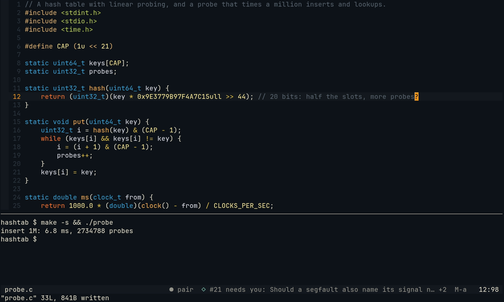
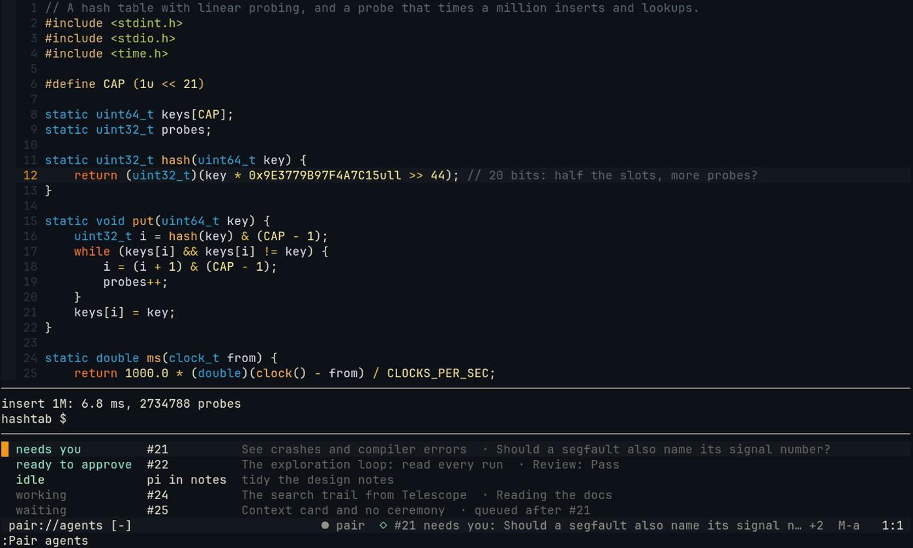

# Your other agents, in one place

When you work through several agents at once, finding out who finished means looking at their panes, and each look
is an interruption you made yourself. Pair looks for you. When another agent needs you, is ready to merge, failed
or is done, Pair tells you in **one line, at your next breakpoint**, with the key that goes there and the keys that
open what a board task left behind: its report or pull request, its branch's diff, its worktree. It never moves your
cursor, opens a window or speaks while you type.


*Recorded from [a tape](captures/tapes/agents.tape) with the real plugin and daemon. The board and herdr are
stand-ins: their agents move on once you start typing.*

## What you see



*The capture predates the board's keys: a board task's line now ends `M-a · M-o opens`.*

- **The line.** After Pair's own part of the statusline: `◇`, who (`#21` for a task of this project's repository,
  `WEB-3` for another repository's, an agent's name or `pi in notes` for an agent outside the board), what it means
  for you, and its question or title. `+2` says two more came at the same time; they are in the list. Then the keys:
  `M-a` for any line, and `M-o opens` for a board task's (the words go once you have used it).
- **`Alt-a`** (`<M-a>`, the `agents_key` option) brings that agent's herdr pane to the front: herdr switches to
  its workspace and tab. The line goes once you have been there, or when it is no longer true (someone answered the
  question, the task was merged). When the agent has no pane any more (a finished task's agent is gone), `Alt-a`
  puts the line away. A line that asks nothing of you (done, failed) also goes by itself after two minutes; one that
  needs you or is ready to merge stays.
- **`Alt-r`** (`<M-r>`, the `agents_review_key` option), on the line of a task ready to merge, opens its branch as a
  [review](gen.md#reviewing-a-board-task-pair-review) in `:Pair gen list`: what its reviewer said, `≠ brief` on the
  branch, and its files, to keep the pieces you want in yours. The line then says `M-r reviews`.
- **`Alt-o`** (`<M-o>`, the `agents_open_key` option) opens the task's report or pull request (see
  [what a task left behind](#what-a-task-left-behind)). Pair's own keys `Alt-d` and `Alt-t` (a decision, listening)
  stay theirs, so the diff and the terminal are one key away in `:Pair agents`, where the relayed task is under the
  cursor, and in the chat pane.
- **In the chat pane** the same line appears once, in grey, with an action line while it is the newest: `o open   d
  diff   t terminal   · Alt-↑ picks`. `Alt-↑` picks the line, and then `o`, `d` and `t` act on its task (a letter
  on an empty line is the start of a question until then). Neovim opens what they ask for; once the line is answered,
  its keys go.
- **`:Pair agents`** (or `/agents` in the chat) lists every task and agent, the ones that need you first: needs
  you, ready to merge, failed, done (tasks you saw finish in the last 12 hours), idle agents, working, waiting.
  `Enter` on a line goes to that agent; `o`, `d` and `t` open what its task left behind; `r` opens its branch as a
  [review](gen.md#reviewing-a-board-task-pair-review); `q` closes the list.



*The capture predates Shepherdr: `ready to approve` is `ready to merge` now, and the list has the keys in its top
line: `Enter goes · o report or PR · d diff · t terminal · r review · q closes`.*

| State | From the board (Shepherdr) | From herdr |
| --- | --- | --- |
| needs you | the task needs you (Shepherdr's Needs you): a question, a permission, a login, a plan to approve | the agent shows a question or an approval (`blocked`) |
| ready to merge | its work is done and waits to be merged (Ready) | |
| failed | the task ended without its work done | |
| done / finished | merged, or closed with nothing to merge | the agent went from working to idle |
| working | at work, or merging | the agent works |
| waiting | To do (it waits for a go) or Queued (it waits for room, or for other tasks) | |

Only a change into one of these states is news. What is already true when the daemon first looks, or what changed
while no Neovim or chat pane was connected, is not relayed (`:Pair agents` shows it), and a task working away never
is.

## When it speaks: breakpoints

The news waits for your next breakpoint, the same one [a held thought](watcher.md#the-held-thought) waits for:

- you saved a file, or a command or test run ended;
- you left Insert mode and have not edited for 3 seconds: you stopped to look; or
- you have not typed or edited for 15 seconds.

Even then, never while you type (in Neovim or the chat pane), while Pair answers or makes a remark, or while it
has the wheel.
At a breakpoint the most urgent news becomes the line: needs you first, then ready to merge, failed and done.
There is only ever one line; what came with it is counted (`+2`) and listed in `:Pair agents`.

## What a task left behind

`o`, `d` and `t` (in `:Pair agents`, on the chat pane's relayed line) and `Alt-o` (on the statusline's) open what a
board task made. Each is read when you press it, read only, and opens in Neovim:

| Key | Opens | How |
| --- | --- | --- |
| `o` | its report or its pull request | the report is the newest artifact the task's agent or reviewer made. A task's artifacts are kept in its space, so Pair lists the space's (`shepherdr artifact list --space=<space>`) and asks the newest 20, newest first, who made them (`shepherdr artifact show <id>`: `by BDY-7 agent`); the first that is the task's opens, as its HTML file. The pull request is the one `task show` names. One of them opens with `vim.ui.open`; with both, you pick |
| `d` | its branch's diff, read only | `git diff <base>...<branch>` in its worktree (or the space's folder), against the branch the repository merges into (origin's default, else `main`, else `master`), in a split named `pair://agents/<id>/diff` (`q` closes it) |
| `t` | a terminal in its worktree | a split with your `shell`, started in the task's worktree; for an agent of your own, in its folder |

When there is nothing to open, Pair says why: no report or pull request yet, no branch yet, no worktree on this
machine (a task that is done went with its merge), or a task of another machine, of which Pair reads only its line.
From the chat pane, the Neovim of the session opens it; with none connected, the chat gives the links or the folder
instead.

## Tasks working on your files

The board's tasks work in their own worktrees, so nothing stops one from changing the file you have open. Pair reads
what they change and says so where you work:

```text
 ◇ SHO-71 is changing this file · work/71-fold-footer · :Pair agents
905   if (folded && rows > 13) {
906     footer.push(['Enter', 'unfold']);
```

- **The winbar note.** A window whose file the branch of a working task also changes says so in its winbar: the
  task, its branch, and `:Pair agents` to go to it. Two tasks are named by their ids. The note goes when the task
  stops changing the file (it was merged, stopped or archived) or the window shows another file. A window that has a
  winbar of its own (a `/gen` try's, or one your config sets) keeps it, and gets no note. `board_winbar = false` in
  the plugin's setup turns the note off ([neovim-plugin.md](neovim-plugin.md#setup)).
- **The overlap remark.** When you edit lines that a task's branch also changes (or the line next to them), that is
  the `overlap` moment. It goes through the [speak gate](watcher.md) like any other: the Watcher scores it, and a
  remark waits for your next breakpoint. The Partner reads which task it is and the lines the task writes there, and
  says what its change does and that whichever of the two is merged second meets a conflict. It is raised once per
  task and change of its branch, only for your own edits (Pair's, and code you kept from a `/gen` or a review, are
  not yours), and dropped while held if the task stops changing the file.

**What it reads.** Every 30 seconds while a Neovim is connected to the session: the tasks of the repository's space
that are at work (Shepherdr's `work` and `merging`; a task that waits for a go has changed nothing yet), each one's
branch from `shepherdr task show <id> --json` (asked once), and what the branch changes with git, read only: `git
diff -U0` against where the branch left the base branch (the newest commit it shares with your local base branch or
origin's, whichever is further on, so work merged since is not counted as the task's), in its worktree when it has
one on this machine, so changes its agent has not committed count too. The lines are the base's, the lines your
checkout has unless you changed them. Your own work is left out: the task of the branch you are on, any task whose
branch that is, and the task whose worktree you work in. So are other machines' tasks.

## Where it reads

Pair reads by itself and writes nothing to the board: it never adds, tells, stops, merges or sets a task on its own.
The writes there go through [`/gen board`](gen.md#gen-board-a-task-for-the-board), a task added on a pick that
names what it does (add only, add and delegate, delegate with a plan first, or delegate for research only), a task's
[review](gen.md#reviewing-a-board-task-pair-review), where a tell, "merge it" told to its agent or archive run on the
pick that names them, and [`/brief sync`](gen.md#keeping-the-task-in-step-brief-sync), whose tell runs only on its pick
too. Pair never runs `shepherdr merge`.

- **herdr's agents**: `agent.list` over herdr's socket, which Pair knows from the chat pane, or from Neovim when it
  runs in herdr. Every agent herdr recognises, in any workspace.
- **The board**, if [Shepherdr](https://github.com/eliasstravik/shepherdr) (its command `shepherdr`) is
  installed, through its command with a list of words, never a shell: `shepherdr task list --json` for each task's
  status and status line, `shepherdr task show <id> --json` for its space, branch and pull request (read again only
  when its status line changes), and `shepherdr space list` (every minute) for each space's folder. The task's
  worktree is the one git lists for its branch (`git worktree list`), and its pane is that of the herdr agent working
  there. A task's own agents (the agent and its reviewer, in the task's worktree) show as the task, not twice.
- A session opened in a task's own worktree leaves that task out: it does not tell an agent about itself.

Both are read every 5 seconds while a Neovim or chat pane is connected, and not at all otherwise. What the working
tasks change is read every 30 seconds ([above](#tasks-working-on-your-files)). A source that fails
(no board installed, Shepherdr not running, herdr closed) is logged once and keeps what it last answered (nothing,
for a board that is not installed), so the other source is still read and relayed.

## Configure

On by default. In `~/.config/pairing-buddy/config.json`:

```jsonc
"agents": false                       // no relay
"board": null                         // no board: herdr's agents only (the context card reads no board either)
"board": "/path/to/shepherdr"         // the board's command, when it is not on the daemon's PATH
```

The board is the one the context card, the goal, the brief, the chat's header, `/gen board`, `:Pair review`, the
winbar note, the overlap remark and `/brief sync` use (`board`, default `shepherdr`). `"agents": false` stops the relay
only: the winbar note and the overlap remark go with `"board": null`. herdr-projects 1.x (the board before Shepherdr) is not read any more.

In Neovim, `agents_key = '<M-a>'`, `agents_open_key = '<M-o>'` and `agents_review_key = '<M-r>'` in `setup()` change
the keys (`false` for none; each is mapped only while a line shows, `Alt-r` only on a task ready to merge, and only
where you have no mapping of your own). The statusline part comes with
`require('pair').statusline()`.
