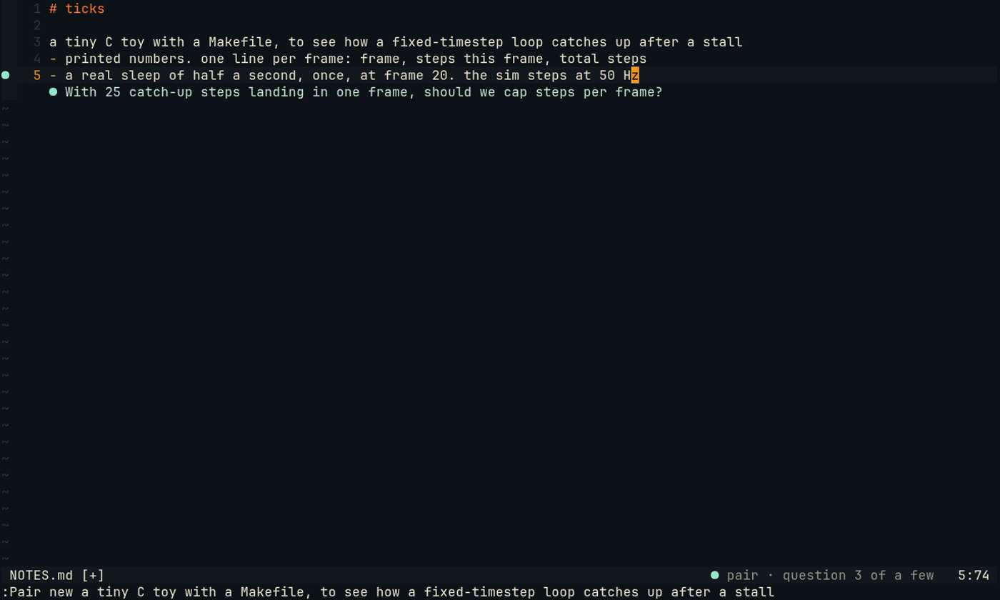
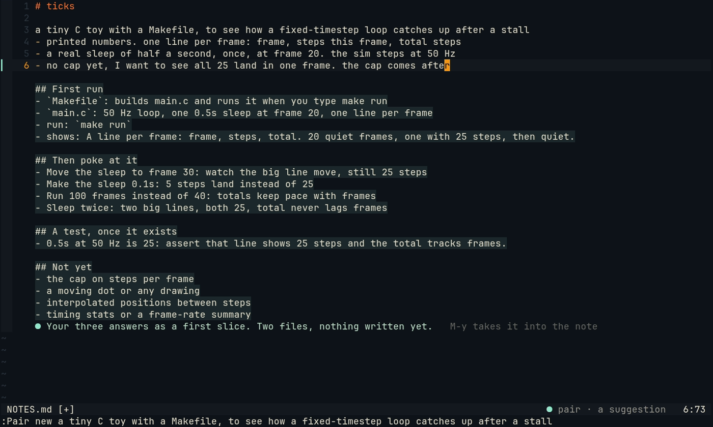
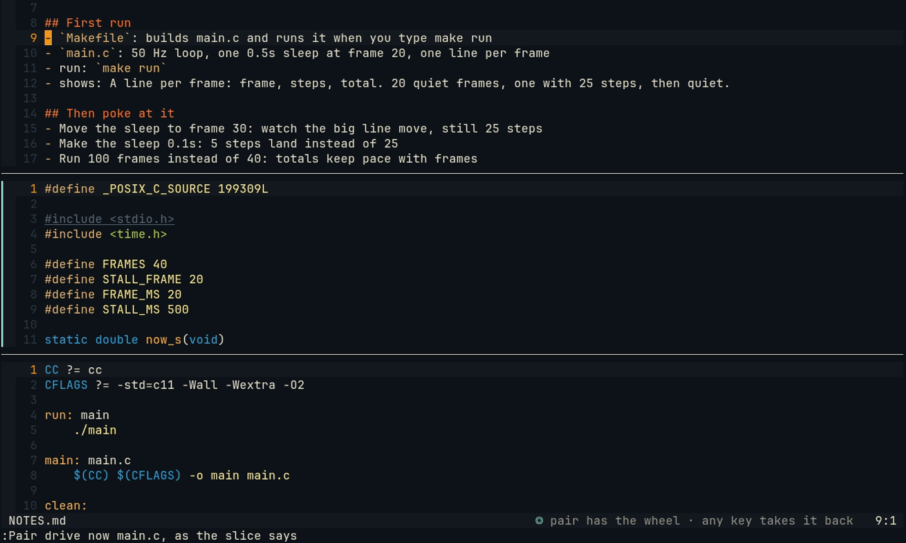
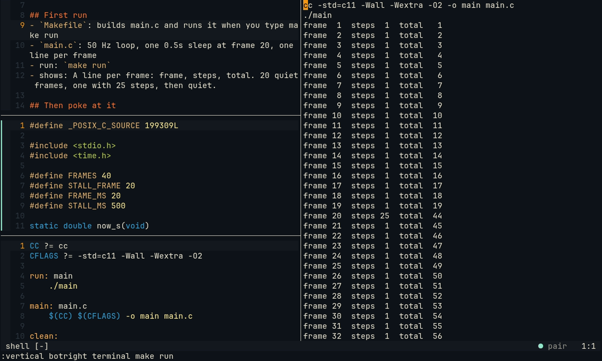

# The blank page: `:Pair new`

An empty folder, `:Pair new` and one sentence. Pair asks the question whose answer changes the first runnable
version most, then the next, three in all, one at a time. Then it proposes a first slice: two files, how to run
them, what to poke at once it runs, when the first test is worth writing, and what to leave out. The slice is a
suggestion in your note. Nothing goes to disk until you save.


*The plugin and the daemon as shipped, in a clean Neovim with ayu. The three questions, the slice and the two files
are a real `:Pair new` with a cloud model, unedited, replayed by the [capture rig](captures/). Each question was asked after
the answer before it.*

## One question at a time

1. `:Pair new a tiny C toy with a Makefile, to see how a fixed-timestep loop catches up after a stall` opens
   `NOTES.md` in the current folder. In an empty buffer it writes a heading named after the folder and your
   sentence under it. The buffer is not saved. Without a sentence, Pair first asks "What are we making?", and your
   answer is the idea.
2. The sentence becomes the session's goal. Pair's question shows under your last line, with `●` in the sign
   column and in its words, and the statusline says `● pair · question 1 of a few`.
3. You answer on the lines under the question, as a list or as prose. The answer goes once you have left Insert
   mode (`Esc`) and changed nothing for a second and a half. Going back into Insert mode, or fixing a typo in
   Normal mode, waits again, so it is the fixed answer that goes. The next question shows under it, and the one
   before goes.
4. Pair is asked for one question, no code, no list of options. A question has at most 18 words and is not one you
   answered already (most of its words the same as an earlier question's). One that is no question, is longer or
   repeats one gets one more try, with what was wrong; the second try is shown as it comes.

While a question waits, Pair makes no remarks about the note. Its remarks about everything else go on: a question
you leave unanswered does not silence it. `:Pair clear` ends the questions; `:Pair new` starts again.
The note's margin stays empty while the questions run; once they end, `NOTES.md` is a note like any other, and
Pair marks its margin as it does elsewhere ([notes](notes.md)).



## The first slice

After the third answer, the slice shows under the note's last line as a suggestion. Nothing is struck through, and
`Alt-y` (`:Pair accept`) takes it into the note as your own change, still unsaved. `:Pair dismiss` drops it.

```markdown
## First run
- `Makefile`: builds main.c and runs it when you type make run
- `main.c`: 50 Hz loop, one 0.5s sleep at frame 20, one line per frame
- run: `make run`
- shows: A line per frame: frame, steps, total. 20 quiet frames, one with 25 steps, then quiet.

## Then poke at it
- Move the sleep to frame 30: watch the big line move, still 25 steps
...

## A test, once it exists
- 0.5s at 50 Hz is 25: assert that line shows 25 steps and the total tracks frames.

## Not yet
- the cap on steps per frame
...
```



The Partner writes the slice as JSON. The daemon checks it against the rules and writes the Markdown itself:

| Rule | Why |
| --- | --- |
| Two files: the build or run file and one source file; fewer is refused, and never more than three | The thinnest slice that runs end to end (Cockburn's walking skeleton), not a skeleton of the whole idea |
| No README, licence, changelog, contributing guide, `.gitignore`, `.editorconfig`, Dockerfile, `.github`, test or docs folder (other config files are asked against, not refused) | There is nothing to describe until it runs |
| No library or tool you did not name | Every dependency in the first slice is one you chose |
| How to run it, and 2 to 4 probes (fewer than two is refused; more than four is asked against, not refused) | What to try once it runs, and what to watch |
| One test, for the first piece with an answer you can write down without running the program (asked for, never refused) | Exploring comes first. A test comes when one piece is settled |
| Every line at most 90 characters (asked for again, never refused) | It is a note, not a spec |

A slice that breaks a rule gets one more try, with what was wrong. If the second try breaks a rule too, the chat
says which, and nothing is shown.

The two files come from the stack your words name:

| Your words name | The first slice is |
| --- | --- |
| C (or gcc, clang, raylib) | `Makefile` (`make run` builds and runs it) and `main.c` |
| C3 | `Makefile` (`make run` calls c3c) and `main.c3` |
| Odin | `Makefile` (`make run` calls odin) and `main.odin` |
| Zig | `Makefile` (`make run` calls zig) and `main.zig` |
| Go (with a capital), golang, `go.mod`, `go run`, "in go" | `go.mod` and `main.go` (`go run .`) |
| JavaScript, JS, TypeScript, node.js, "node script", "in node" | `package.json` (a `start` script, no dependencies) and `main.js` |

"go" and "node" are plain English too ("files go to the trash", "each node of the tree"), so only these forms name
the stack. When your words name two stacks, the one named first counts. For any other stack, the rule is the same:
one build or run file and one source file.

## The first run

The slice says what the two files are, and you write them. Or you hand Pair the wheel for one of them, the way
you would hand over anything else: `:Pair drive the Makefile from the slice`. The Driver may type a file that does
not exist yet. It opens as a new buffer in a split, gets typed while you watch as one undo step, and reaches the
disk when you save it ([details](driver.md)).



In the capture, both files are handed over, one after the other. Then `:wa` and `make run`, and the 25 steps
land in the frame after the stall:



## What it is not

- It writes no files. The note, the slice and the files the Driver types are buffers until you save them.
- It is not a spec tool. Requirements, design and task lists are worth it for a team. For a toy, three answers
  and two files that run are enough.
- It runs no scaffolding generator and installs nothing.

## Limits

- Three questions, always, unless Pair asks none it can use or you stop them with `:Pair clear`.
- A daemon restart ends the questions: Neovim says so, and `:Pair new` starts again.
- A repeated question is found by its words. One that asks the same thing in other words ("falls behind and must
  catch up", then "stalls, so one frame owes several steps") still comes.
- `NOTES.md` is in Neovim's current folder, and must be inside the project (the git root, or the folder itself
  when there is no git yet).
- An answer that has gone cannot be taken back: once it has settled after `Esc`, the next question comes.
- The slice's rules are checked in code where the table does not say otherwise, but a library is found by its name in your words. A library the model
  uses without listing it in `needs` is not caught.
