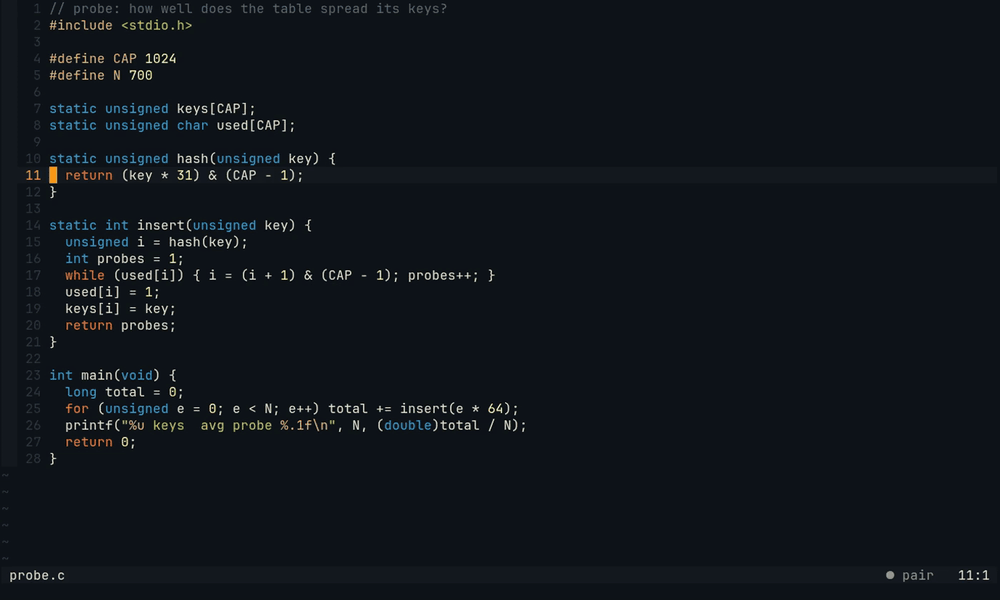

# Builds and crashes

Most runs are no test runs: `make run`, `./build.sh`, `zig build run`, `odin run .`. Pair sees a crash and a compiler
error the way it sees a failing test: on its line, one key away.

*In a C project, Pair runs `make run` on each save. A missing semicolon puts `✗` and gcc's words on its line
(`✗ does not build · probe.c:11`). With the semicolon, it builds and crashes: `✗ AddressSanitizer: SEGV · probe.c:19`,
`Alt-j` goes to that frame, and Pair says why it crashed there. A warning the builds before did not print gets `△` and
its words; an old one stays quiet. The builds and runs are real; only the models' words are scripted (recorded from
[captures/tapes/crash.tape](captures/tapes/crash.tape)). Step by step in [neovim.md](neovim.md#a-crash-and-a-compiler-error).*

## What is read

Pair reads what builds and runs print
([src/run-output.mjs](../src/run-output.mjs)), from your terminal (the shell hook or herdr) and from the run on save
(`"testOnSave": {"~/src/probe": "make run"}`; any command works there, and `cc -o probe probe.c && ./probe` is read
whole):

- **Crashes.** The signal in the exit code (139 is `SIGSEGV`, 134 `SIGABRT`; Ctrl-C, a kill or a closed pipe are no
  crash) or in the line bash, zsh or make prints for it (`Segmentation fault (core dumped)`), so a segfault counts as
  a failure also through herdr alone, without an exit code. Only those whole lines count, and never in a run that
  ended with exit 0: a program's own `Aborted transaction` is no crash. Reports name what went wrong and where:
  AddressSanitizer and UBSan, glibc's failed `assert`, Zig's panic and its stack, Odin's runtime assertions and bounds checks, C3's
  runtime errors and a gdb backtrace. The place is the innermost frame in your project's code, not libc's.
- **Compiler errors and warnings** with file, line and column: `file:line:col: error:` (gcc, clang, zig, odin's unix
  style), odin's `file(line:col) Error:`, c3c's `(file:line:col) Error:`, and the linker's `undefined reference` (GNU ld) or `undefined symbol` (lld). Paths are taken from where
  the command ran and from the folder make says it entered, so a run in a subfolder, `make -C src` or a sub-make lands on the
  right file.
- **New warnings.** A warning is news when it is in a file you edited in this session and no build in this session
  printed it before (the first run of each command is its baseline). An incremental build that compiles a file you
  did not touch again, after a header changed, brings no news. The line is left out, so a warning that moved with
  your edit above it is the same one.

## What you see

In Neovim, the last build or run that crashed or printed diagnostics shows on its lines until the same command runs
clean: `✗` and the crash's or error's words after the line, `△` and the words for a new warning, a quiet `△` for an
old one. `Alt-j` goes to the crash, else the first error, else the first new warning, at its column. A run on save
also says it in the statusline: `✗ does not build · probe.c:11 +2`, `✗ Segmentation fault · probe.c:19` or
`✓ make run · 1 new warning`.

## When Pair speaks

A **crash** is an unasked remark even while you look at the terminal: it says that it crashed, not why. The Partner
reads the code at the frame and says why it crashes there; the same crash at the same place is raised once (again,
it is the same error a second time). A **new warning** is one too, but the Partner speaks only when it points at a
bug (a wrong format, an uninitialised value); an unused variable while you explore gets silence. Details in
[watcher.md](watcher.md#crashes-and-new-warnings) and [neovim.md](neovim.md#a-crash-and-a-compiler-error).

## Limits

- Only the formats above are read: no MSVC, rustc, or Go build errors outside `go test`.
- A crash without a report or a stack (a bare segfault, without a sanitizer) has no line to show; the statusline and
  the remark still name it.
- Odin's and C3's formats are written from their compilers' sources and not yet checked against their real output.
- Only the last build or run that crashed or printed diagnostics shows in Neovim.
- A warning is new against this session's builds and edits only: after a daemon restart the first build is the
  baseline again, and a warning a header change causes in a file you did not edit is not news.
