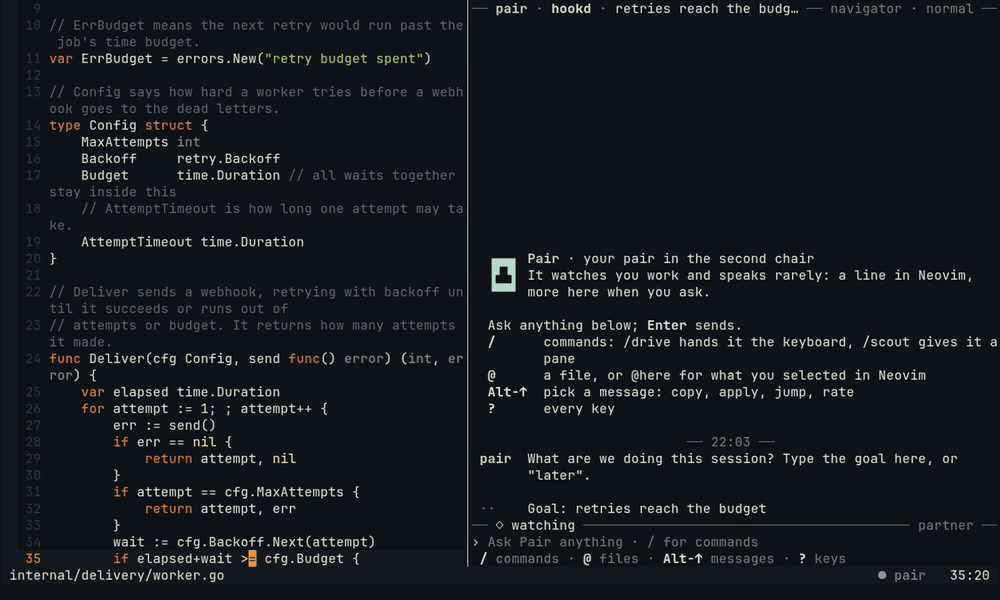
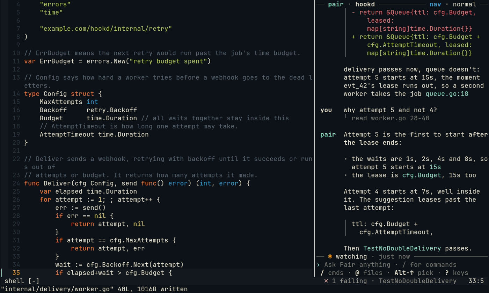
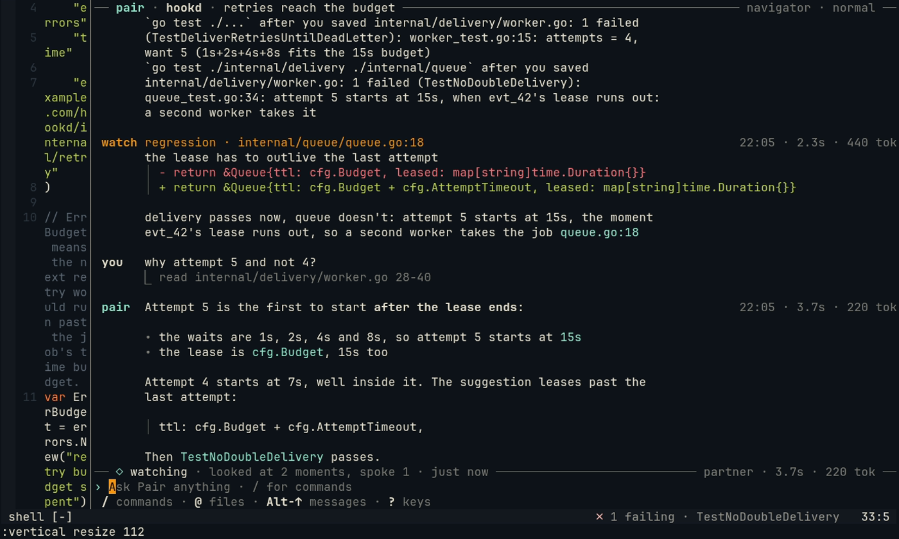
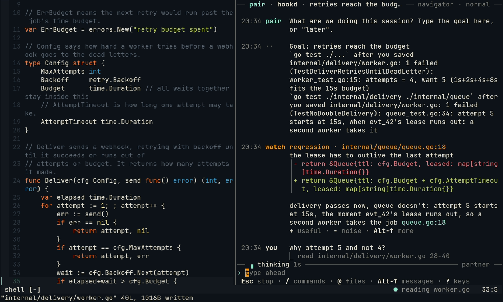
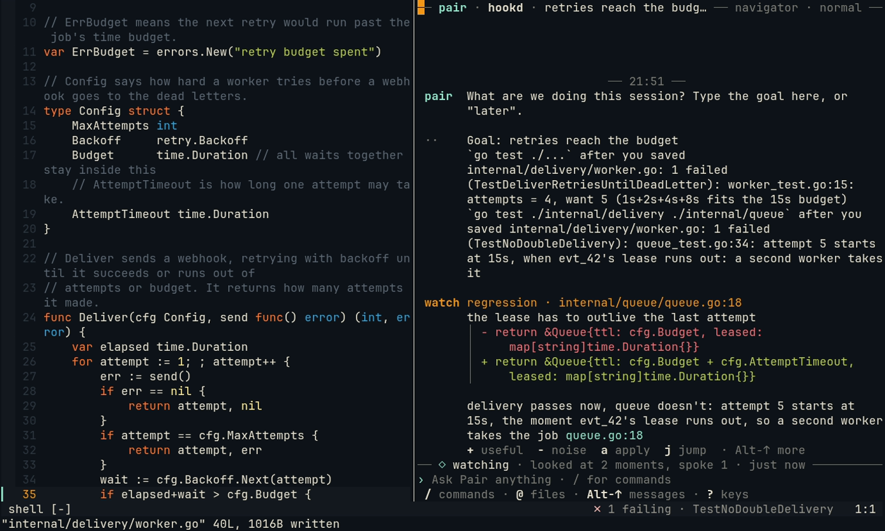
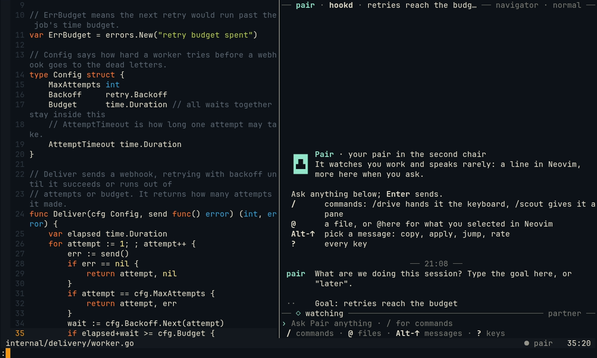
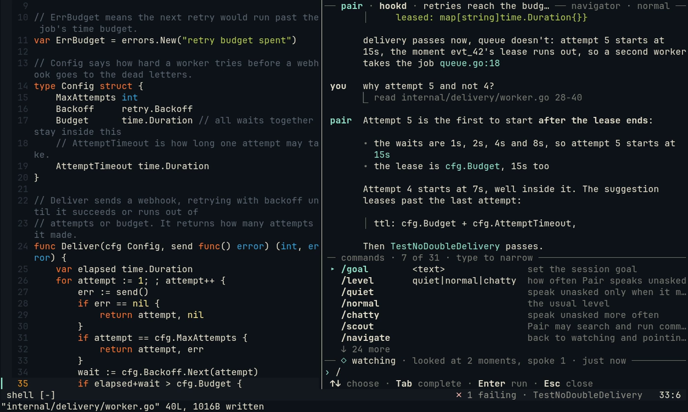
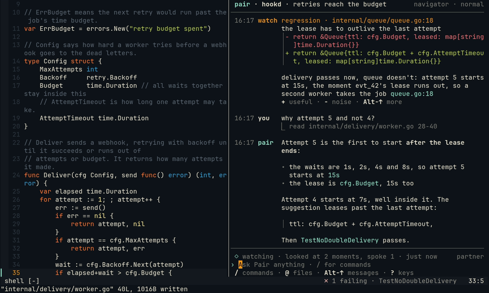
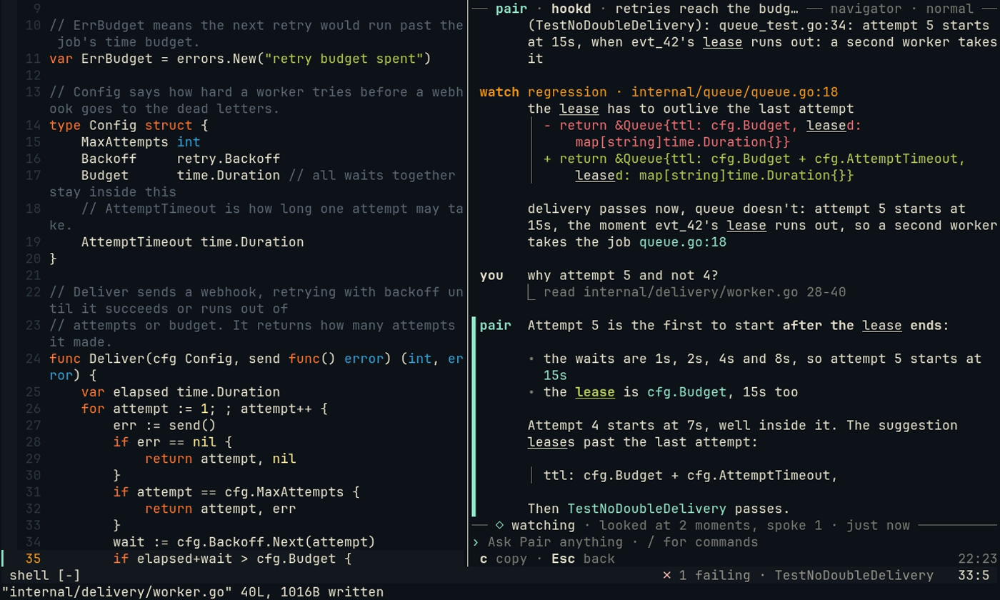
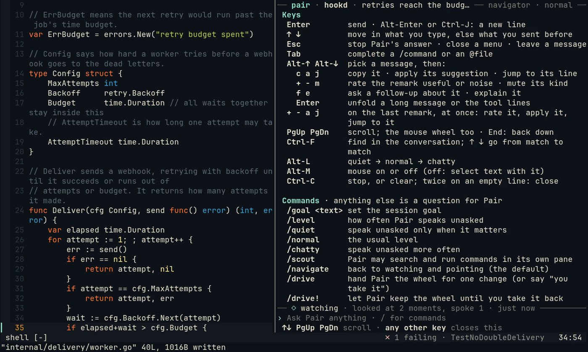

# The chat pane

The chat pane is where you talk to Pair and read what it says at more length than the one line under your cursor. In
herdr, `pair` opens it on the right of the pane you run it in; without herdr, `:Pair chat` opens it in a terminal
buffer on the right of Neovim, and `pair chat` runs it in any terminal. It is optional: a Neovim alone is a whole
session.



## What you see

Four rows of chrome, two of them rules with words in them; the rest is the conversation. From the top:

- **The header, in the top rule**: `── pair · hookd · the session's goal ── board 3 working · 1 needs you · navigator · normal ──`.
  The project, the goal, and on the right the [board](agents.md)'s counts for the repository's other tasks (how many
  work, how many need you, in the accent; nothing when there is no board, the board does not know the repository, or
  there is nothing to count), Pair's [role](roles.md) and its [talk level](watcher.md) (`quiet`, `normal`, `chatty`),
  and how many kinds of remark you muted. The counts follow the board, read about once a minute. The role is in its
  colour from the website: `navigator` blue, `scout` green, `driver` red. While Pair
  [keeps the wheel](driver.md#keeping-the-wheel) (`/drive!`), the header says `driver · keeps the wheel` in place of
  the level. When the pane is narrow the goal is cut first, to a few words; then the board's counts give way, the goal
  is left out (always under 52 columns), the role is shortened (`nav`), then the muted count, the level and the role
  give way.
- **The conversation**, newest at the bottom. Each message has a 7-column gutter with who speaks, the same in a wide
  pane and a narrow one:

  | Gutter | Who |
  | --- | --- |
  | `you` | What you sent, on screen as soon as you press Enter |
  | `pair` | Pair's answer to a question; a `✎ suggested change` shows as a diff. Also what Pair asks you: the session's goal, its greeting with last time's note, and whether it may run or type a command |
  | `watch` | What Pair said unasked: the kind of moment and the file and line first, then its words |
  | `gen` | What a [/gen](gen.md) request made, in magenta, as a card with its keys ([below](#the-gen-card)), and what the request asks you |
  | `└` | What Pair's tools did for your question: the files it read, the commands it ran, what it searched |
  | `··` | Notes: the tests on save, a verdict noted, a level changed, another agent's news (`◇ #80 ready to merge: …`, with `o open   d diff   t terminal` while it is the newest: [agents.md](agents.md#what-you-see)) |
  | `!` | An error, in red, such as a model that does not answer, with what to check: its words are Markdown, so a command in it (`pair doctor`) is a code span, whole, to copy |

  The time is not on each message: a dim `── 21:19 ──` in the middle of the pane says it at the start, and again
  after a pause of five minutes or more, with the day (`── Thu 29 Oct · 00:12 ──`) when it is another day than the
  message before it. A picked message (`Alt-↑`, [below](#acting-on-a-message)) shows its own time on the right of the
  footer.

  ```
                              ── 21:19 ──
   watch regression · internal/queue/lease.go:18
         the lease ends before the last attempt does, so the third retry
         finds the job taken and gets a 409.
         │ - return &Lease{ttl: cfg.Budget}
         │ + return &Lease{ttl: cfg.Budget + cfg.AttemptTimeout}
         + useful  - noise  a apply  j jump  · Alt-↑ first

   you   why does the third retry get a 409 and not a 200?
         └ read internal/queue/lease.go 1-40 · searched AttemptTimeout
  ```

  A remark is one unit: what about, its words, its diff behind the same `│ ` bar as a code block, and last its
  **action line**, the keys that work on it, spaced like buttons: `+` useful, `-` noise, `a` takes its suggestion,
  `j` goes to its line (each only where it applies). They work once the remark is picked: the first `Alt-↑` picks
  it (the aside says so), and the line drops the aside. On an empty line the letters stay letters, so a question that
  starts with `a` or `-` is typed, never taken as a key. The line shows while the remark is the last thing said (a
  note after it, such as the tests on save, does not count); once you rate it, or you or Pair say something after it,
  the line goes.

  Before Pair runs or types a command it asks, as `pair`: the question in words, and the command under it behind a
  bar, whole (backticks in it too), to read and copy. `y` allows it, `n` or `Esc` declines (and drops what you had typed), or type an answer (the name of another
  terminal, where it offers one); the footer shows those keys, and the message says what you answered.

  ```
   pair  May I run this in my pane (go test runs code)?
         │ go test ./internal/queue -run TestLease -count=1
  ── ? waiting for your answer ──────────────────────── qwen3-coder-30b · 6.4s ──
  y/N › or type an answer
   y allow · n decline · Esc decline
  ```

  [`/gen board`](gen.md#gen-board-a-task-for-the-board) asks the same way, as `gen`, with the board's command under
  its question, and each pick is one key: `y` adds the task for later (add only), `d` adds and delegates it, `p`
  delegates it with a plan first, `r` for research only, `c` copies the command to the clipboard (and adds nothing),
  `n` adds nothing.

  The goal you type, or the one Pair took from the board or the branch, is in the header; the conversation does not
  say it again. Only a goal set elsewhere (`:Pair goal`) while Pair's question for it is open shows as a `··` note
  under the question, to answer it.

  Pair's words are Markdown: `code` shows in Pair's accent, **bold** as bold, _italics_ in italics, a link as its
  words with the address after them, lists with a hanging indent, headings, quotes, and code blocks behind a bar. A
  table shows as written. The numbers of an ordered list are padded to the widest of it, so ` 9.` and `10.` end in
  one column. A message longer than 18 lines folds to its first 12; picked, `Enter` in the footer unfolds it.

  Code blocks, diffs and the command of a question wrap between tokens, with a hanging indent: at a space first, else
  before a dot or after an opening bracket, a slash or a value's `=`, never inside a name, a number or a flag
  (`cfg.AttemptTimeout`, `my-component-name`, `v1.2.3-rc.1`, `--config=`). A name longer than the whole line breaks
  after a dash in it; only a word with none is cut. A line indented deeper than half the pane shows at half of it, so
  its words keep the other half. A `code` span in a sentence wraps at its own spaces, so it starts on the line of the
  word before it.

  **In a wide pane** the words end by column 80, the measure that reads well; code blocks and diffs use the whole
  width. The margin on the right holds what a turn of Pair's took, on the first line of what it said in it (an answer,
  or a remark): `21:19 · 6.4s · 3.4k tok`. With less room the tokens go first, then the duration.

  **In a narrow pane** (under 52 columns) the gutter stays, so a message spends no row on its name. What gives way,
  instead of being cut in the middle:

  - the `└` line names files by their base name and counts the tools that do not fit: `└ read lease.go 1-40 · +1`;
  - a remark's place is its file's base name: `regression · lease.go:18`;
  - the header drops the goal and shortens the role (`── pair · hookd ──── nav · normal ──`);
  - the status keeps its words whole and drops what it can: the model first, then the counts
    (`── ◉ watching · 3m ago ──`), `? waiting`, `▖ reading lease.go 1-40 4s`, `! reconnecting 6s`;
  - the footer says its keys short (`/ cmds · @ files · Alt-↑ pick · ? keys`);
  - the `@` menu cuts a path at its start, a folder at a time, so two files never look the same:
    `@…/retry/backoff.go`, `@…/backoff_test.go`.

  

  
- **The status, in the rule over what you type**: what Pair does now, as `── ▖ writing 6s ──── qwen3-coder-30b ──`.
  It names no keys (those are in the footer). The answer streams into the conversation as the model writes it. How
  long Pair has been at it shows once that is 3 seconds, so a short turn does not tick. The status has the colour of
  the part at work: while Pair works on your question its spinner and its word (`thinking`, `writing`, `reading`) are
  in its accent, bold; the Watcher's `◉` and its spinner while it looks are yellow; the Driver's `◆` and `Pair drives`
  are red, bold; a /gen request's number and its spinner are magenta. The other words (`watching`, `waiting for your answer`, `reconnecting`) are body text, so they rank
  above the footer. In a narrow pane, what waits under the answer (`1 remark below`) stays longer than the seconds.

  | Status | Means |
  | --- | --- |
  | `◉ watching · looked at 12 moments, spoke 2 · 3m ago` | Idle. The Watcher looked at 12 moments this session and Pair spoke at 2: most moments are not worth a word |
  | `▖ thinking 4s` | Pair works on your question; `Esc` stops it |
  | `▖ writing 6s` | Its answer is arriving, word by word |
  | `▖ writing 6s · 1 remark below` | A remark or a note came while the answer streams: it waits, and goes under the answer once that is done ([below](#calm-motion)) |
  | `▖ reading queue.go 1-40`, `running go test ./...` | One of its tools is at work, and on what |
  | `▖ looking at regression` | The Watcher looks at a moment of its own accord (its spinner yellow); it may say nothing |
  | `? waiting for your answer` | It asked to run or type a command |
  | `◆ Pair drives · any key in Neovim takes it back` | Pair has the wheel ([Driver](driver.md)) |
  | `▖ gen #4 generating 41s`, `◉ watching · gen #7: 0 of 9 kept` | A [/gen request](#the-gen-card) at work (its spinner magenta), or done with something left to take |
  | `! the pair daemon went away · reconnecting 6s · attempt 4` | The daemon restarted (the `!` in yellow): how long it has been away and how many times the pane tried, so a blip reads differently from a daemon that is gone. What you type is kept (the input says so); nothing sends until it is back, and the pane carries on then |

  On the right: the Partner's model, how long its last answer took, and the tokens and cost of it when the provider
  reports them (`! watcher not answering` instead when a model does not answer); when you scrolled up, how many lines
  are below (and `End` in the footer goes back down). The right
  side gives way first, from its end; then the status is said shorter ([narrow panes](#what-you-see)).

  
- **What you type**, after `›`, and under it **the keys that work now**: they change when Pair works, asks, or you
  pick a message. The footer holds keys only; a short note (copied, taken in Neovim) shows there for a moment.



### The empty pane

Before anything is said, the pane shows Pair's head, the CRT-headed robot of the website drawn in quadrant blocks
(its frame in Pair's accent, two green eyes, a magenta antenna), with what Pair is beside it, and the keys to start
with under it. The head is four rows whatever the words beside it do; in a pane too narrow for its name beside it,
the words go under it.

```
      ▗▖
   ▗▛▀▀▀▀▜▖  Pair · your pair in the second chair
   ▐ ▀  ▀ ▌  It watches you work and speaks rarely: a line in
   ▝▙▄▄▄▄▟▘  Neovim, more here when you ask.

   Enter   ask anything
   /       commands · /drive hands it the keyboard
   @       a file, or @here for your selection
   Alt-↑   pick a message: copy, apply, jump, rate
   ?       every key
```



### The gen card

What a [/gen](gen.md) request makes is the `gen` speaker's, in magenta. Its message is one unit, as a remark is: its
number and shape, what it made, how its check went, the debrief, and last an **action line** with the keys that still
do something on it.

```
 gen   #4 · file · 2 new files to review: db/migrations/0007_orders_status.sql +14, …
       ✓ `go test ./...` on the unsaved buffers: 41 pass
       ? guessed existing rows get the status new

       k keep one   Enter open the list   d drop all   u undo   · Alt-↑ picks
── ◉ watching · gen #4: 2 to review ─────────────────────────── qwen3-coder ──
```

`k` keeps (code at the cursor goes into your buffer, the next file to review opens in Neovim, a try's file is kept, a
scaffold puts `/keep` on the line with its files in the menu), `Enter` opens it in Neovim (its place, its file, or
`:Pair gen list`), `d` drops what is left (a second `d` does it; for a scaffold, its copy goes), `u` undoes the
request and, once undone, makes it again. As on a remark, they work once the card is picked: the first `Alt-↑`
picks it while its line shows. Only the keys that still apply show, and none while the request is at work. What a
request asks you (its shape, the brief, a question of its model) is the gen speaker's too. The status says what
/gen does: the request at work and the one waiting its turn, and, once done, what is left to take. The whole of it,
per shape, is in [gen.md](gen.md#in-the-chat-pane-the-gen-card).

### Calm motion

The pane moves only where you are not reading:

- **Nothing moves above the answer you read.** A remark or a note (the tests on save, another agent's news) that
  comes while Pair's answer streams waits; the status says so (`▖ writing 6s · 1 remark below`, `2 notes below`), and
  it goes under the answer once that is done, in the order it came. What you send yourself shows at once.
- **A short turn does not tick**: the time Pair has worked shows from 3 seconds on.
- **Glyphs every font has**, one column wide: `!` (yellow) for the daemon gone or a model that does not answer, not
  `⚠`, which some fonts draw as a two-column emoji; `└` under a question for its tools, not `⎿`, which many fonts lack.
- **A frame is one update** where the terminal can take it so: the pane asks the terminal about synchronized output
  (DEC mode 2026) as it starts, and wraps each frame in it when the answer is yes (kitty, WezTerm, foot, Ghostty,
  Alacritty, iTerm2 and tmux 3.4 among others), so a frame never shows half drawn. A terminal that does not answer
  gets plain frames, as before.

## Talking to Pair

Anything you type that is not a command is a question for Pair; it is always answered, outside the talk level.

- **Enter** sends. **Alt-Enter** or **Ctrl-J** starts a new line (Shift-Enter too, in a terminal that reports it). A
  paste keeps its line breaks and does not send.
- **Up** and **Down** move between the lines of what you type, and from the first or the last line through what you
  sent before in this project, kept across panes and restarts.
- **/** opens the commands as you type, in three columns: the command, its arguments, what it does. It shows seven at a
  time; its rule says how many of all (`commands · 7 of 41 · type to narrow`) and its last line how many more there
  are (`↓ 34 more`); **↑** and **↓** go through all of them. **Tab** completes, **Enter** runs one that needs nothing
  more. The [chat commands](cli.md#chat-commands) list them all. After `/gen` and a space, the menu lists its shapes
  first (`here`, `file`, `try`, `scaffold`, `board`), then what else `/gen` does. After `k` on a scaffold's card, `/keep ` waits
  on the line with that scaffold's files left to keep (`Enter keeps`); a `/keep` you type yourself has no menu.

  
- **@** opens the project's files (from git): `@internal/queue/queue.go` names one in your question, for Pair to read;
  **Tab** or **Enter** inserts it (the footer says `Enter inserts`).
  **@here** sends the lines you selected last in Neovim with it, else the line you are on: the question names them
  (`queue.go:18-20`), as `:'<,'>Pair ask` does.
- **Esc** (or **Ctrl-C**) stops the answer Pair is working on; `/cancel` too. When Pair answers nothing, they stop a
  [/gen request](#the-gen-card) at work, or the newest one still starting or waiting its turn (the footer says `Esc stop`). You can type your next question while
  it works.
- "you take it" or "your turn" hands Pair the wheel, as `/drive` does ([Driver](driver.md)).
- `/gen here <what>` asks Pair for code at your cursor in Neovim, `@here` in it over the lines you selected there
  ([/gen](gen.md)). `/gen file <what>` asks for new files, which open in Neovim as buffers to review; the chat's
  line about the request lists them, with the check on them and how to take them
  ([gen.md](gen.md#new-files-gen-file)). `/gen try <what>` asks for a sample to read and run, in a folder outside the
  project, which opens in Neovim in a split; `/gen run` runs the newest again, `/gen tries` lists the folders still
  kept, and `/keep [path]` moves the newest try's file into the project as a buffer to review
  ([gen.md](gen.md#samples-gen-try-and-keep)). `/gen scaffold <what>` builds many files and their wiring in a copy of
  the project; the chat gets its debrief, `/keep <path>` keeps a file of it and `/gen drop` deletes the copy
  ([gen.md](gen.md#many-files-gen-scaffold)). Ask about a try or a scaffold right here: Pair reads their files. When the request's shape is a guess, or Pair asks something about it, the question waits in the
  chat with what its answers do: `y` takes the guess or the answer given, `n` cancels or leaves it to Pair, and
  anything else you type is the answer. A request that contradicts its [brief](gen.md#the-brief) asks first: `y` as
  asked, `n` follows the brief, `e` opens the note at that line. `/brief` says what the brief is, `/brief <note>`
  pins a note, `/brief off` leaves it out, and `/brief sync`, on a board task's branch, says what the task's brief on
  the board lacks and asks: `y` tells its agent, `c` copies the command, `n` leaves it
  ([gen.md](gen.md#keeping-the-task-in-step-brief-sync)). `/gen` alone lists today's requests, and then how much of the code you took
  is [not yours yet](gen.md#owning-generated-code) (`┊ not yours yet: 2 files · 31 lines`); `/today` ends with
  the same line.



## Acting on a message

**Alt-↑** picks the last message (the last remark, [gen card](#the-gen-card) or relayed line of another agent instead, while its action line shows), and further presses go up (**Alt-↓** down, or **↑** **↓** once one is picked; a click picks one too). A bar marks it,
and the footer lists what you can do with it, with the message's time on the right:

| Key | On the message |
| --- | --- |
| `c` | Copy its text to the clipboard |
| `a` | Take its suggestion in Neovim, unsaved, as `Alt-y` does there; `/undo` undoes it |
| `j` | Go to its file and line in Neovim; `Ctrl-O` there comes back |
| `+` / `-` | Rate the remark useful or noise, as `Alt-u` and `Alt-n` do |
| `m` | Mute this kind of remark for the session (`/unmute` lets it back) |
| `f` | Ask a follow-up about the remark: what you type next goes with its words |
| `e` | The idea behind the remark, as `/why` |
| `Enter` | Unfold a long message, or the tool lines one per line; on a gen card, open it in Neovim |
| `k` `d` `u` | On a [gen card](#the-gen-card): keep, drop (twice), undo |
| `o` `d` `t` | On another agent's relayed line: open its task's report or pull request, its branch's diff (read only), a terminal in its worktree, in Neovim ([agents.md](agents.md#what-a-task-left-behind)) |
| `Esc` | Back to typing; any other key does that too |

The last remark, while it is the last thing said, shows `+`, `-`, `a` and `j` on its own
[action line](#what-you-see): `Alt-↑` then the key. Typing `+` or `-` and Enter rates the last remark too, and
`/useful 2` or `/noise 2` an older one, as `+2` and `-2` do after `/remarks`.



## Finding and scrolling

- **PgUp** and **PgDn** scroll half a pane, the mouse wheel three lines. **End** on an empty line (or PgDn to the
  bottom) follows the conversation again. What you read stays put while new messages come in below.
- **Ctrl-F** finds in the conversation (`/search <text>` too). The find row stands where you type (what you typed
  waits) and says which match you are on, of how many, and in how many messages: `find: lease  3 of 9 · in 4
  messages`. Every match is underlined; the one you are on is bold, underlined and green (no reverse video, no
  fill). **↑** and **↓** (or **Ctrl-P**, **Ctrl-N**) go from match to match, older or newer, also between two in one message; a folded message
  opens to show a match in its folded part. **Enter** keeps the message picked, **Esc** closes.

  
- **Alt-M** turns the mouse off, so that the terminal selects text with it again, and on. While it is on, most
  terminals still select text with Shift held.

## Every key

`?` on an empty line shows them; **↑** **↓** and **PgUp** **PgDn** scroll the list, any other key closes it. `/help` does too.



| Key | What it does |
| --- | --- |
| `Enter` | Send |
| `Alt-Enter`, `Ctrl-J` | A new line |
| `↑` `↓` | Move in what you type, else through what you sent |
| `Ctrl-A` `Ctrl-E`, `Home` `End` | Start and end of the line; on an empty line, `Home` goes to the top of the conversation and `End` back to the newest |
| `Ctrl-W`, `Alt-Backspace` | Delete the word before the cursor |
| `Ctrl-U` `Ctrl-K` | Delete to the start, to the end of the line |
| `Alt-B` `Alt-F`, `Ctrl-←` `Ctrl-→` | A word back, forward |
| `Tab` | Complete a `/command` or an `@file` |
| `Esc` | Stop Pair's answer (else the Watcher's look at a moment, or a /gen request at work), close a menu, leave a message |
| `Alt-↑` `Alt-↓` | Pick a message ([above](#acting-on-a-message)); on a gen card, `k` `Enter` `d` `u` keep, open, drop, undo |
| `PgUp` `PgDn`, wheel | Scroll |
| `Ctrl-F` | Find |
| `Alt-L` | The talk level: quiet → normal → chatty |
| `Alt-M` | The mouse on or off |
| `Ctrl-L` | Draw the pane again |
| `Ctrl-C` | Stop the answer or a /gen request at work; else clear what you typed; twice on an empty line, close the pane |
| `Ctrl-D` | Close the pane, on an empty line |
| `y` `n` | While Pair asks: allow, decline; `Esc` declines too (for a `/gen` question: take the guess or the answer given, cancel or leave it to Pair); on `/gen board`'s question, `d` `p` `r` `c` as [above](#what-you-see) |
| `?` | The keys, on an empty line |

Closing the pane leaves the session running; `pair` or `:Pair chat` opens it again, with the conversation so far.

## In Neovim

`:Pair chat` runs the same pane in a terminal buffer. Neovim passes every key to it in Terminal mode, with two
exceptions to know of: `Ctrl-\ Ctrl-N` leaves Terminal mode, and if your config maps `Esc` in Terminal mode (a common
mapping, to leave it), `Esc` does that instead of stopping an answer: use `Ctrl-C` to stop, and `Ctrl-C` to leave a
picked message.

## Colours

The pane uses your terminal's own 16 colours, so it follows your theme, and Pair's accent: the colour Neovim derives
from your colorscheme, in true colour, so that Pair reads the same in both. Until a Neovim with `termguicolors`
connects, the accent is the terminal's cyan. There are no background fills, gradients or glows. With `NO_COLOR` set
it prints no colours.

Each colour has one job, so that it still means something, and so that what you must read is never in the colours
that light themes wash out:

| Colour | Only for |
| --- | --- |
| Body text | Everything addressed to you: answers, questions, notes, the status word while Pair is idle, waits for you or reconnects, the empty card, the help |
| Pair's accent | Pair's name, `code` in its words, the prompt, the spinner and the word of what it does, the bar of a picked message, the frame of its head |
| Yellow | The Watcher: the `watch` label, a remark's kind and place, the `◉` of the status and its spinner while it looks; the `?` of a question waiting for you; `y` and `n` (bold) in the footer while it waits; the `!` of a daemon gone or a model that does not answer |
| Dim | Chrome: the rules, the time dividers and an answer's time in the margin, what a key in the footer does, the `└` tool lines, a fold, a link's address |
| Green, red | `+` and `-` lines of a diff; the find match you are on, in green (bold and underlined too); an error, in red |
| Blue, green, red (bold) | The role in the header, as on the website: `navigator` blue, `scout` green, `driver` red; and the Driver's `◆ Pair drives` in the status |
| Magenta | /gen: the `gen` label, and a request's number and spinner in the status |
| Green, magenta | The eyes and the antenna of Pair's head, on the empty pane |

Light themes are where dim and yellow fade: against the background, dim is about 2 : 1 in Tokyo Night Day and
Solarized Light, and yellow is 3.0 : 1 in Solarized Light and 1.7 : 1 in xterm's default light (body text wants
4.5 : 1). So no sentence is set in either: the y/N question is body text with its command behind a bar, and only the
keys `y` and `n`, in bold, keep the yellow.

## The plain pane

When the pane's input or output is no terminal (a pipe, a script), with `TERM=dumb`, or with `pair chat --plain`, it
is the plain pane: lines as they come, a `navigator ›` prompt (the role in its colour, when there are colours), one
line per question, and `└` lines for the tools. It
takes the same commands but `/search`, `/copy` and `/clear`, which say they work in the full-screen pane only;
there `?` and Enter asks about what Pair said last, as `/why` does. Nothing above about keys, picking, the menu, the
rules or the status applies there: Pair's question ends in `[y/N]`, and the goal is said in the conversation. What a
/gen request made says `gen` before it (in magenta), and under it how to take it, in words, for there are no keys.

## Limits

- Copying uses OSC 52, the terminal's way to the clipboard: kitty, WezTerm, foot, Alacritty and Ghostty take it, and
  tmux passes it on with `set-clipboard on`. Whether it reaches your clipboard through herdr depends on herdr; a
  terminal that does not take it drops it silently, and the pane cannot tell.
- Some terminals send Shift-Enter as a plain Enter; Alt-Enter and Ctrl-J always add a line.
- `@` completes from `git ls-files`; outside a git repository it offers `@here` only, and you can still type a path.
- Messages from before this version show without their remark, place or diff, as plain text.
- The cost shows only when the provider reports it: a local server's turns show their time and tokens.
- An answer's time, duration and tokens show in its margin only in a pane wider than 80 columns, and only for
  answers given while the pane is open: the conversation it shows again after a restart has its times in the dividers.
