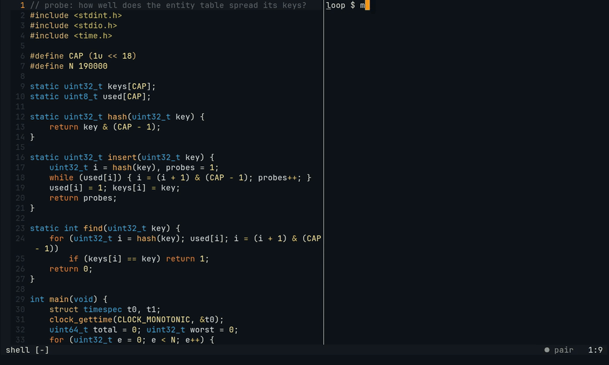
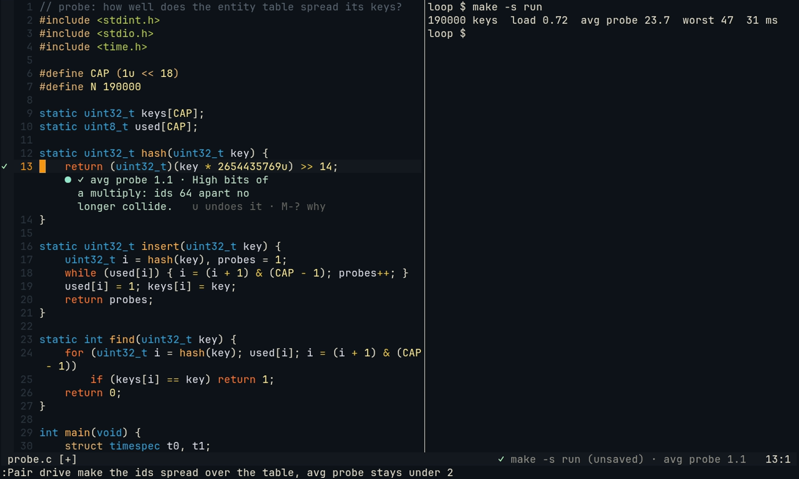

# Driver and suggestions

You drive; Pair sits in the second chair. Two things let it touch your code, both in plain sight:

- **`suggest`**, in every role: a change shown in your buffer that you accept with one key or ignore.
- **`edit`**, only as Driver: the change Pair makes in your buffers while you hand it the wheel, in up to five edits.

Neither saves anything. Your buffer changes, and the disk changes only when you `:w`.

## Suggestions

`suggest(file, line, end_line, new_text, note)` shows that lines `line` to `end_line` would become `new_text`:

- The old lines are highlighted (`PairSuggestDelete`, linked to `DiffDelete`), with the note and the accept key at the end of the first one.
- The new lines appear below them as ghost text (`PairSuggestAdd`, linked to `DiffAdd`). They are virtual lines: not in the buffer, not in your undo tree.
- The chat shows the same note and the new text.

| You | What happens |
| --- | --- |
| Press the accept key (`Alt-y`, `<M-y>`, by default) or `:Pair accept` | The lines are replaced, unsaved: one `u` undoes it. The Watcher counts them as Pair's code until you edit them ([gen.md](gen.md)) |
| Edit those lines yourself | The suggestion goes away: you ignored it |
| `:Pair dismiss` | The suggestion goes away |
| Do nothing | It stays until one of the above, or until Pair suggests something else on the same lines |

Several suggestions show at once, in one buffer or in several: two fixes in one answer, or one now and one later.
Each is its own ghost diff, with its own accept:

- The accept key and `:Pair accept` take the suggestion your cursor is on; elsewhere in a buffer, the newest one in it. `:Pair dismiss` drops the same one. The others stay.
- The jump key (`Alt-j`) goes to the first suggestion of Pair's answer, and from each suggestion on to the next, round to the first again.
- A new suggestion on the same lines as one that shows replaces it. Up to five show; a sixth drops the oldest.

The accept key is mapped in Normal mode, only in a buffer with a suggestion, and only while one shows (`accept_key` in `setup`; `false` maps nothing). Avoid `<Tab>`: terminals send it as Ctrl-I, so jumping forward in the jumplist would accept. A suggestion for a line past the end of the buffer is refused, and the model is told so. If the lines changed under the suggestion when you accept, nothing is replaced and you are told so. Lines added above it move it along.

## Handing over

| From | How |
| --- | --- |
| Neovim | `:Pair drive` or `:Pair drive <what to do>` |
| The chat | `/drive` or `/drive <what to do>`, or a line that is "you take it" or "your turn", alone or followed by punctuation and a request (`you take it: set the timeout to 30 s`); "your turn to explain ..." stays a question |

A request can say what you expect to see after the change, and which command shows it: see [the hand-over without a test](#the-hand-over-without-a-test).

Then:

1. Pair becomes the Driver for one answer. The chat pane's header and `require('pair').status()` show `driver`
   (the [plain pane](chat.md#the-plain-pane) shows it in its prompt).
2. It reads the code and calls `edit`, once for each place the change touches, in one file or several. An edit replaces whole lines, or, with `old_text`, only that text in them (`retries + 1` becomes `retries` and the rest of the line stays); `old_text` that is not in those lines exactly once changes nothing, and the model is told why. Neovim types the change while you watch (see [the visible hand-over](neovim.md#the-visible-hand-over)): ghost text with Pair's cursor, each line entering the buffer only when it is whole, all of it one undo step. If no window shows those lines, they open in a split. The edit's answer to the model waits until the typing is done. The chat says `Changed src/ws.mjs:1 (u undoes it).`
   A file that does not exist yet (inside the project, in a folder that does) opens as a new buffer and is typed there, for example the `Makefile` of a [first slice](blank-page.md#the-first-run). Its `read` says it does not exist yet, or shows the buffer once Pair has typed it. The disk has it when you save it.
3. Each edit is its own undo step. Up to five edits per hand-over: a sixth is refused, and the model is told to say what it changed. An edit Neovim could not apply (a line past the end of the buffer), or that you stopped halfway, does not count. Five keeps a change small enough to watch, and a model that loops harmless.
4. Pair checks the change on the unsaved buffers (below), once the model says its edit is the last of the change (an edit with `more` waits for the next one; an answer that ends after one is checked when it ends, for the hand-back line): with the project's command on save (`testOnSave`), or, without one, with the build and run you last ran in your terminal. It tells the model the result. The model says in one sentence what it changed and, when something ran, whether the tests pass or what the run printed for what you expect. It is told not to run them itself: they would read the file on disk, which changes only when you save.
5. When the answer ends, Pair goes back to the role you handed over from by itself: Navigator, or Scout with its pane, also when it answered without an edit, for example with a question. Unless you let it [keep the wheel](#keeping-the-wheel).
6. The hand-back line: its words under the last line it changed, `✓` or `✗` in the sign column there when the check ran (with the line the run printed for your target first: `✓ avg probe 1.1 · …`), `▎` on the lines of every edit, and `u undoes it` (`u undoes each edit` after several: one `u` per edit, in the buffer it changed). They go with your next edit. After that, `u` on the edit's line in `:Pair today` still undoes it: Neovim merges the undo into the buffer as it is then, and keeps your later edits, or changes nothing when you edited the same lines ([the ledger](neovim.md#the-ledger)).

A hand-over needs Neovim connected (`:Pair start`), and is refused while Pair is still answering something else. No remark nobody asked for starts while Pair has the wheel.

## Keeping the wheel

`:Pair drive! [what]` or `/drive! [what]` hands Pair the wheel until you take it back. It answers the request as
Driver and keeps the wheel when the answer ends: each question you type after it, in the chat or with `:Pair ask`,
is a hand-over of its own, with its own edits, check and hand-back line. The chat says
`Pair keeps the wheel for each request until you take it back: any key in Neovim, or /navigate.`

In Neovim, a `:Pair` command (`:Pair ask and y to 20`, `:'<,'>Pair ask ...`) is how you talk to it: the keys of
that command line do not take the wheel back. It ends as any hand-over does when you take the wheel back (any other
key in Neovim, any other command line or one you abort, typing at a shell prompt), or with `/navigate`, `/scout` or
`:Pair navigate`. Pair then goes back to the role you handed over from. No remark nobody
asked for starts while it keeps the wheel.

## The check on the unsaved buffer

After the Driver's last edit of a change, Pair runs one command once on the buffers as they are, before anything is saved: the files it edited, and every other buffer of the project with changes you have not saved, in any Neovim connected to the session. It runs in Pair's own pane like the tests on save, so you see it. The command is always yours, never the model's:

1. one in backquotes in the hand-over (`` you take it: …, run `make -s run` ``);
2. else the project's command in `testOnSave`, tests or a build and run;
3. else the build and run you last ran in your terminal, as [the run log](exploration.md) knows it: `make -s run`, `odin run .`, `zig build run`, `cc -o probe probe.c && ./probe`. One that only runs a program by its path (`./probe`) gets the build you ran before it in the same folder (`make && ./probe`), since the copy has the old program. One you ran in a folder of the project runs in that folder; one you ran outside the project is no check.

- A command that only runs a built program (`./probe`, `build/probe`) with no build before it is no check: in the copy it would run the old program and judge the old code. The model is told so, and you can name the build and run in backquotes. A script by its path (`./build.sh`) builds what it needs and counts.
- What Scout's [command policy](scout.md#the-command-policy) refuses (`sudo`, `git push`, `curl`, ...) is never run for a check; the model is told why.
- A command taken from your terminal that Scout would ask about (`make run`, `make install`, `./deploy.sh`, `python3 send_mail.py`) asks you first in the chat, as Scout does: ``May I run `make -s run` on the unsaved buffer, in a scratch copy, to check my edit (…)?`` A yes holds for that command for the rest of the session; a no, or no answer within a minute, runs nothing. A command you named in the hand-over, or your command on save, is yours and runs without asking.
- Without any command, nothing runs and the model is told so.

- **Go**: a command with `go test` in it gets `-overlay`: Go reads each unsaved file from its buffer's text, and nothing else changes. `go test -json ./...` runs as `go test -overlay <file> -json ./...`.
- **Everything else** (make, cc, zig, odin, c3c, jest, vitest, pytest, cargo, ...): the command runs in a scratch copy of the project, with the buffers' text in their files. The copy has the files git knows (tracked, or untracked and not ignored) and the files git ignores, such as `.env`; without git, every file. Folders git ignores are left out, so what a run builds or caches there (`dist`, `coverage`, `target`, `.pytest_cache`) is made in the copy and never reaches your project. Only dependency folders are linked from the project, at any depth (a workspace package's own `node_modules` too): `.venv` and `venv` as they are, and `node_modules` package by package, without its caches (`.cache`, `.vite`), so a cache a run writes stays in the copy.
- The copy stays, one per project, in the data directory (`runs/trees/`): each run copies only the files that changed since the last one, as reflinks where the file system has them, and puts back the ones a buffer replaced. The copied files keep their times and the buffers are written now, so `make`, `cargo` or `tsc` in the copy builds only what changed, from the second run on. What a build leaves there takes room; deleting `runs/trees/` is safe, the next run copies the project again.
- A project with more than 50000 files to copy, or an edited file in a dependency folder, is not tested, and the model is told why. Another unsaved buffer in a dependency folder is left out: written through the link, it would land in the project.
- The statusline shows `⠹ go test ./... (unsaved)`, then `✓ go test ./... (unsaved) · 4 tests, 3 packages` or `✗ 1 failing · TestX`, and the signs on your test functions show this run's results, at the lines your buffer has them on. A build and run shows what it found (`✗ make -s run (unsaved) · Segmentation fault`, `· does not build · probe.c:13`), or the line it printed for your target (`✓ make -s run (unsaved) · avg probe 1.1`). The chat gets one line about it.
- A picture the run writes in the copy (`.png`, `.jpg`, `.gif`, `.webp`, up to 4 MB: a renderer's screenshot) goes to the model with the result, the newest one if there are several, when the model reads images: a provider's model as pi-ai's catalog says, a model at a `baseUrl` only with `"images": true` in its entry ([config](config.md)). Any other model is told the picture's name and that it is not attached.
- The run is not a baseline for the [tests on save](tests-on-save.md): a test that fails on the buffer and then on save still counts as newly failing against the last run on save.
- Without Pair's pane, nothing runs and the model is told why.
- A run that does not end in time is stopped with Ctrl-C: within the `timeoutSeconds` of the project's command on save ([tests-on-save.md](tests-on-save.md)), else 2 minutes, as Scout's are. A program that opens a window keeps it open in the copy until you close it.

## The hand-over without a test

Exploring has no test to make pass: the check is something you can see in the output. So a hand-over can carry an intent and an observable:

```
you take it: make the ids spread over the table, avg probe stays under 2
```



*The hash table of [the exploration loop](exploration.md) ([captures/loop](captures/loop/probe.c)). You ran `make -s run` in your terminal; the hand-over names what to change and the number to reach. Pair types its edit, asks in the chat (not shown, answered yes) and runs your `make -s run` on the unsaved buffer in a scratch copy, and hands back with the line the run printed next to your target. The build and the runs are real; only the Partner's words are scripted. Recorded from [captures/tapes/hand-over-run.tape](captures/tapes/hand-over-run.tape).*

Pair splits the words ([src/check.mjs](../src/check.mjs)):

| Part | Which words | In the example |
| --- | --- | --- |
| The intent | the first clause, up to the observable | make the ids spread over the table |
| The observable | a later clause that says what you will see: with `prints`, `shows`, `stays`, `under`, `above`, `at least`, `equals`, `<`, ..., or what follows `expect:` | avg probe stays under 2 |
| The command | one in backquotes, with the words that lead in to it (`run`, `check with`) | none: your last build and run |

Before it edits, the Driver hears what you expect and which command will run. After the edit:

- **A number with a bound** (`avg probe stays under 2`, `keep worst at most 4`, `fps above 59`) is checked in code. The run's numbers are read as [the run log](exploration.md#every-run-read) reads them, and the one whose label has the observable's words is compared with the bound. The hand-back line starts with it, `✓ avg probe 1.1` or `✗ avg probe 2.6`, and the model is told whether it met the bound, and to say why when it did not.
- **Several bounds** (`avg probe under 2 and worst under 5`, or split by commas) are each checked: one missed is `✗`, all met is `✓`, and the line shows every number, `✗ avg probe 1.3 · worst 89`. A bound on a number the run did not print leaves the verdict to the model, which is told the numbers that were found.
- **Anything else** (`the window shows both counters`, `it prints the sum once`) is the model's to judge: it gets the output and your words, and starts its sentence with `✓` or `✗`. That mark goes in the sign column.
- **A run that fails** (it does not build, it crashes, it exits with another code) is `✗` whatever you expected, with what went wrong: `✗ Segmentation fault`.



The same one undo step as any hand-over: `u` takes the edit away, and nothing was saved.

## Taking the wheel back

Any key you press in Neovim while Pair has the wheel takes it back (scrolling, clicking and the terminal's focus reports are not keys, so you can scroll to watch), and so does typing at the prompt of one of your shell panes (with zsh's [shell hook](cli.md#pair-shell-hook) in any of your terminals, else in the one with focus):

- While Pair is typing its edit, the edit stops and what it typed so far is undone: one change or none. That key, and any you press until the undo is done, does nothing else, so it cannot change the buffer under a half-typed edit. The model is told `Not changed: the user has taken the wheel back.`
- The plugin refuses edits from that key on, before the daemon has even heard of it.
- The daemon switches Pair back to the role you handed over from: from then on the policy hook refuses `edit` and `type`, telling the model the user has the wheel, so it can suggest the change instead. The conversation is offered that role's tools from its next answer on (tools that vanish in the middle of an answer make some local models write the call as plain text).
- The chat says "You have the wheel back."

Typing in the chat pane does not take the wheel back: the chat is where you talk to Pair while it drives. herdr does not report keystrokes: in zsh the [shell hook](install.md) says when keys change the line at the prompt, in any pane; elsewhere Pair tells typing from the prompt line, which it looks at twice a second while that pane has focus ([herdr.md](herdr.md#the-users-panes-the-shell-hook-else-heuristics)). The text the Driver's `type` puts there does not count, and neither does pressing Enter on it.

## Ping-pong, with or without a test

1. You write a failing test, then say "your turn". Or, exploring, you say what you want and what you expect to see.
2. With a test you just edited, Pair is asked to read it and the code it tests, and to make the test pass by changing the code, not the test. Without one, what you expect to see is the goal.
3. It makes its edits and hands back.
4. You run it and write the next test, or say the next thing to see.

As Driver Pair also has `search` and `run` in its own pane (the same command policy and limits as [Scout](scout.md)), so it may run the test before it edits. After the edit, the files on disk would still be the saved ones: Pair checks the unsaved buffer instead (above), and says whether the tests pass or what the run printed. Saving is yours.

## Typing into your terminal

`type(text)` puts one line into your terminal: the herdr or tmux pane you last looked at or ran a command in, or the `:terminal` buffer in Neovim you were in last ([without herdr](neovim.md#without-herdr)). It is only for the Driver:

- It asks first in the chat: ``May I type `npm test` into your terminal (pane …), without pressing Enter? (y, or another terminal: …)`` `y` or `yes` allows it; the name of another of your terminals the question lists types it there instead; anything else, or no answer within a minute, declines.
- It never presses Enter: running the line is up to you.
- It takes one line of plain text. Enter, Ctrl-C and any other control character or escape sequence are refused, in the session and again where it is sent (herdr or Neovim).
- What [Scout's command policy](scout.md#the-command-policy) refuses is refused here too (`git commit`, `git push`, `curl`, `sudo`, ...).
- It goes only to one of your terminals, never to the chat, Scout's pane or an editor pane.
- If you take the wheel back while the question is open, a yes types nothing.

## The Driver and /gen

Both write code for you, under two different contracts:

| | Driver | [/gen](gen.md) |
| --- | --- | --- |
| How you ask | Hand over the wheel: `:Pair drive`, "your turn" | `/gen here <what>`, `Alt-g`, `:Pair gen` |
| What it does | Types its change into your buffer while you watch | Proposes code at the place you asked; you take it with one key, or not |
| Held to | Five edits per hand-over, small enough to watch | Size limits (`gen.limits`): files, lines, searches, minutes |
| Its role | The Driver, until it hands back | None: a conversation of its own, and Pair keeps its role |
| Checked | On the unsaved buffer after its last edit | On the unsaved buffer once you take the code |
| Undone | `u` per edit; `u` in `:Pair today` per edit | `/undo`, or `u` in `:Pair today`: the whole request at once |

## The policy in code

| Tool | Navigator | Scout | Driver | /gen |
| --- | --- | --- | --- | --- |
| `say`, `read`, `recall` | yes | yes | yes | yes |
| `point`, `open`, `suggest` | yes | yes | yes | no |
| `search` | no | yes | yes | yes |
| `run` | no | yes | yes | no |
| `edit` | no | no | up to five per hand-over | no |
| `type` | no | no | after a yes, without Enter | no |
| `propose`, `ask` | no | no | no | yes |

Each conversation is offered only its role's tools, and the `beforeTool` hook refuses any other name (`src/tools.mjs`). The session checks again that Pair still has the wheel when the edit or the typing happens (`src/session.mjs`), and the Neovim plugin refuses an edit once you have pressed a key, and undoes one you stop halfway (`lua/pair/init.lua`, `lua/pair/drive.lua`). The Driver role is never stored: a hand-over is stored as Navigator, so a daemon restart during one brings back Navigator.
