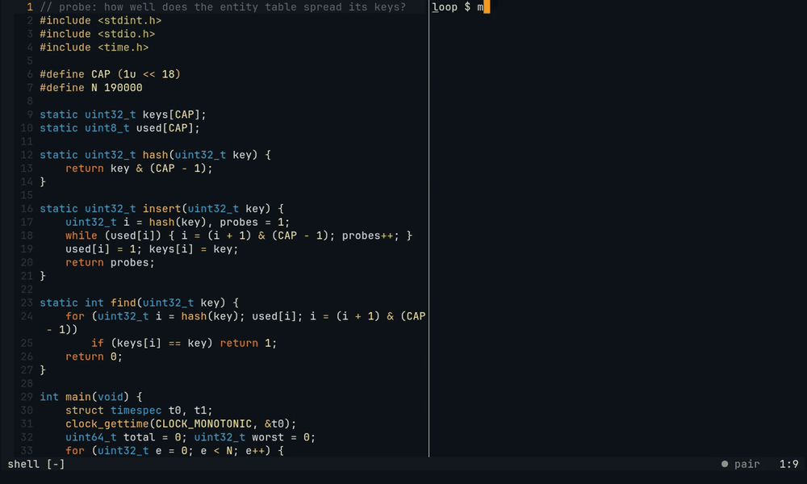
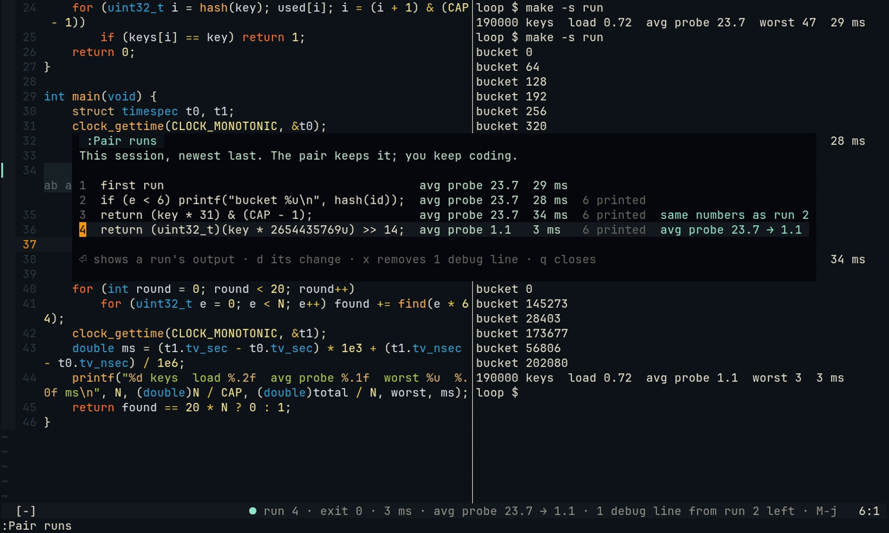
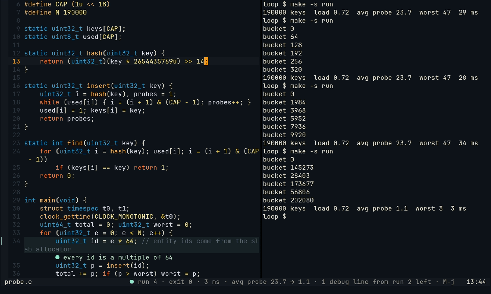

# The exploration loop

Exploratory coding has a loop: build, run, read the line it prints, change one thing, run again. In this style a
number in the output is the test. Pair reads every run of that loop next to the run before. It says when the numbers
did not move although you changed the code, and when they did. It keeps the runs in a notebook, `:Pair runs`. When the
hunt is over, it counts the `printf` lines you added for it.

*The hash table of the research behind this feature ([captures/loop](captures/loop/probe.c)), built and run with
`make -s run` in your own terminal on the right. Run 2 adds a `printf` for the hunt. Run 3 multiplies the key by 31
and prints the same numbers, and Pair says why: the ids come 64 apart and `* 31` keeps them so. Run 4 takes the high
bits and the numbers move. The builds, runs and numbers are real; only the Partner's words are scripted (DeepSeek's
words from the live test, shortened). Recorded from [captures/tapes/loop.tape](captures/tapes/loop.tape).*

## Every run read

Each build and run of the session gets a number. That covers your terminal (through the shell hook or herdr) and
Pair's run on save. A run is a command that builds or runs a program: `make`, `cc`, `zig`, `odin`, `c3c`, `cargo`,
`go`, a script, or a program by its path (`./probe`, `build/probe`). `git status`, `ls` and test runs are not. Test
runs have their own reading ([tests on save](tests-on-save.md)).

Pair reads the numbers a run prints ([src/run-log.mjs](../src/run-log.mjs)). It takes each number with the words
before it as its label: `avg probe 23.7`, `worst 47`, `35 ms`. Only lines the run prints once count. A listing (one
line per bucket or item) is what a debug print shows, not a measurement. Neither are a compiler's `file:line` or an
address.

Next to the last run of the same command, the statusline says what the run showed:

| The run | The statusline |
| --- | --- |
| The first of its command | `run 1 · exit 0 · 35 ms · avg probe 23.7` |
| You changed the code, and the numbers stayed | `run 3 · exit 0 · 55 ms · avg probe 23.7 · same numbers as run 2` |
| A number moved | `run 4 · exit 0 · 5 ms · avg probe 23.7 → 1.1` (a number that got worse says `(worse)`) |
| A program without numbers printed the same | `run 2 · exit 0 · same output as run 1` |
| A crash, a broken build, a new warning | `run 5 · exit 139 · Segmentation fault`, `· does not build`, `· 1 new warning` |

A time counts as moved only when it halves or doubles. One run of a small program is noisy, and 35 → 52 ms is
noise. A printf, a comment or a note is no change of the code. Adding a print and seeing the same numbers is no news.
After a crash or a broken build, the next good run compares with the last good one. `exit` shows only when the shell
hook or the run on save knows the exit code.

## When Pair speaks

Two moments of the loop can bring a remark. Like every remark, it goes through the Watcher and the talk budget
([watcher.md](watcher.md)):

- **The same numbers after a change** (`same_result`). The change did nothing, and why is the question. The Partner
  reads your change and the code the run goes through, with the last runs and what they printed. It points at the
  line that explains it and says why, with the real numbers, and what to try next. In the live test the Watcher
  scored this 8 of 10. The Partner pointed at `uint32_t id = e * 64`: every key is a multiple of 64, and `* 31`
  keeps them 64 apart.
- **A number that moved** (`number_moved`). The move has to come from a change of the code, by at least a quarter (a
  time: half or double). The remark is worth most at the end of a hunt, when earlier changes did not move the
  numbers and this one did. Pair then says what is now true and why this change worked where the others did not:
  "`>> 14` keeps the multiply's high bits … avg probe 23.7 → 1.1, worst 47 → 3". A first try with the plain result
  gets silence.

The Partner also reads the last three runs of the command when you ask it something.

## `:Pair runs`, the notebook

Each run of the session, newest last: the line of code you typed before it, its number, its time, how many lines your
debug prints printed in it, and what it showed. You don't have to write down what you tried.

| Key | What it does |
| --- | --- |
| `⏎` | The run's output; `⏎` or `q` goes back to the list |
| `d` | The change before the run: the lines you typed, file and line |
| `x` | Removes the debug lines left from the hunt (see below) |
| `q` | Closes |

## The debug lines of the hunt

Exploring is printing: you add a `printf`, run, read, and add another. Pair keeps the print statements you add in a
session ([src/debug-lines.mjs](../src/debug-lines.mjs)). This is a rule, not a model: asked to also mention a
leftover printf, the model did not, so it is done in code. Each language has its prints: `printf`,
`fprintf(stderr, …)`, `puts` and `std::cout` in C and C++, `std.debug.print` in Zig, `fmt.println` in Odin,
`io::printfn` in C3, and `fmt.Println`, `dbg!`, `console.log`, `print`. A print that was in the file when you opened
it is your program's own output, not a debug line.

The hunt is over when a number moves the right way, or when a run goes through after a crash or a broken build. Pair
then counts the debug lines still in the code: `1 debug line from run 2 left · M-j`. `Alt-j` goes to the first one,
and `x` in `:Pair runs` removes them all from their buffers. That is one undo step per buffer, and nothing is saved:
`u` brings them back.

## Limits

- The log is for this session only: a daemon restart starts it again, and it keeps the last 30 runs.
- A number is matched to the same number of the run before by its line and its place in the line. A run that prints
  a different line for the same thing has nothing to compare it with.
- Odin's `fmt.println("probe", p)` has no format string, so the panel cannot count the lines it printed.
- The debug lines are found in the lines you typed. A print you pasted with other lines is found too, but one that
  came in with a `git checkout` is not yours.
