# The pair in Neovim

Pair sits in the second chair. In Neovim it has a small visual language: a few marks in one colour, all in your
own font, and no windows, boxes, borders or field labels (the three panels, `:Pair trail`, `:Pair context` and
`:Pair today`, open only when you ask).
Everything it shows follows one test: would you keep it on screen for an eight-hour day?


*The capture above is the plugin and the daemon as shipped, in a clean Neovim with the ayu colorscheme. The test
run is real `go test`; only the models' words are scripted. It is recorded from a tape in [captures/](captures/).*

## A few marks, one accent

| Mark | Where | What it means |
| --- | --- | --- |
| `●` and a line or two | under the line you are on | Pair's voice: what it says unasked, in your font, indented with your code |
| a lit line number | the number column | its gaze: the lines it is reading, one after another, with a short trail |
| `▎` | the sign column | a line it points at, or the line its words are about |
| `•` | the sign column, and `held thought` in the statusline | a remark that waits for your next break, about this line ([below](#the-held-thought)) |
| `M-j` | after its words | go where it points; your cursor never moves by itself |
| `◎` | the statusline | it has the wheel (the Driver); any key takes it back |
| a block after ghost text | where it types | its cursor, while it types the change you handed over |
| `◌` | the statusline | it is not there: reconnecting, or a model is down |
| `◉` and a meter | under your line, and the statusline | it listens while you hold `Alt-t` ([push-to-talk](voice.md)) |
| `⠹` | the statusline | it thinks before it answers, or runs your tests |
| `✓` `✗` | the statusline, and the sign column of your tests | tests it ran for you when you saved |

**One accent, from your colorscheme.** Pair takes its colour from the colorscheme you use, so it fits in light and
dark: of the colorscheme's own colours for regular expressions, its terminal cyan, its hints and its specials, it
picks the one whose hue is furthest from every colour your code is drawn in, and makes sure it reads on your
background. So Pair is never mistaken for syntax. It also keeps at least 30° of hue away from the colorscheme's
error colour, so Pair is never mistaken for an error. With ayu that is its regexp teal; with Neovim's own
colorscheme, its cyan. Pair's words are your foreground tinted toward the accent, and `code` in them is the accent.

**On a grey palette.** Many desktop themes are greys with one signal colour, often a warm red. When your code is
drawn in greys, with at most that one colour, Pair takes a quiet teal instead: the one other colour on screen, so
when it speaks, you see it, and it never reads as an error. Before, such a palette gave Pair its red.

**The chat pane in the same colour.** Neovim sends the accent to the daemon, and the chat pane prints Pair's name and
the `code` in its words in it, in true colour, with long lines wrapped under the words. Before a Neovim with
`termguicolors` connects it uses the terminal's cyan; with `NO_COLOR` set it prints no colours.

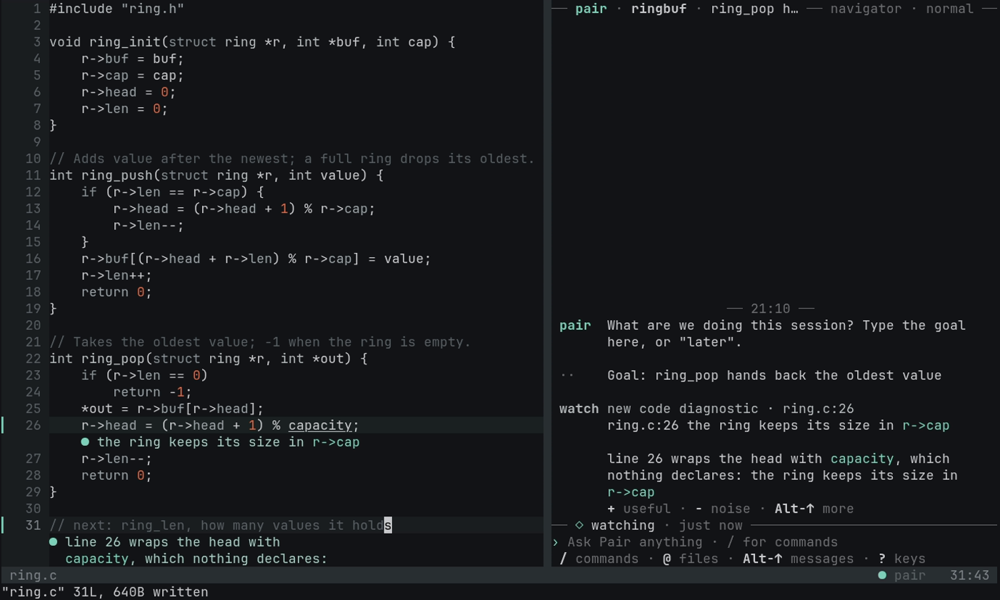

Every highlight group is defined with `default = true`, and only when the colorscheme has not defined it: a
colorscheme or your config can set any of them and keeps its own. Pair sets them again when you change the
colorscheme, `background` or `termguicolors`.

## The wrong turn

The moment this language was made for: a test is red, and you start fixing it in a file the failure does not name.

1. You ran the tests in your terminal; the failure names `worker_test.go`. You open `backoff.go` and change the
   shift, sure it is off by one.
2. Once you pause, Pair looks: its gaze crosses the line numbers of `backoff.go`, then the statusline says
   `● reading worker.go`.
3. Two quiet lines appear under your edit, fading in over a quarter of a second: the shift is fine, and the real
   cause is `worker.go:35`, which gives up on `>=`. They end with `M-j`.
4. You undo. The words go with your edit: an edit counts as having seen them, neither useful nor noise.
5. `Alt-j` goes there. The line is tinted, the `>=` is underlined, and Pair's note sits after the line.
   `Ctrl-O` brings you back.

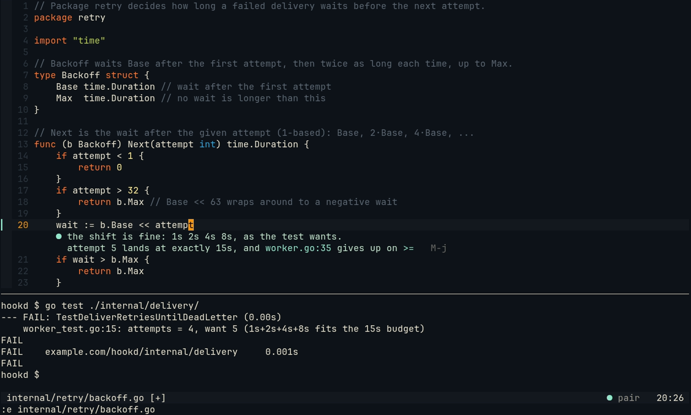

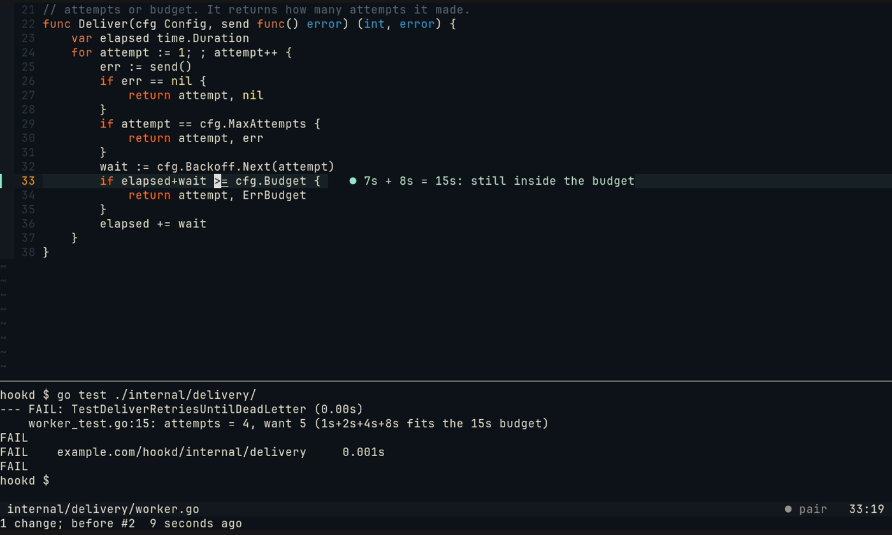

The trigger behind it, `edit_while_red`, goes through the speak gate like the others: the Watcher scores whether a
check of that file would save you time, and the Partner reads your change, the failing test and the code it tests.
It traces the test through the code as it is now, thinking first if its model can: if your change is the fix, or it is not
sure, it stays silent; only when the failure still comes from elsewhere does it point there. Details in [docs/watcher.md](watcher.md).

## It runs what you'd skip

The second moment: you save a fix, the tests you ran pass, and you would push. Pair runs the whole suite as you
save, in its own pane, and finds what your fix broke somewhere you were not looking. You set the command per project
(`testOnSave` in the config, see [tests-on-save.md](tests-on-save.md)); the model never starts a run.


*The plugin and the daemon as shipped, in a clean Neovim with ayu. Both test runs are real `go test -json ./...`
runs on the project; only the models' words are scripted.*

1. You save `worker.go` as it is, and the statusline spins: `⠹ go test ./...`. This first run of the session is the
   baseline: it is red on the delivery test, the bug from the wrong turn, and that raises nothing.
2. You change `>=` to `>`, the fix, and save. The delivery test passes now, but the statusline turns to
   `✗ 1 failing · TestNoDoubleDelivery`: a test that passed in the run before. In `queue_test.go`, below, the test function gets a `✗` and its
   neighbour a quiet `✓`; the message `t.Fatalf` printed sits under line 34, where it failed.
3. Pair reads the test, then `queue.go` (the statusline names each file; where the file is on screen, its gaze
   crosses the line numbers), and two lines appear under your change: attempt 5 now starts at 15 s, the moment the
   queue's lease on the job runs out, so a second worker takes it. They end with `M-j`.
4. `Alt-j` goes to `queue.go:18`, where its fix waits: the old line struck through, the new one under it, and `M-y`.
5. `Alt-y` takes it, `:w` saves it, the tests run again: `✓ go test ./... · 4 tests, 3 packages` for a few seconds,
   and the `✗` turns into a `✓`, rising from the background.

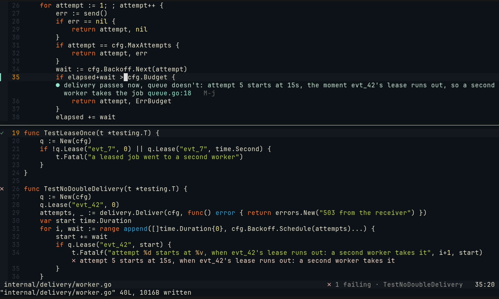

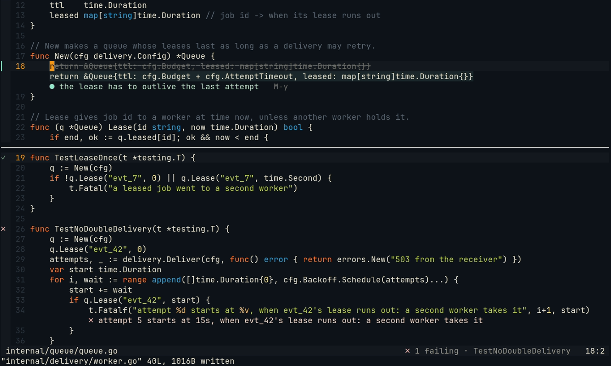

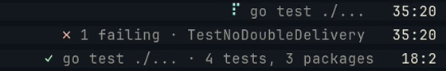

The run on save is never a remark by itself: the statusline and the signs say how it went, and the chat says when it
turns red or green. Only a **regression**, a test that fails now and did not in Pair's run before, goes through the
speak gate as an unasked remark, so a suite that stays red the same way stays quiet. The Partner is asked to keep
your change working (you made it for a reason) and to suggest the fix where it breaks, thinking first if its model
can. Details in [docs/watcher.md](watcher.md#regressions).

**What the run shows.**

- **Statusline.** `⠹ go test ./...` while it runs, with the flags that only ask for JSON left out. Then
  `✗ 1 failing · TestNoDoubleDelivery` (`+2` when more fail, `does not build` for a Go build error) until the next
  run, or `✓ go test ./... · 4 tests, 3 packages` for six seconds before it rests at `● pair` again. Pair reading,
  driving, or away comes first. Without Pair's pane (no `pair` in herdr) it says `◌ go test ./... · needs \`pair\` in
  herdr` instead, until a run can start.
- **Signs.** With a JSON report (`go test -json`, `jest --json`, `vitest --reporter=json`), each test that ran gets
  `✓` or `✗` in the sign column of its function (Go) or its `test(...)` line (jest, vitest), in every buffer you have
  open and in test files you open later. Passing signs are quiet; failing ones are your colorscheme's error colour.
  A sign whose result changed since the last run fades in; while the next run is on, the last results show half
  faded.
- **Failures.** The failed test's message (`t.Errorf`, a panic, `expect(...)`) shows after the line it failed on,
  or under it when the line is too long for the window.

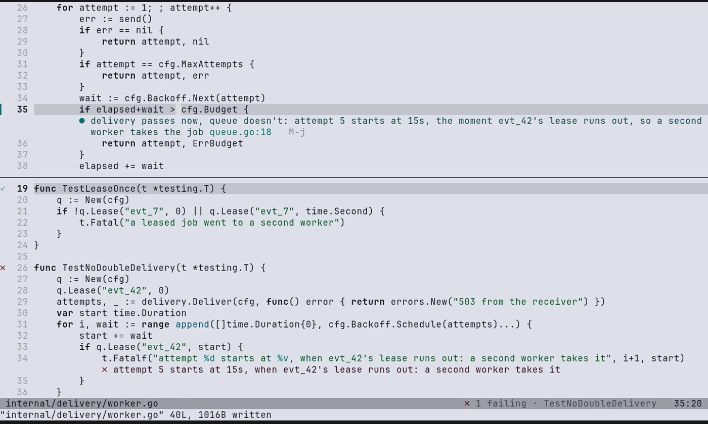

## The visible hand-over

The third moment: you write the first case of a table test and hand over the boring part with
`:Pair drive the edge cases`. You watch Pair type, it tests what it typed before anything is saved, and it gives the
keyboard back.


*The plugin and the daemon as shipped, in a clean Neovim with ayu. The test run is a real `go test -overlay` on the
unsaved buffer; only the models' words are scripted.*

1. The statusline says `◎ pair has the wheel · any key takes it back`. Pair reads the test and the code it tests;
   its gaze crosses the line numbers.
2. It types. The new text arrives as ghost text with Pair's cursor at its end; the indent comes at once, as your
   editor would put it. A line enters the buffer only when it is whole, so your buffer and your language server
   never see half a line, and nothing goes red while it types. Each line it entered gets `▎` in the sign column.
   Text it replaces is struck through for a moment first; within a line, only the part that changes is.
3. It runs your project's test command on the **unsaved** buffer: `⠹ go test ./... (unsaved)` (see
   [docs/driver.md](driver.md#tests-on-the-unsaved-buffer)).
4. It hands back: its words under the last line it changed, `✓` (or `✗`) in the sign column there and in the
   statusline, the `▎` still on the lines it changed, and `u undoes it`. Like any of its words, they go with your
   next edit.
5. Everything it typed is one undo step: one `u` takes it all away, `Ctrl-R` brings it back. Nothing is saved
   until you `:w`. After your next edits, the [ledger](#the-ledger) still undoes it.

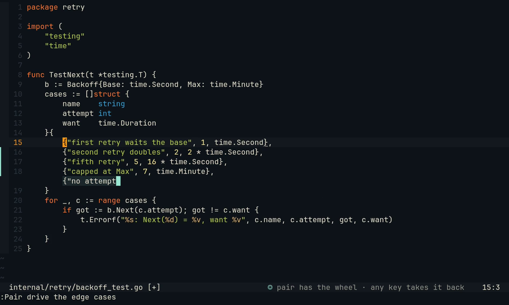

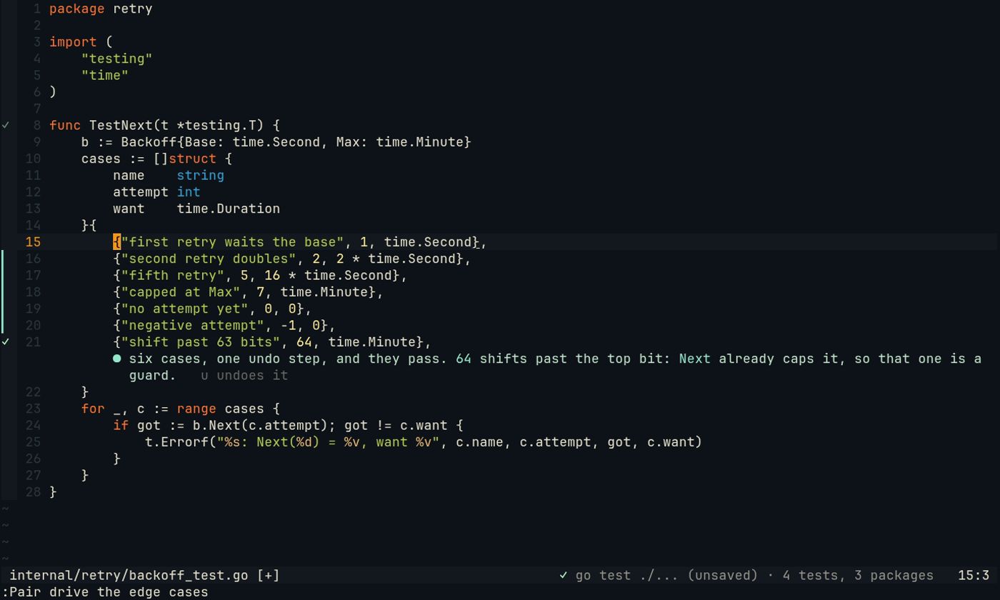

**Taking it back halfway.** Any key you press while Pair types ends it at once, and leaves **no change**: the
lines it already entered are undone, and that key, and any you press until they are, does nothing else, so it
cannot change the buffer under a half-typed edit. Scrolling and clicking to watch are not keys. After the typing,
a key still takes the wheel back, and leaves the one change.

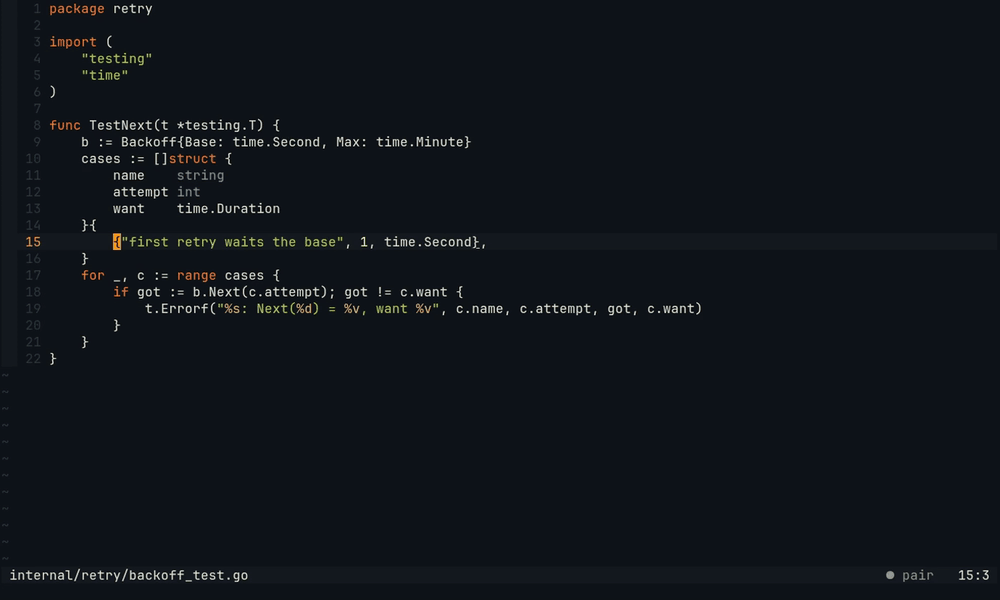

A long edit types faster, to take about four seconds; with `motion = false` it lands at once, as one undo step.
If no window shows the lines it changes, they open in a split first, so you can watch; your cursor stays where it was.

## The blank page

At the start of something new, `:Pair new` and one sentence: Pair asks three questions in `NOTES.md`, one at a
time, each under your last answer, in its usual voice (`●` and its words). Your answer goes once you leave Insert mode and it settles.
The first slice comes as a suggestion that adds lines and strikes nothing, and `Alt-y` takes it into the note. See
**[docs/blank-page.md](blank-page.md)**.


## The search trail

You look for something with Telescope and it is not there under your words. A test is red; you grep for
"give up": nothing. "dead letter": one comment. You find-file "retry" and open `backoff.go`. Those three searches say
what you are after better than a goal you typed, and that the code calls it something else. Pair reads the trail
and, once you pause, says where the thing is, in the code's own word.

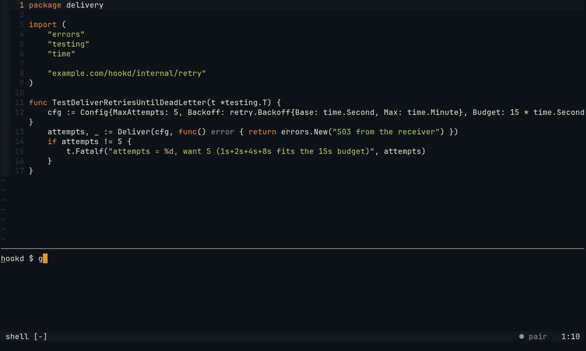

*The plugin and the daemon as shipped, with real Telescope in a clean Neovim. The test run is real `go test`. The
Watcher's score and the Partner's words are what a live model answered to this trail in the live test
(`test/live/trail.test.mjs`), replayed.*

1. The delivery test fails in your terminal: `attempts = 4, want 5`.
2. `␣sg` "give up", `Esc`: 0 results. `␣sg` "dead letter", `Esc`: one comment, nothing worth opening. `␣sf`
   "retry", `Enter`: `backoff.go` opens.
3. A few seconds after the last search, with no edit since, Pair looks. The Watcher scores the trail with what fails
   now; the Partner gets the trail, the failing test's message, and what ripgrep finds in the project for each of
   your queries, then reads the code.
4. Its words show under your line: the word you are looking for is `ErrBudget`, and it fires at
   `elapsed+wait >= cfg.Budget`, which refuses the wait that lands exactly on the 15 s budget. They end with `M-j`.
5. `Alt-j` goes to `worker.go:35`, the `>=` underlined.

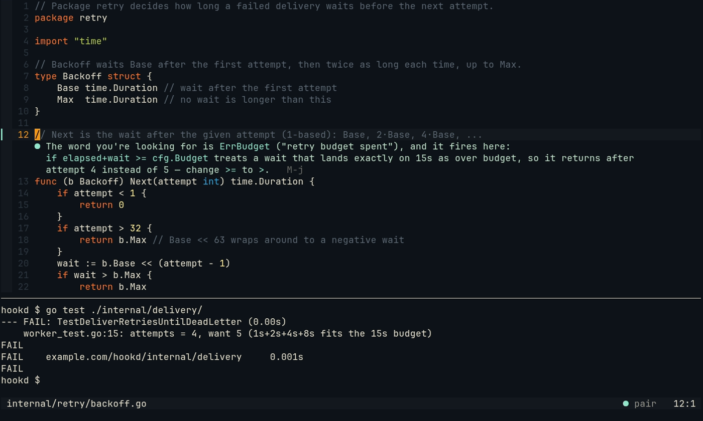

**`:Pair trail`** shows what Pair saw: each search since your last edit, oldest first, with the picker, your words,
how many results, and what you opened from it. Under them, what the trail looks like and what the Watcher made of
it. These lines are all of your searches a model ever gets, and only with a trail remark. `x` forgets them, `q`
closes the panel.

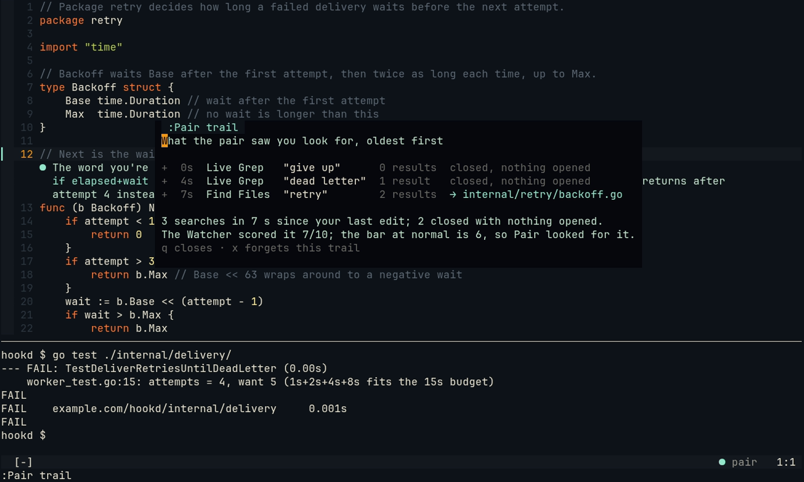

**When it speaks.** A trail is the searches since your last edit, within four minutes. It is looked at once you
pause after the last one, when there are three or more and one of them closed with nothing opened, or you searched
the same words again and landed somewhere else. Three searches that each opened a file are you finding your way,
and the same words opening the same file each time are your way back to it: both stay quiet. An edit
ends a trail: what you searched before it, you found. Each new search in a trail is a new look, within the budget
of your talk level.

**Why the failing test goes with it.** From the trail alone, the model guesses what you are after, and in live runs
it guessed wrong: it pointed at the attempt limit, the other place that "gives up". With the failing test's message
next to the trail, it named the `>=` every time. So the cue always carries what fails now: the last red test run,
else the last failed command, from the last ten minutes. With nothing failing, the cue still comes, and says where
your words are in the code.

**How the searches are read.** Telescope (`FileType TelescopePrompt`, then the prompt's `BufLeave`, as Telescope
closes it) and snacks.picker (as its input window closes, whether you confirm from the input or the list): the picker's title, your words,
the result count and the selected entry, then whether that file is where you are now (in a new split too). No mapping, action or
picker setting of yours changes, and nothing is written to the picker's own history; Telescope's history keeps
only searches that ended in a selection, and the ones you gave up on are the telling ones. A picker closed with an
empty prompt is no search. fzf-lua has no hook for its close, so its searches are not read
([#56](https://github.com/makefunstuff/pairing-buddy/issues/56)). `searches = false` in
`setup` turns all of this off.

## The held thought

Most of what Pair has to say is not urgent. A remark about drift, a stall, or an error in a line you wrote and left
is held for your next natural break: a save, a run or a commit that ended, leaving Insert mode for a few seconds, or
a quiet stretch. A wrong turn, a regression or a failure you missed still speak at your next pause in typing.


*The plugin and the daemon as shipped, in a clean Neovim on mini.base16 with a grey palette, `clangd` for the
diagnostics, and the real chat pane on the right. Only the models' words are scripted.*

1. You write `ring_pop` in C and go on typing. `clangd` marks `capacity` on line 26: nothing declares it.
2. You stop for a moment to think; Pair looks, reads `ring.h`, and has its remark ready. It does not say it: you are
   still in Insert mode, still writing. A `•` appears in the margin at line 26, and the statusline says
   `● pair · held thought · M-j`. The chat stays as it was.
3. You finish the function and save. Now the remark shows: line 26 tinted with `capacity` underlined and its note,
   the words under your line, and the same words in the chat, in the same teal.

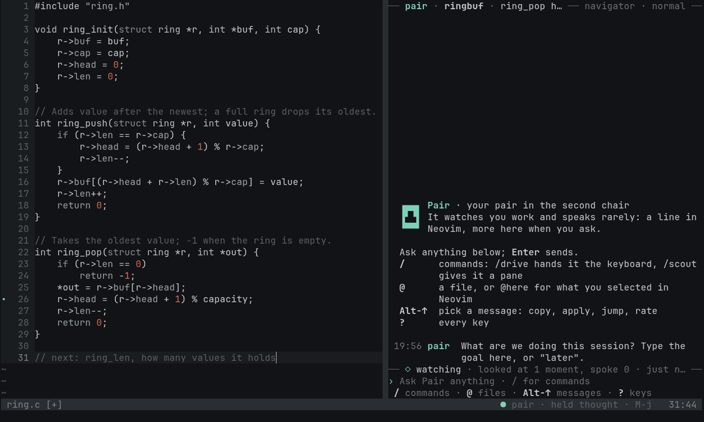


`Alt-j` shows a held thought at once, and goes where it points once it shows. If you fix the line yourself before
your break, the dot goes and Pair says nothing. The rules are in [docs/watcher.md](watcher.md#the-held-thought).

## The ledger

At the end of a morning, what did the pair actually do? `:Pair today` (or `/today` in the chat) opens a quiet list
at the bottom: everything Pair did in this project today, oldest first, one line each. The time, what it did in
the accent, what it did it to, and on the right the key that acts on it.

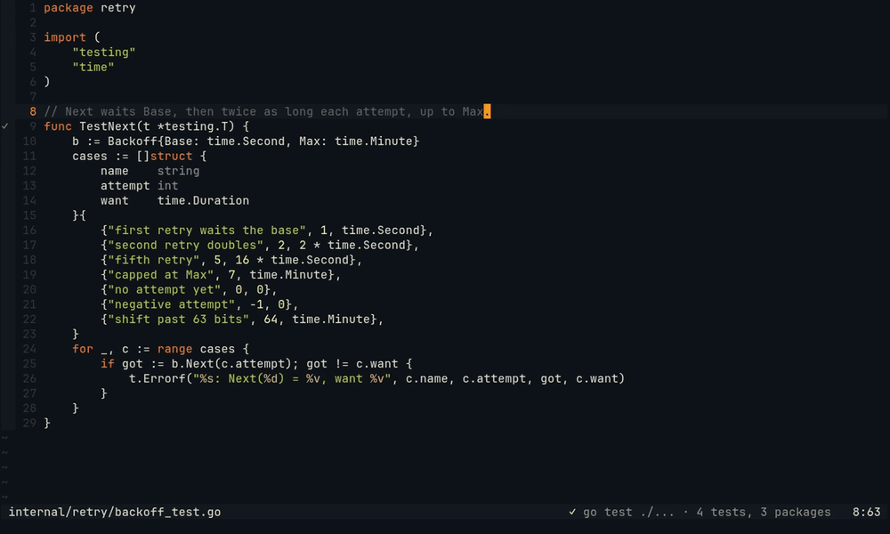

*The plugin and the daemon as shipped, in a clean Neovim with ayu. Off screen, a morning of the two moments above:
the tests on save find a regression and `Alt-y` takes Pair's fix; you hand over the edge cases, then write a comment
above them and save. Every line in the list is what the daemon booked as it happened; only the models' words are
scripted.*

| It | When | On the right |
| --- | --- | --- |
| `read` | it read a file; reads in a row are one line (`queue_test.go 24-37, queue.go 1-29`) | `⏎ go` |
| `said` | its words, unasked or answering you | your verdict on a remark (`+ useful`, `- noise`), or `⏎ all` |
| `pointed`, `showed` | it pointed at a line, or opened one in a split | `⏎ go` |
| `suggested` | it suggested a change | `⏎ go`; once you accept it, `accepted · u undo` |
| `typed` | the Driver's edit (`6 lines in backoff_test.go · one undo step`), or one line it typed into your terminal | `u undo`, for the edit |
| `ran`, `searched` | a command in its pane, or the tests it ran on save or on the unsaved buffer, with `✓` or `✗`; the same run in a row is one line (`· 3 times`) | `⏎ output` |
| `asked`, `refused` | what it asked before running or typing, and what its policy refused, with the reason | `you said no` |
| `stayed quiet` | the moments it let pass: `3 moments under the bar`, or held back by the budget | `⏎ why` |

The last one shows that the gate works: Pair noticed, judged, and chose not to talk.

**Keys in the list.** `⏎` goes to the place in the window you came from, or opens what the entry holds in the
list's window (a command's output, why Pair stayed quiet, all it said; `q` comes back). `+` and `-` rate a remark.
`q` closes the list. While it is open, it follows along.

**`u` undoes Pair's edit, later.** In the buffer, Pair's edit is one undo step, but only until your next edit
buries it. In the ledger, `u` on a `typed` line takes that edit back whenever you like, after other edits too: the
daemon kept the buffer's text before and after it, and Neovim merges the undo into the buffer as it is now. Your
changes since stay; the line is struck through and says `undone · u again redoes`; `u` again makes the edit again.
An accepted suggestion works the same way. If you changed the very lines Pair's edit touched, undoing it would undo
yours too, so nothing changes and Pair says why. The undo is one undo step in that buffer, and unsaved, like the
edit was: the disk changes when you `:w`.

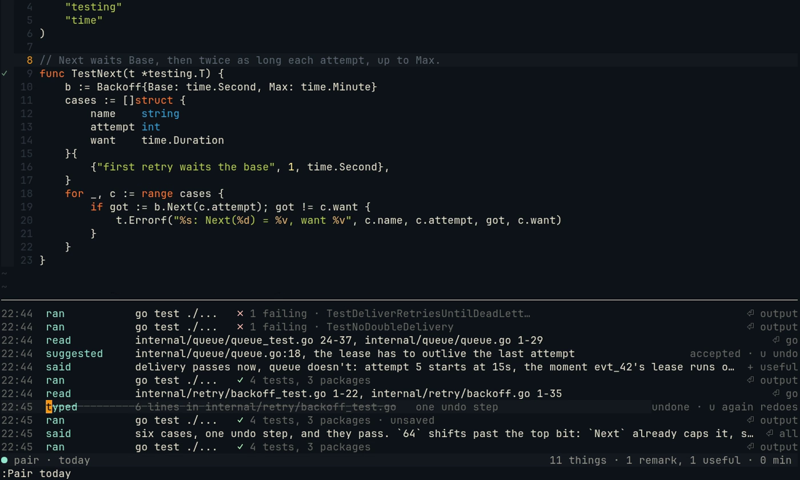

The list is today's, from local midnight, across the sessions of this project; the line at the bottom sums it up:
`11 things · 1 remark, 1 useful · 2 h 10 min` (the active pairing time today). The entries are kept in
`sessions.sqlite`; what they open to (the output of each command, its last 20 000 characters, and the text before
and after each edit) for a week.

## What each thing looks like

**Words.** One or two lines under the line you are on, indented with your code, with `●` before them. At most
three lines; the chat pane has all of them. Your next edit, anywhere, takes them away.

**Points.** The lines Pair points at get `▎` in the sign column and a faint tint; the code it means on the first
line is underlined. Its note goes after the line when it fits in the window, else under the line, and moves when
you resize. Editing a pointed line removes the point. The last point is where `Alt-j` (or `:Pair jump`) goes, unless Pair suggested a change since: then it goes to the suggestion, where `Alt-y` takes it.

**The gaze.** While Pair reads a file you have open, the line numbers it reads light up in the accent, one after
another, with a trail of two fading behind, in about 0.8 s whatever the length. The statusline names the file for
two seconds, also when it is not on screen. Without line numbers, the statusline alone shows it.

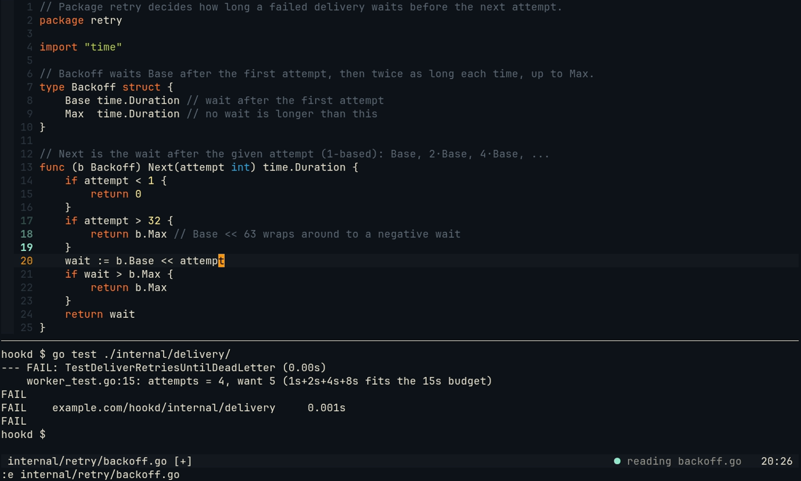

**Suggestions.** The old lines are struck through from their first character (the indent stays clean), the new
lines sit right under them on a faint tint, and the note follows with `M-y`.

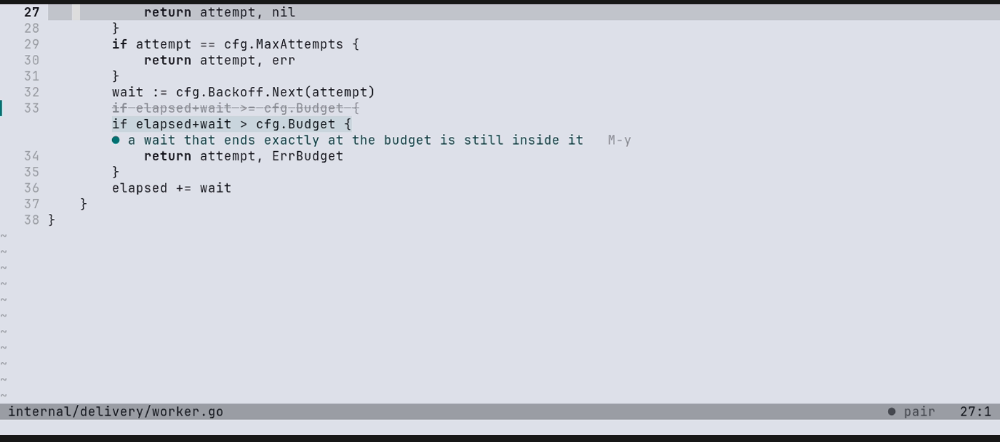

**The statusline.** One quiet segment: `● pair` at rest, the `●` in the accent while Pair's words are on screen,
`● reading worker.go` while it reads, `◎ pair has the wheel · any key takes it back` while it drives, and the
tests on save as above (`(unsaved)` after the label for the run on the Driver's edit). The role and
the talk level show only when they are not the usual ones (`● pair · scout`, `● pair · quiet`). While a thought is
held, `● pair · held thought · M-j`, the `●` in the accent.

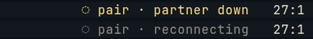

## What it knows: the context card

`:Pair context` shows everything the pair uses, as it is this second, on one card you can read and trim: the goal,
the board task of your branch, git, the commands you ran, and where you have been in the editor. It is the same
text the Partner gets with every remark and question, so what is not on the card is not sent. It is read again every
two seconds while it is open.

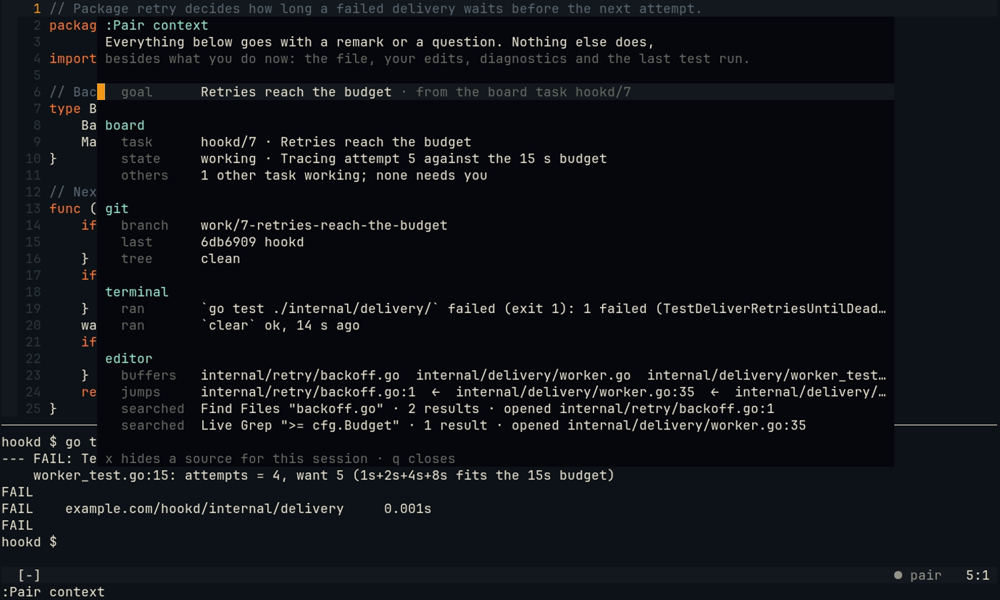

*The card in the capture, made by the daemon and plugin as shipped: no goal was typed, it came from the board task
of the branch. The test run and the two Telescope searches are real; the board is a stand-in for
herdr's work board ([captures/board.mjs](captures/board.mjs)).*

| Source | Rows | Read from |
| --- | --- | --- |
| goal | what the session is for, and where it came from | the board task, else the branch name, else what you typed |
| board | the task, its state, and how many of the repo's other tasks are working or need you | the herdr work board: the task whose number is in the branch name, in this repo |
| git | branch, last commit, how many files changed, the pull request | `git`, and `gh pr view` at most every five minutes |
| terminal | the last three commands, how they ended and how long ago | the herdr panes and the shell hook |
| editor | your buffers, the jumplist, and your searches with what you opened from them | Neovim, and the searches the [search trail](#the-search-trail) reads from Telescope and snacks.picker |

- **`x` hides a source** for the rest of the session: it is struck through on the card and no longer sent. `x` on
  it again brings it back. `q` or `Esc` closes the card. A hidden terminal also means no remark about a failed
  command (nothing to say it with); the last test run still goes, with what you do now. Hiding works from then on:
  what went with earlier questions stays in the session's conversation.
- **A budget per source.** Six buffers, four jumps and three searches go; the card says how many more were cut.
- **The board's own launches are not yours.** A command that launches one of the board's agents (it hands the agent
  a file from one of the board's task folders) is left out of the commands, and the card counts it as not sent, so
  Pair never thinks you ran it. Your own `herdr-projects` commands are yours.
- **Matched by repo and number.** The branch `work/7-retries` belongs to task 7 of this repo only: another repo's
  task 7 is never taken for it. The repo is the folder of the main checkout (also from a worktree) or the name in
  `origin`'s URL.
- The searches are the search trail's: a search you leave with `Esc` shows without "opened", since nothing was.
  Hiding the editor also keeps the search trail from raising a remark, which would send the searches.
- A branch is read as a task number only when the number stands alone in a part of its name (`work/7-retries`,
  `7-fix`), so `release/2.0` is no task.
- `:Pair context` needs a connection; before one, it says so.

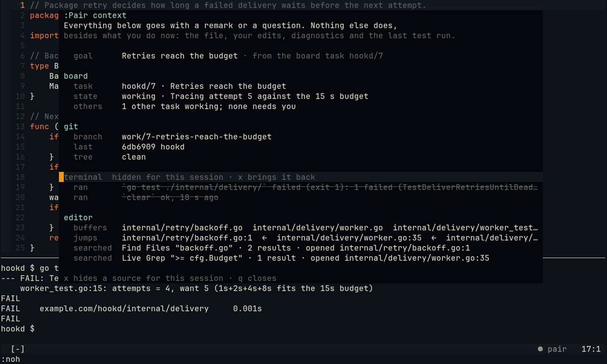

## Setup

The lazy.nvim spec is in [install.md](install.md#install). Without a plugin manager:
`vim.opt.rtp:append('/path/to/pairing-buddy')` and `require('pair').setup({auto_connect = true})`.

```lua
require('pair').setup({
  auto_connect = true,
  jump_key = '<M-j>',  -- false for none; :Pair jump works either way
  listen_key = '<M-t>', -- hold it to speak to Pair (docs/voice.md); false for none
  motion = true,       -- false: no fades, the gaze lights one line at a time without its trail, and the Driver's edit lands at once
  glyphs = {},         -- for example {voice = '\u{f444}', wheel = '\u{f030c}'} with a Nerd Font
  searches = true,     -- false: your Telescope and snacks.picker searches stay in Neovim, and there is no search trail
})
```

| Option | Default | Meaning |
| --- | --- | --- |
| `auto_connect` | `false` | Connect to the daemon at startup (the lazy.nvim spec sets it). A Neovim without a screen (`nvim --headless`, an agent's or a script's) or one started in the temp folder does not, so it never starts a session; `:Pair start` connects it anyway |
| `socket` | the daemon's default | The daemon's socket |
| `debounce_ms` | `2000` | How long after you stop typing an edit is sent |
| `max_points` | `5` | Points kept at once |
| `jump_key` | `'<M-j>'` | Goes where Pair pointed last, or shows a held thought. Mapped in Normal mode while it points somewhere or holds a thought |
| `accept_key` | `'<M-y>'` | Accepts a suggestion. Mapped in Normal mode, only in that buffer and only while a suggestion shows. Avoid `<Tab>`: terminals send it for Ctrl-I, the jumplist's forward jump |
| `listen_key` | `'<M-t>'` | Hold it to speak to Pair ([voice.md](voice.md)). Mapped in Normal and Visual mode from the start |
| `useful_key`, `noise_key` | `'<M-u>'`, `'<M-n>'` | Your verdict on Pair's last unasked remark. Mapped in Normal mode only while a remark waits for one |
| `motion` | `true` | Fades, and the trail behind the gaze; without it the gaze still steps line by line |
| `searches` | `true` | Read your Telescope and snacks.picker searches for the [search trail](#the-search-trail) |
| `glyphs` | plain Unicode | Pair's marks (below) |

Every key option takes `false` for none; the commands work either way. The keys are mapped only where you have no
mapping of your own, and all but `listen_key` only while there is something for them to act on. The glyphs are plain
Unicode, so they show in any font: `voice` `●`, `mark` `▎`, `held` `•`, `away` `◌`, `wheel` `◎`, `listen` `◉`, `pass`
`✓` and `fail` `✗`. The
spinner is braille, `⠋⠙⠹⠸⠼⠴⠦⠧⠇⠏`.

Once connected, the plugin stays connected: when the daemon restarts (an upgrade, `systemctl --user restart`, a
crash), it reconnects by itself, after 1, 2, 5, 10 and then every 30 seconds, and sends the current file again.
`:Pair stop` disconnects for good.

Colours need `termguicolors`, which Neovim turns on by itself in most terminals. Without it Pair links its groups
to standard ones and does not fade.

## Commands

| Command | What it does |
| --- | --- |
| `:Pair start [goal]` | Connect to the daemon (not needed with `auto_connect`), optionally setting the session goal |
| `:Pair new [idea]` | Start something new: three questions in `NOTES.md`, one at a time, then a first slice of two files ([details](blank-page.md)) |
| `:Pair goal <text>` | Set the session goal |
| `:Pair ask <text>` | Ask Pair something (the answer appears in the chat pane); with a range (`:'<,'>Pair ask ...`), about those lines |
| `:Pair level quiet\|normal\|chatty` | How often Pair speaks unasked |
| `:Pair scout` | Switch to Scout: Pair may search and run commands in its own pane |
| `:Pair navigate` | Switch back to Navigator (the default) |
| `:Pair drive [what]` | Hand Pair the wheel for one change; any key takes it back. With a range, for those lines |
| `:Pair jump` | Go where Pair pointed last (same as `Alt-j`); `Ctrl-O` comes back. While Pair holds a thought, show it now |
| `:Pair trail` | Show your searches since your last edit, as Pair saw them; `x` forgets them |
| `:Pair accept` | Accept Pair's suggestion (same as `Alt-y`); for a suggestion in an unasked remark, that rates the remark useful |
| `:Pair dismiss` | Drop Pair's suggestion; for a suggestion in an unasked remark, that rates the remark not useful |
| `:Pair useful` | Pair's last unasked remark was useful (same as `Alt-u`) |
| `:Pair noise` | It was not (same as `Alt-n`) |
| `:Pair open` | Open the place Pair asked to show while you were typing |
| `:Pair today` | The [ledger](#the-ledger): everything Pair did in this project today; `⏎` goes there or shows the output, `u` undoes one of its edits later |
| `:Pair clear` | Remove Pair's points and words, and end the questions of `:Pair new` |
| `:Pair context` | Show what Pair knows right now: the goal, the board task, git, your commands, buffers, jumps and searches; `x` hides a source for the session, `q` closes |
| `:Pair end` | End the session now; Pair writes a short session note, which the next session in this project starts from (it also [ends by itself](memory.md#no-ceremony-a-session-starts-and-ends-by-itself)) |
| `:Pair listen [cancel]` | Push-to-talk without the key: works as a tap of `Alt-t`; `cancel` drops what is being recorded ([voice.md](voice.md)) |
| `:Pair stop` | Disconnect this Neovim, and stop reconnecting |

## Statusline

`require('pair').status()` returns one quiet segment while connected, and is empty when the plugin is not connected.
`require('pair').statusline()` is the same with Pair's highlight groups, for the `statusline` option or a statusline
plugin's section:

```lua
vim.o.statusline = "%f %m%=%  %l:%c "
-- lualine: sections = {lualine_x = {function() return require('pair').status() end}}
```

| Segment | When |
| --- | --- |
| `● pair` | At rest. The role and talk level show only when they are not the usual ones: `● pair · scout`, `● pair · quiet` |
| `● reading worker.go` | While Pair reads |
| `⠹ pair · thinking` | While its model thinks |
| `● pair · held thought · M-j` | While a remark waits for your next break |
| `⠹ go test ./...`, `✗ 1 failing · TestX`, `✓ go test ./... · 4 tests, 3 packages` | [Tests on save](tests-on-save.md); `(unsaved)` after the command for the run on the Driver's edit |
| `◎ pair has the wheel · any key takes it back` | While it drives (`· thinking` while its model thinks, the hint again while it types) |
| `◌ pair · partner down` (or `models down`) | While a model is down |
| `◌ pair · reconnecting` | While the daemon is away |

## Highlight groups

| Group | What | Made from |
| --- | --- | --- |
| `PairAccent` | the `●` before Pair's words | the accent |
| `PairNote` | Pair's words and notes | your foreground toward the accent |
| `PairCode` | `code` in its words | the accent |
| `PairKey` | the key after its words | between background and foreground |
| `PairSign` | `▎` and `•` in the sign column | the accent |
| `PairPoint` | a line Pair points at | the background, faintly toward the accent |
| `PairSpan` | the code it means there, underlined | the background toward the accent |
| `PairGaze` | a line number it reads | the accent, bold |
| `PairSuggestDelete` | the lines a suggestion replaces, struck through | between background and foreground |
| `PairSuggestAdd` | a suggestion's new lines, and the text the Driver is typing | your foreground on a faint tint |
| `PairCursor` | the Driver's cursor | the background on the accent |
| `PairStatus`, `PairStatusDim`, `PairStatusWarn` | the statusline segment | the accent, the statusline's own colours, your colorscheme's warning colour |
| `PairStatusPass` | `✓` in the statusline after a passing run | your colorscheme's "ok" colour (`DiagnosticOk`) |
| `PairPass` | `✓` on a passing test | the "ok" colour, faded toward the background |
| `PairFail` | `✗` on a failing test, and in the statusline | your colorscheme's error colour (`DiagnosticError`) |
| `PairFailNote` | why a test failed, after its line | your foreground toward the error colour |
| `PairHeard` | your words as Pair heard them, in italics | between background and foreground |

## Ask about lines

`:'<,'>Pair ask why does this loop twice?` sends the selected lines with the question: the Partner gets them as
your buffer has them, numbered. `:'<,'>Pair drive tidy this up` hands over the wheel for those lines. The answer is
in the chat pane, as for any question.
