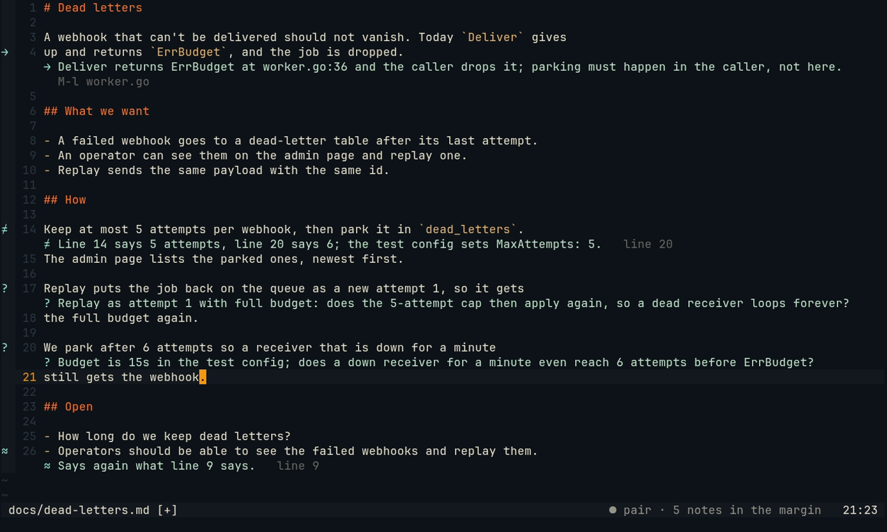
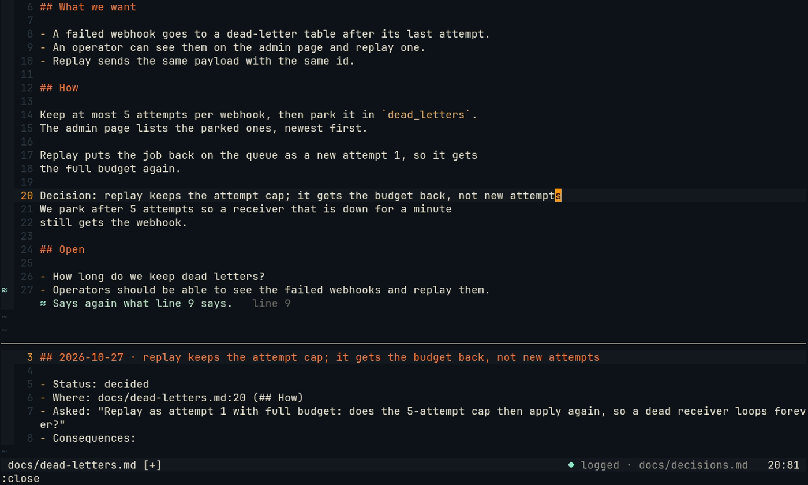
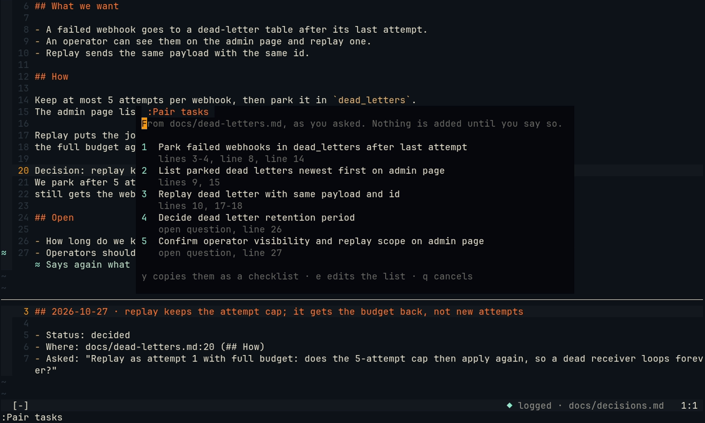

# Notes in the margin

You think in Markdown: a design note, an idea, a plan. Pair reads along and puts at most five marks in the margin.
It asks and points. It never writes your prose.


*The capture is the plugin and the daemon as shipped, in a clean Neovim with the ayu colorscheme. Only the model's
words are scripted. It is recorded from [a tape](captures/tapes/notes.tape) on the sample project's
[design note](captures/notes/dead-letters.md).*

## The marks

| Mark | What it says | Made by | The key after it |
| --- | --- | --- | --- |
| `?` | a question the note does not answer | the model | |
| `≠` | two lines that cannot both be true, or a line the code contradicts | the model | `line 20`: where the other line is |
| `→` | a claim that depends on code, and what the code does | the model | `M-l worker.go` opens the code in a split |
| `◆` | a decision worth logging | a rule for lines that start with `Decision:`, the model for others | `M-d logs it` |
| `≈` | a paragraph that says again what an earlier one says | a rule | `line 9`: the one it repeats |

Each mark is a glyph in the sign column and one line of Pair's words under the line it is about, in Pair's
[visual language](neovim.md#a-few-marks-one-accent): the same accent, the same fade-in, no boxes. The statusline
says `● pair · 5 notes in the margin`.



**When they come.** At each pause in your typing (`typingPauseMs`), the rules look at the note: a paragraph that
repeats an earlier one, and a `Decision:` line that is not in the log yet. When you have stopped writing for 10 s,
the Partner's model reads the note, numbered, with the code it names: each name in backticks, and each camel or
snake word outside them, found in the project with `git grep` (where it is defined, if a line defines it, in C,
Odin, Zig, C3, Go and the like). It answers with at most five marks as JSON, and Pair keeps only those that hold
up: a known kind, on a written line that is no heading, a contradiction with its other side, and a file that exists
for a link. An empty answer is asked once more: without thinking, a model now and then answers `[]` for a note with
plain contradictions in it. Rules come first, so the
five are the repeats, then the decisions, then the model's marks in its order. The note is read again only after it
changed.

**When they go.** You change a marked line and its mark goes; a contradiction also goes when you change its other
line. A line that only moves (you add a line above) keeps its mark. `:Pair clear` takes them all away.

**Why a rule finds the repeat.** A model reading a note misses a paragraph that says again what an earlier one
said: in the research behind this feature, the note's last line repeated line 9 almost word for word and none of
the model's marks said so. Two paragraphs repeat each other when they share at least three idea words (no stop
words, plurals and verb endings dropped) and those words carry at least half of what the two say, each word
weighed by how rare it is in the note. A decision restates the question it settles, so it is never a repeat.
Paragraphs that are parallel are no repeats either, however alike they read: two allocator sections, three build
targets, option A and option B each say something of their own. A paragraph is about its label (`Option A:`,
`` `debug`: ``) when it has one, else its first idea word ("The arena allocator …" is about the arena); two
labelled paragraphs with different labels, or two whose subject the other does not mention, are parallel.

## The decision log

Write a decision as a line that starts with `Decision:` (also `- Decision:` or `**Decision:**`). At the next pause
it gets `◆`, and `Alt-d` (`<M-d>`, or `:Pair decide`) logs it in `decisions.md` next to the note, in the spirit of
[Nygard's architecture decision records](https://cognitect.com/blog/2011/11/15/documenting-architecture-decisions):

```markdown
## 2026-10-27 · replay keeps the attempt cap; it gets the budget back, not new attempts

- Status: decided
- Where: docs/dead-letters.md:20 (## How)
- Asked: "Replay as attempt 1 with full budget: does the 5-attempt cap then apply again, so a dead receiver loops forever?"
- Consequences:
```

- The decision is in your words, and so are its consequences: the line is left for you to fill in. `Asked` quotes the model's question or contradiction in the same section that the
  decision answers (the one that shares most words with it, else the nearest above), and that mark goes.
- A later decision about the same thing (same note, same section, mostly the same words) **supersedes** the old
  entry: it stays, and its status says `superseded by 2026-10-28 · …`. Nothing is deleted.
- A decision logged already is not logged again. Going back to one that was superseded is a decision of its own: it
  is logged again, and supersedes the one in between.
- The log opens in a split below the note, at the new entry; your cursor stays in the note, and the statusline says
  `◆ logged · docs/decisions.md` for a few seconds. **Pair does not write the file:** the entry is in the log's
  buffer, and you save it, like any change Pair suggests.
- `Alt-d` on a line the model marked `◆` logs that line as it stands.



## Tasks, only when you ask

`:Pair tasks` reads the note in the current buffer and lists its work as tasks, in a panel: each with the lines it
comes from, and an open question as a task to decide it. Nothing is added anywhere until you press `y`. `e` lets you
edit the titles first; `q` or `Esc` closes the panel.

- With a `taskCommand` in the config, `y` runs it once for each task, in the project, with `{title}` and
  `{description}` (for example `From docs/dead-letters.md, lines 3-4.`) put in as whole words, never through a shell:

  ```jsonc
  {"taskCommand": ["gh", "issue", "create", "--title", "{title}", "--body", "{description}"]}
  ```

  Or your board's own `add` command. The chat says what was added, or why not.
- Without one, `y` copies them as a Markdown checklist (`- [ ] title (lines 3-4)`) for you to paste.



## What the triggers mean in prose

Unasked remarks about a note go through the [speak gate](watcher.md) like any other: the Watcher scores the moment,
the budget limits how often Pair speaks, and its words show under your line.

| Trigger | When | What Pair does |
| --- | --- | --- |
| `note_stall` | you wrote a line that ends with `?` and then no new words for 90 s (not after 5 min: you are away) | asks one question back, at most 18 words, about the note or the code it names; never the answer |
| `note_drift` | a minute after you begin a section whose heading and words share none with the note's title or the goal | reads the note; if the section has left it, asks once: "is this still the dead-letters note?"; else stays silent |
| repeated idea | at the pause | the `≈` mark above, with the line it repeats |
| contradiction | when the model reads the note | the `≠` mark |
| claim about code | when the model reads the note | the `→` mark; `Alt-l` opens the code |
| decision | when you say so | `Alt-d`; see [The decision log](#the-decision-log) |
| tasks | when you ask | `:Pair tasks`, and a `y` |

Both remarks are one question and nothing else, and Pair holds them to it: it shows the first question of the
answer alone (at most 25 words, else nothing), says no second remark, and refuses to point at lines meanwhile. In
live runs, models otherwise added a second remark about a contradiction the margin already showed.

The Watcher is asked about the question or the section itself: would a question back help, and is this section about
something other than the note's title. Asked only whether a remark would save time, a tested model scored a stalled
question 3 and an off-topic section 2, under the normal bar of 6, since nothing failed; asked this way, 7 and 8, and
2 for a section on the note's own subject.

## The note as a brief for /gen

`NOTES.md` at the project root is also the brief that every [/gen request](gen.md#the-brief) runs against, with the
goal and the board task; `/brief <note>` or `:Pair brief` in a note pins another one. Pair reads it there as here:
it never writes it. A request that contradicts a line of it asks you first, and the debrief quotes the line its code
goes against (`≠ brief "…" NOTES.md:11`). For a `/gen file` request, `Alt-d` on a `? guessed` line of
[`:Pair gen list`](gen.md#the-review-list-pair-gen-list) logs that guess as a decision in `decisions.md`, as for a
decision of the note's.

## Keys and options

`setup({decide_key = '<M-d>', link_key = '<M-l>'})`: both are mapped in Normal mode, only in a note that has a mark
they act on, and only where you have no mapping of your own; `false` for none. `:Pair decide` and `:Pair tasks`
work either way. The glyphs are `question`, `contradiction`, `code`, `decision` and `repeat` in
[`glyphs`](neovim-plugin.md#setup).

## Limits

- The model reads the note without thinking: in testing, a thinking model took 25 to 55 s per note and found no
  more. It reads a note at most once per change, in the Partner's model, outside its conversation, so marks do not
  become chat history.
- Code is found by name with `git grep`, so only in a git project, in tracked files, and only the first
  definition of each of at most 10 names.
- A mark sits on the line it was made for, found again by its text within 20 lines; a line you change loses it.
- The log goes next to the note; one log per folder of notes.
- `Asked` takes the model's marks of the same section; a decision with no question before it has no `Asked`.
- Tasks are one model answer: at most 8, titles of at most 60 characters.
