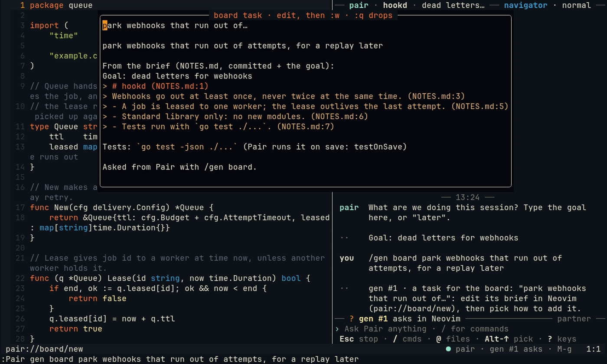
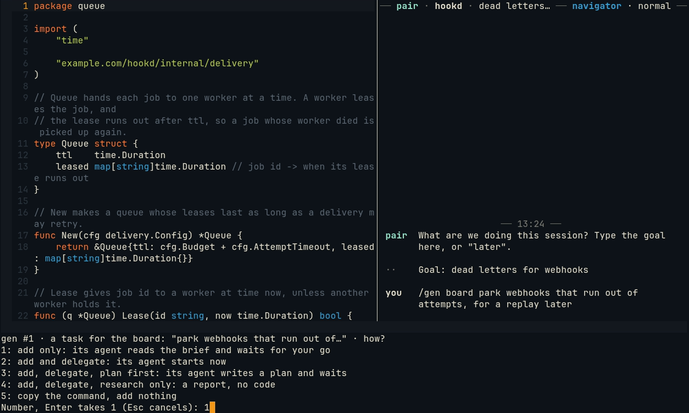
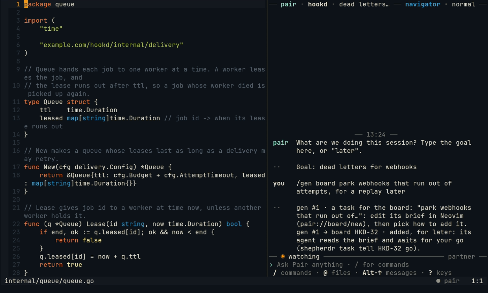
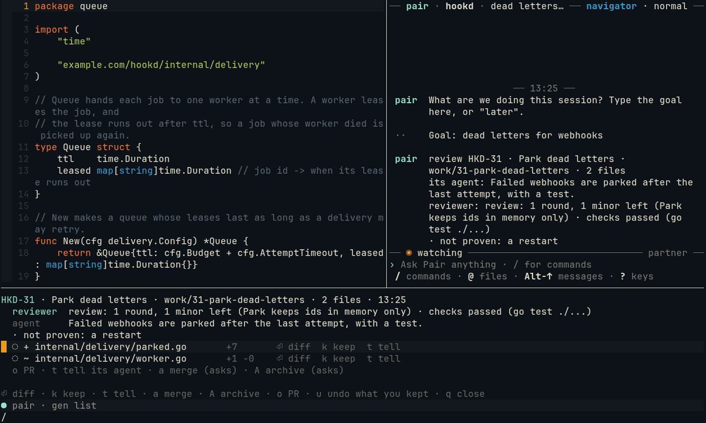
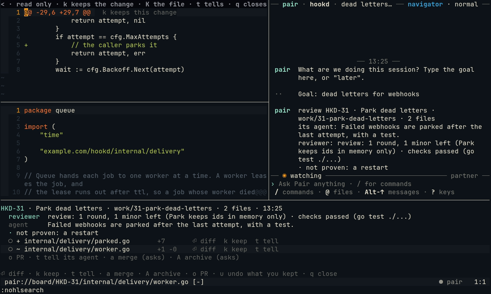
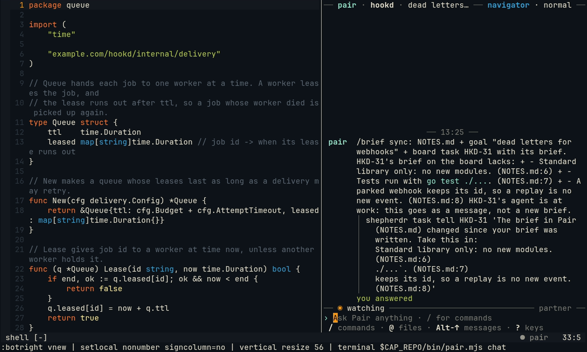

# The board: hand a task over, review it back

Some work is too big to watch: many packages, an install, something to run while you are away. `/gen board` hands
it to your work board, [Shepherdr](https://github.com/eliasstravik/shepherdr), as a task whose brief Pair writes
from yours. When its agent is done, `:Pair review` opens its branch so you can keep the pieces you want. Pair adds,
tells, merges or archives nothing without your pick.

You need Shepherdr running, with this repository as one of its spaces.

## 1. Hand it over

In Neovim:

```vim
:Pair gen board park webhooks that run out of attempts, for a replay later
```

No model runs. A window opens with the task: its title on the first line, its brief under it, written from your
request and your brief (the goal and `NOTES.md`, quoted with `file:line`) and your test command.



Edit what you like, then `:w`. `:q` drops it and adds nothing. A note with changes you have not committed is copied
in whole, since the task's agent works in a git worktree and sees only what is committed.

## 2. Pick how to add it

`:w` asks how:



| Pick | The task's agent |
| --- | --- |
| add only | reads the brief and waits for your go (`shepherdr task tell <id> go`) |
| add and delegate | starts on it now |
| plan first | starts, writes its plan, and waits for your go |
| research only | writes a report, changes no code |
| copy the command | nothing is added: the command goes to your registers, to run yourself |

The chat says what the board made: `gen #1 → board HKD-32 · added, for later`.



From the chat, `/gen board <what>` asks the same, one key per pick; to edit the brief first, ask from Neovim. A
request that runs past `/gen`'s limits offers this itself: `/gen board #9` hands that request on with what it found.

## 3. Hear when it is ready

You keep working. When the task needs you, is ready to merge or is done, Pair says so in one line in the statusline
at your next pause, never while you type. `:Pair agents` (or `/agents` in the chat) lists every task, those that
need you first: `Enter` goes to its agent, `o` opens its report or pull request, `d` its diff, `t` a terminal in its
worktree, `r` its review.

## 4. Review it back

On the line of a task ready to merge, `Alt-r`, or:

```vim
:Pair review HKD-31
```

Its branch opens as a list: what its reviewer and agent said, then its files, those that matter to your brief first.



| Key | What it does |
| --- | --- |
| `Enter` | The file's diff, read only. In it, `k` keeps the change under the cursor, `K` the whole file, `q` goes back |
| `k` | Keeps the whole file in yours, unsaved |
| `t` | Tells the task's agent something you write |
| `a` | Asks its agent to merge it, on a pick |
| `A` | Archives the task, on a pick |
| `o` | Opens its pull request |
| `u` | Takes back all you kept |



What you keep lands in your buffers as they are now, unsaved and marked `┊` until you make it yours, a hunk at a
time. Once you have kept pieces, merging the whole branch would bring them in twice: Pair says so, and offers to
archive the task instead.

## 5. Keep the task in step: /brief sync

While a task's agent works, your note may move on. On the task's branch, `/brief sync` in the chat (or
`:Pair brief sync`) says what the task's brief on the board lacks: `+` a line of your note it does not have, `-` a
line it quotes that your note no longer has, `+ decided` a decision logged since.



`y` tells its agent (`shepherdr task tell`), `c` copies the command, `n` leaves it. A task waiting for a go is told
that this is no go.

## More

[/gen board](../gen.md#gen-board-a-task-for-the-board), [reviewing a board task](../gen.md#reviewing-a-board-task-pair-review),
[/brief sync](../gen.md#keeping-the-task-in-step-brief-sync) and [your other agents](../agents.md).
