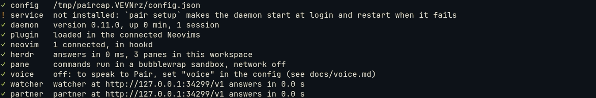

# The first ten minutes

From nothing to Pair beside you in a project: install it, give it a model, check it with `pair doctor`, and open
your first session. You need Node.js 22.19 or newer, Neovim 0.11 or newer, and a model: a local OpenAI-compatible
server, an API key, or a subscription login where the provider allows it.

## 1. Install the daemon

```sh
npm install -g github:makefunstuff/pairing-buddy   # puts `pair` on your PATH
pair setup
```

`pair setup` writes a commented config to `~/.config/pairing-buddy/config.json`, offers a login to a model provider
(Enter skips it), installs the daemon as a user service that starts at login, and starts it.

## 2. Add the plugin to Neovim

With lazy.nvim:

```lua
{
  'makefunstuff/pairing-buddy',
  main = 'pair',
  lazy = false,
  opts = {auto_connect = true},
}
```

With `auto_connect`, every Neovim connects to the daemon when it starts.

## 3. Name your model

In `~/.config/pairing-buddy/config.json`, set one model for both roles:

```jsonc
"model": {"api": "openai", "baseUrl": "http://localhost:8080/v1", "model": "your-model"}
// or, after `pair auth login PROVIDER`:
// "model": {"provider": "openai", "model": "your-cloud-model"}
```

Save it. The daemon takes the change as you save; no restart.

## 4. Check it: pair doctor

```sh
pair doctor
```

One line per part: `✓` is fine, `!` works but could be better, `✗` needs fixing, and each line that is not `✓` says
the fix. Run it again after each fix.



The lines you need for a first session are `config`, `daemon`, `plugin` and your model: one line, `models`, when
both roles share one model as above, or `watcher` and `partner` when each has its own, as in the picture.
`neovim` says `none connected` until a Neovim is open; `voice` is off until you set it up ([Voice](voice.md)).

## 5. Open a project

Start Neovim in your project, in the folder you work in:

```sh
cd ~/src/yourproject && nvim
```

The project is the git root of that folder, and it gets its own session. Then open the chat beside it:

- **In herdr**, run `pair` in a pane next to Neovim: the chat pane opens there.
- **Without herdr**, run `:Pair chat` in Neovim: the same chat opens on the right, in a terminal buffer.

The chat asks what you are doing this session, unless the branch name or a board task already says. Type the goal
and `Enter`, or `later`. `:Pair goal <what>` sets it from Neovim.


## 6. Work

Work as you always do. Pair stays quiet until something is worth a word, then says one line under yours:

| Key | What it does |
| --- | --- |
| `Alt-j` | Go where Pair points; `Ctrl-O` comes back |
| `Alt-y` | Take a suggested change, unsaved, as your own edit |
| `Alt-u` / `Alt-n` | Tell Pair that remark was useful / noise |
| `:Pair ask <question>` | Ask from Neovim; the answer shows under your line and in the chat |

In the chat, type a question and `Enter`. The session ends by itself after 45 minutes without you; `:Pair end` ends
it now, with a short debrief.

## Next

- [The chat pane and its keys](chat-pane.md), then [roles and handing over](roles-and-hand-over.md).
- More: [Getting started](../getting-started.md), [Install and daily use](../install.md),
  [Troubleshooting](../troubleshooting.md) for each `pair doctor` line, and the optional
  [shell hook](../cli.md#pair-shell-hook).
