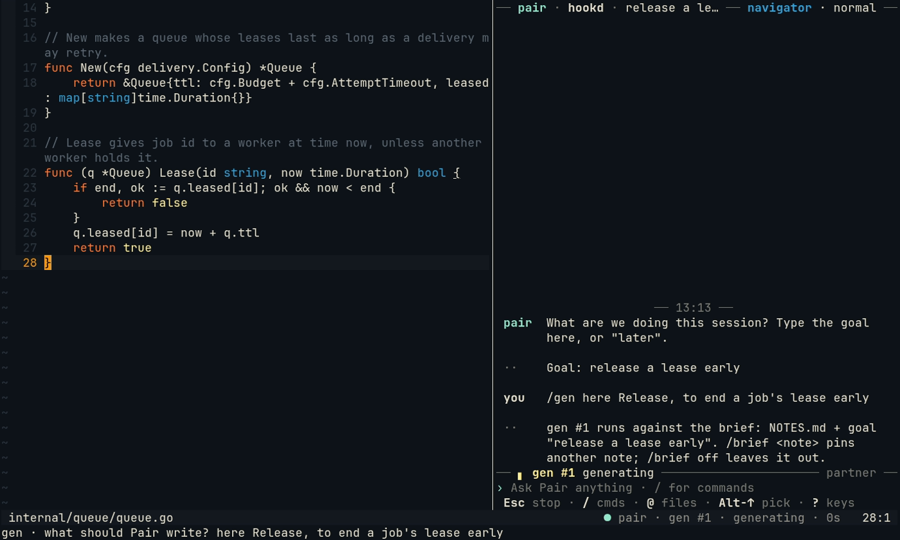
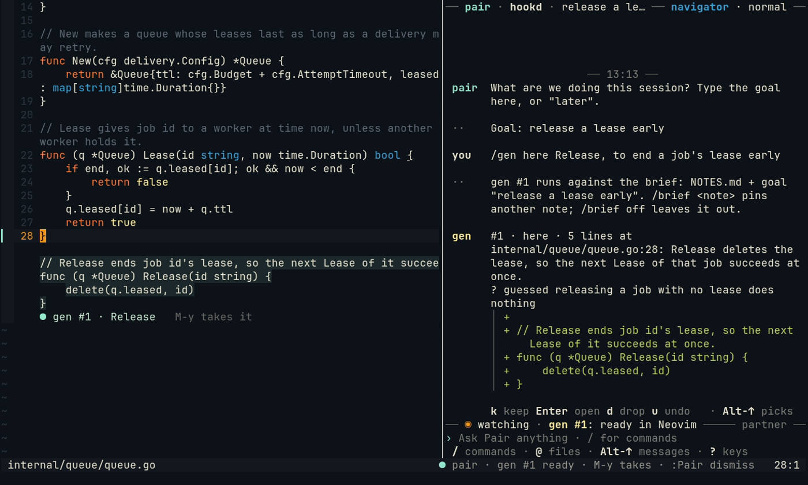
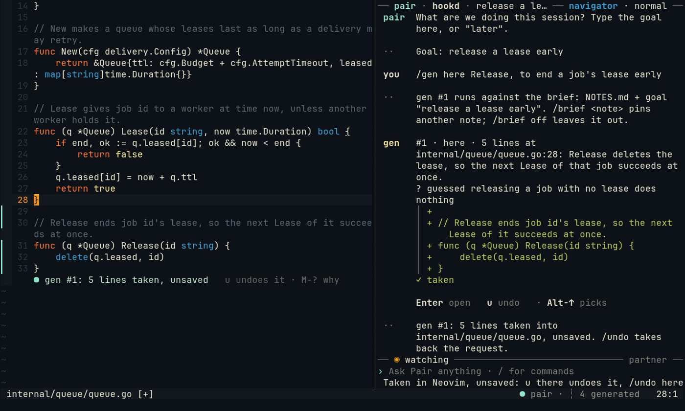
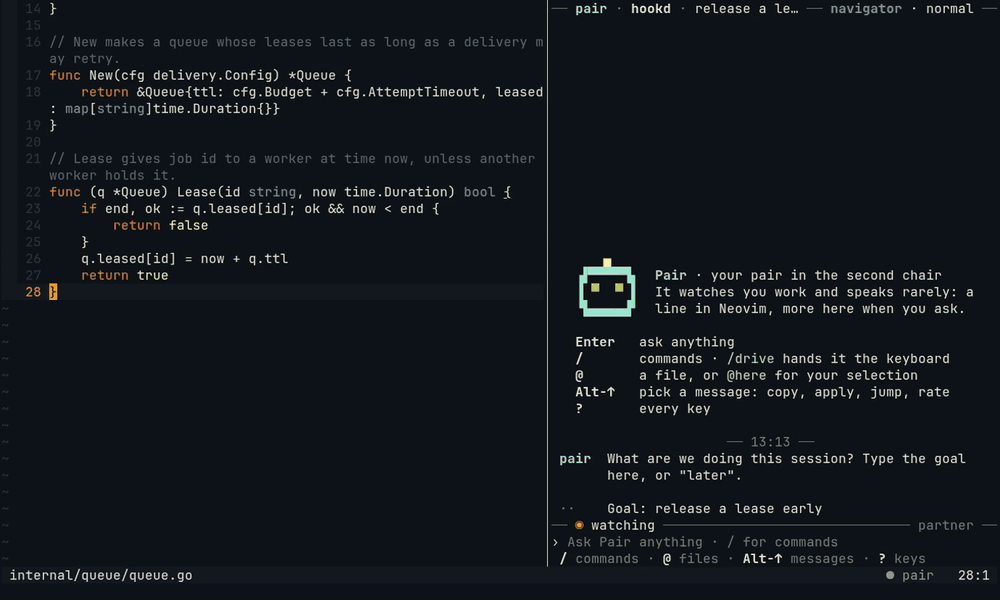
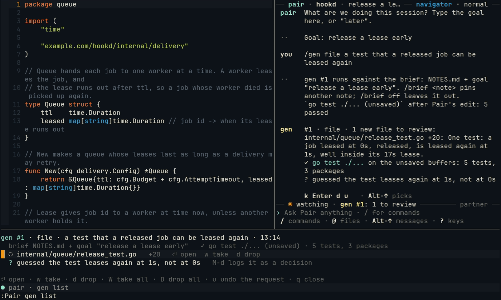
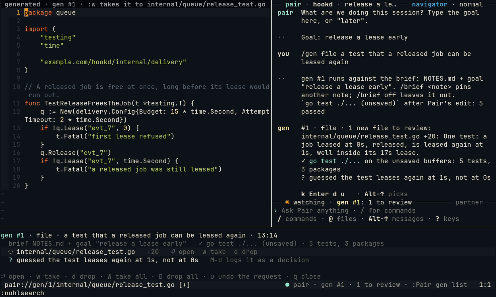

# Asking for code: /gen here and /gen file

Pair writes code only when you ask. `/gen here` puts a proposal at your cursor, to take with one key; `/gen file`
drafts new files as buffers you review and take with `:w`. Either way your disk changes only when you save, and
`/undo` takes back the whole request.

## Code at your cursor

1. In Neovim, put the cursor where the code goes (or select the lines it should replace) and press `Alt-g`
   (or `:Pair gen`). A prompt asks what to write. Start with the shape, `here`, then say what:

   ```text
   here Release, to end a job's lease early
   ```

   Without a shape word Pair guesses one and asks first; `Enter` takes the guess. `Tab` completes the shape.
   From the chat, `/gen here <what>` does the same, at your cursor in Neovim.

   

2. Keep working. The request has a number, `gen #1`, and the statusline and the chat say `generating`. It runs
   against your brief, the goal and `NOTES.md` when there is one: the first request says so in the chat.
3. At your next pause the code shows as ghost lines under the place you asked, with `M-y takes it`. The chat shows
   the same code as a diff on a **gen card**, with what Pair guessed (`? guessed …`).

   

4. `Alt-y` takes it into your buffer, unsaved, as one undo step. `:Pair dismiss` drops it instead. On the gen card,
   `Alt-↑` then `k` takes it too.

   



## Making it yours

Taken code is marked `┊` in the sign column, and the statusline counts it (`┊ 4 generated`): it is not yours yet.
Edit a part of it and that part is yours; `:Pair own` makes all of the file's yours once you have read it.
`:Pair today` and `/gen` in the chat say how much is still not yours.

To take the whole request back, `/undo` in the chat (or `u` on its line in `:Pair today`), even after you edited
around it.

## New files

1. In the chat, `/gen file` and what the files are for (or `:Pair gen file …` in Neovim):

   ```text
   /gen file a test that a released job can be leased again
   ```

2. When it is done, the chat says what it made and how its check went (your tests, run on the unsaved files). The
   files are loaded in Neovim as buffers to review; nothing opens by itself.
3. `:Pair gen list` lists them: `Enter` opens one, `w` takes it, `d` drops it, `q` closes the list.

   

4. In the file, the winbar says `generated · gen #1 · :w takes it to internal/queue/release_test.go`. Read it, change
   it if you like, and `:w`: that writes it to its path. `:wa` elsewhere skips files to review, so one is never
   taken by accident.

   

A change to a file you already have is never a new file: it shows in that file as a suggestion, taken with `Alt-y`.

## More

[/gen](../gen.md): the shapes, the brief and its checks, the gen card's keys, the limits, and owning generated code.
Next: [trying a sample](gen-try.md) and [a scaffold](gen-scaffold.md).
