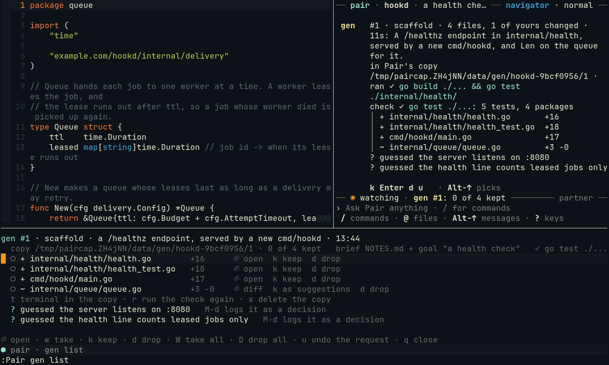
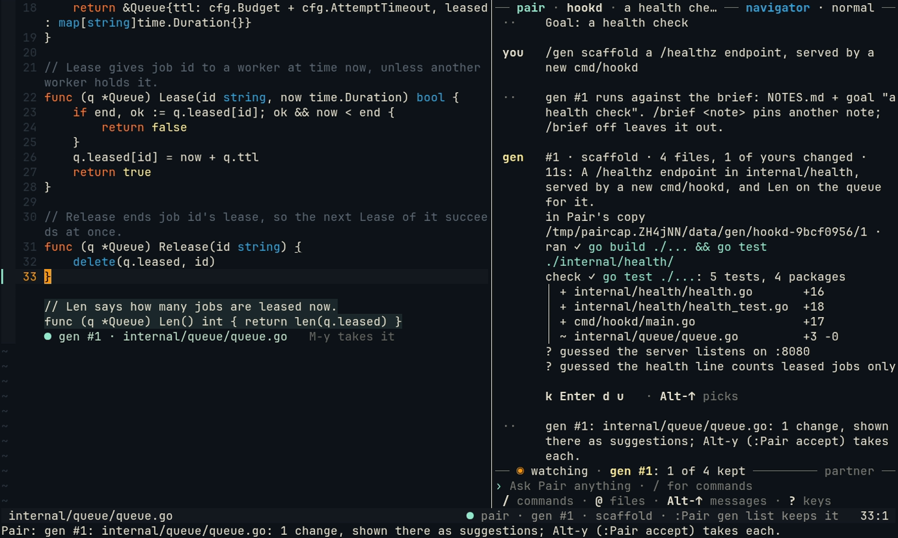

# A scaffold: /gen scaffold

For many files and the wiring that joins them to your code (an endpoint and its server, a page wired into the router),
`/gen scaffold` builds them in a copy of your project, runs and checks them there, and lets you keep what you want a
file at a time. Nothing else reaches your project.

## 1. Ask

In the chat (or `:Pair gen scaffold …` in Neovim):

```
/gen scaffold a /healthz endpoint, served by a new cmd/hookd
```

Pair never picks a scaffold by guessing alone: a guess is always asked first. It copies the project as you see it,
unsaved buffers included, to its data folder, and works there: it writes files, changes yours in the copy, and builds
and tests in a sandbox with no network. An install it would need (`npm install …`, `go get …`) is not run but listed
for you.

## 2. Read the debrief

When it is done, the chat's gen card lists what it made, `+` a new file and `~` a change to one of yours, with the
lines added and removed, how its runs and the check went, and what it guessed. The statusline says
`gen #1 · scaffold · :Pair gen list keeps it`. Nothing opens by itself.

## 3. Keep it a file at a time

`:Pair gen list` lists the scaffold's files:



| Key | What it does |
| --- | --- |
| `k` | Keeps the file. A **new file** opens as a buffer to review (`:w` in it takes it). A **change to a file you have** shows in it as suggestions, one per hunk |
| `Enter` | Opens it: a new file as the copy's file, a change as a diff of your file and the copy's |
| `d` | Drops it; `k` keeps it after all |
| `r` | Runs the check again in the copy |
| `t` | Opens a terminal of yours in the copy |
| `x` | Deletes the copy, after a yes |

There is no key that keeps them all: you read each one before it is yours.

A change to your file lands on your buffer as it is now, so lines you typed since stay. `Alt-y` takes each
suggestion:



From the chat, `/keep internal/health/health.go` keeps one file, and `/gen drop` deletes the copy.

## 4. On a branch instead: --branch

```
/gen scaffold --branch a /healthz endpoint, served by a new cmd/hookd
```

builds it in a git worktree on a new branch `gen/<n>` instead of a copy. Choose it when you want to commit the
scaffold as it is, or open it as a worktree of its own (it gets its own session, see [several worktrees](worktrees.md)).
The worktree starts from `HEAD`, so your uncommitted changes are not in it. Keeping works as for the copy; `x`
removes the worktree, and the branch too while it has no commit of yours.

## More

[Many files: /gen scaffold](../gen.md#many-files-gen-scaffold): the copy, its limits, `gen.network`, changes as
suggestions, and how long a copy stays. Too big even for this? [Hand it to the board](board.md).
