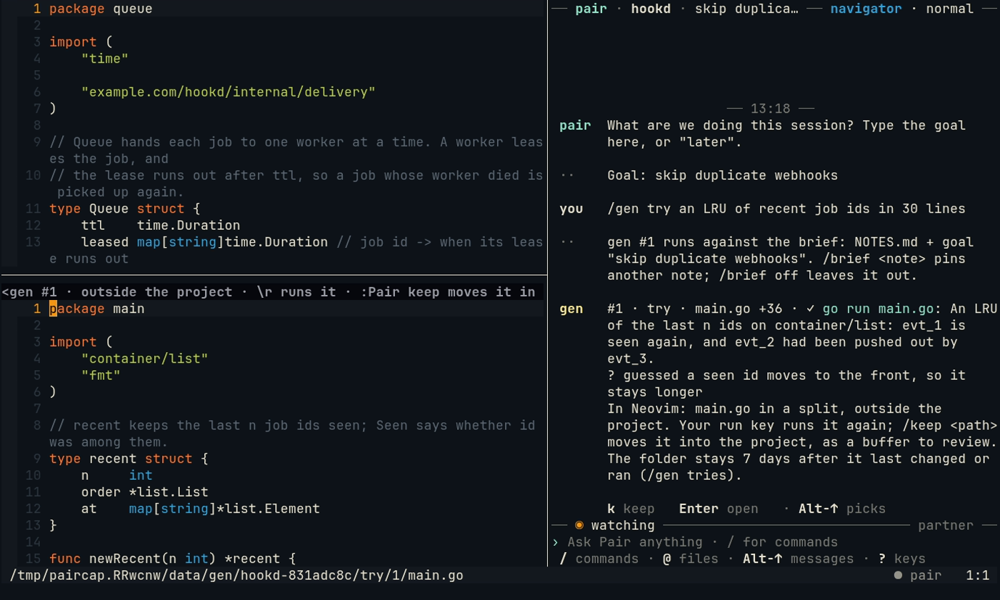
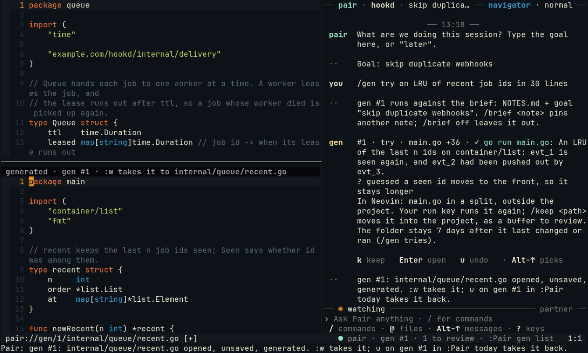

# Trying a sample: /gen try and /keep

Sometimes you want to see code work before it goes anywhere near your project: how a library feels, an algorithm, a
pattern. `/gen try` writes a sample in a folder of Pair's own, outside the project, runs it there, and opens it for
you to read, change and run again. `/keep` brings it in once you want it.

## 1. Ask for a sample

In the chat (or `:Pair gen try …` in Neovim):

```text
/gen try an LRU of recent job ids in 30 lines
```

Pair writes the files in its own folder (`~/.local/state/pairing-buddy/gen/<project>-<hash>/try/<n>/`) and runs them
in its pane, in a sandbox where only that folder is writable and there is no network. It fixes what the run shows.

## 2. Read it

When it is done, the sample's main file opens in a split under your window; your cursor stays where it was. The
winbar says what it is: `try · gen #1 · outside the project · \r runs it · :Pair keep moves it in`. The chat says
what it made and how its run went.



## 3. Change it, run it again

It is a real file: edit it. `\r` in it (your local leader, then `r`), `:Pair gen run` or `/gen run` in the chat runs
it again in Pair's pane, and Neovim shows the end of the output. Ask about it in the chat, too: `why does Seen move
an id to the front?` gets an answer about the sample's lines.

Your edits in a try are not watched: Pair makes no remarks on it.

## 4. Keep it, or not

To bring it into the project, give it a path. In the sample's window:

```vim
:Pair keep internal/queue/recent.go
```

or `/keep internal/queue/recent.go` in the chat. It opens as a buffer to review, unsaved, exactly like a
[`/gen file`](gen-here-and-file.md#new-files) one: `:w` in it takes it. The path must be new; `/keep` never writes
over a file.



If you do not keep it, do nothing: the folder stays seven days after it last changed or ran, then goes. `/gen tries`
lists the folders still there.

## More

[Samples: /gen try and /keep](../gen.md#samples-gen-try-and-keep): the sandbox, `gen.network`, which file `/keep`
takes, and undo.
