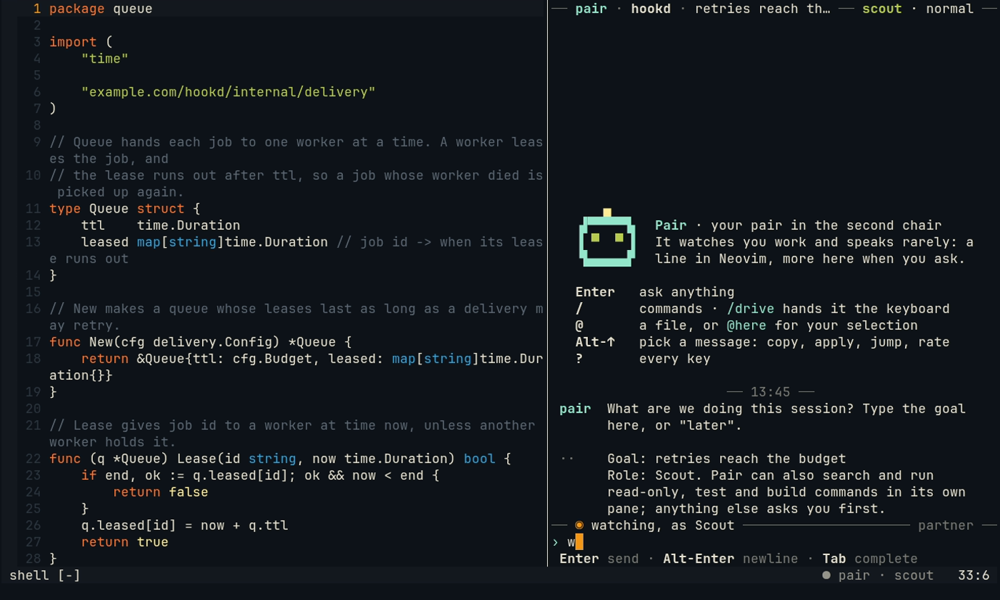
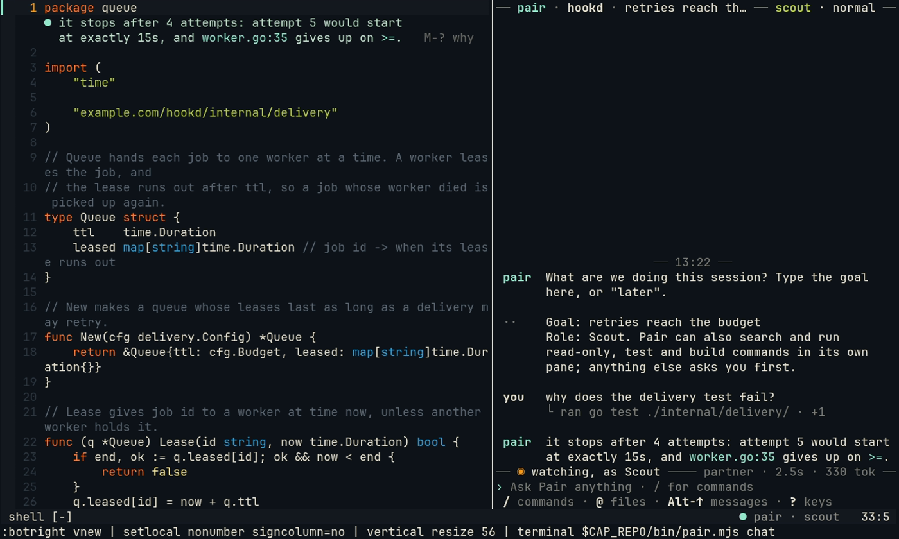

# Roles and handing over

Pair has one role at a time. Navigator, the default, watches, points and suggests. Scout also runs commands, in its
own pane where you see them. The Driver types a change into your buffer while you watch, when you hand it the
keyboard. This shows how to switch, hand over, and take the keyboard back.

## 1. Switch to Scout, and back

In the chat, `/scout` (or `:Pair scout` in Neovim). The header says `scout` in green, and the chat says what Scout
may do.



Now a question may run a command. Ask `why does the delivery test fail?`: Scout runs the test in its own pane and
answers with what it found. Read-only commands, tests and builds run; writes and installs ask you first; commits,
pushes, the network and `sudo` are refused.



`/navigate` (or `:Pair navigate`) goes back to Navigator.

## 2. Hand over the keyboard

For one change, in Neovim:

```vim
:Pair drive the edge cases
```

or in the chat `/drive the edge cases`, or a line that starts "you take it" or "your turn" (`you take it: set the
timeout to 30 s`).


1. The statusline says `pair has the wheel · any key takes it back`.
2. Pair types the change as ghost text with its own cursor. A line enters your buffer only when it is whole; each
   line it changed gets `▎` in the sign column.
3. It checks the **unsaved** buffer with your tests (or your last build and run) and says so once, in the chat:
   `Ran your npm test on it: 9 pass.` Then it hands back: its words under the last line it changed, `✓` or `✗`, and
   `u undoes it`. One change gets no role lines in the chat; `:Pair today` still lists it.
4. Nothing is saved. Read it, then `:w`, or `u` to take it away (one `u` per edit, at most five edits).


## 3. Take it back

Any key you press in Neovim while Pair has the wheel takes it back. While it is still typing, what it typed so far
is undone, and the key does nothing else. Scrolling and clicking to watch are not keys. Typing in the chat pane is
not either: that is where you talk to it.

## 4. Without a test, and for longer

- **Without a test**, say what you expect to see: `you take it: make the ids spread over the table, avg probe stays
  under 2`. Pair builds and runs the unsaved buffer with your own last command, and hands back with the line it
  printed next to your target ([the hand-over without a test](../driver.md#the-hand-over-without-a-test)).
- **For longer**, `:Pair drive!` or `/drive!`: each request after it is a hand-over of its own, until any key or
  `/navigate` takes the wheel back.

## More

[Roles](../roles.md), [Scout](../scout.md) and [Driver and suggestions](../driver.md).
