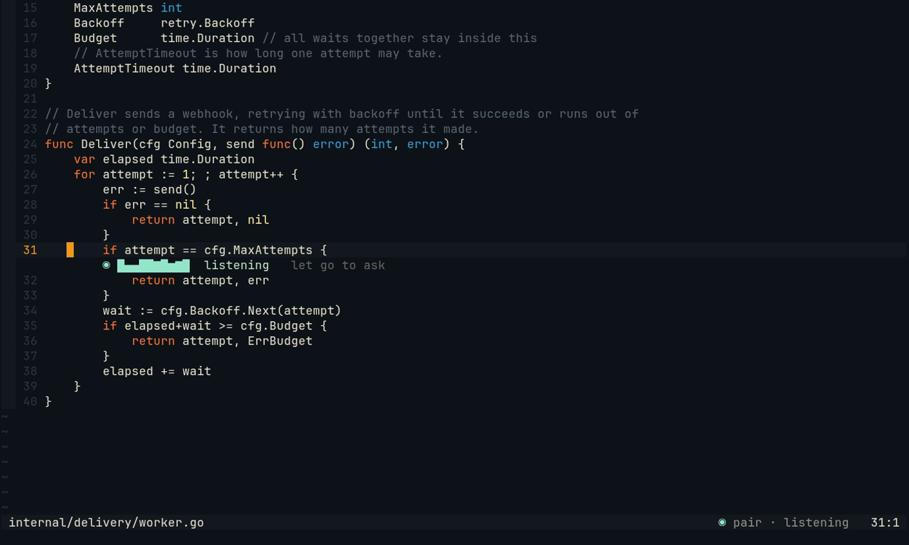
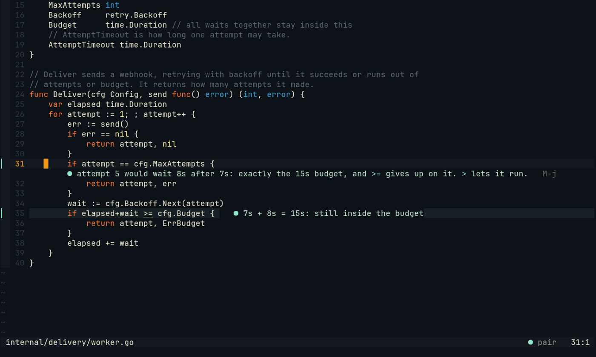
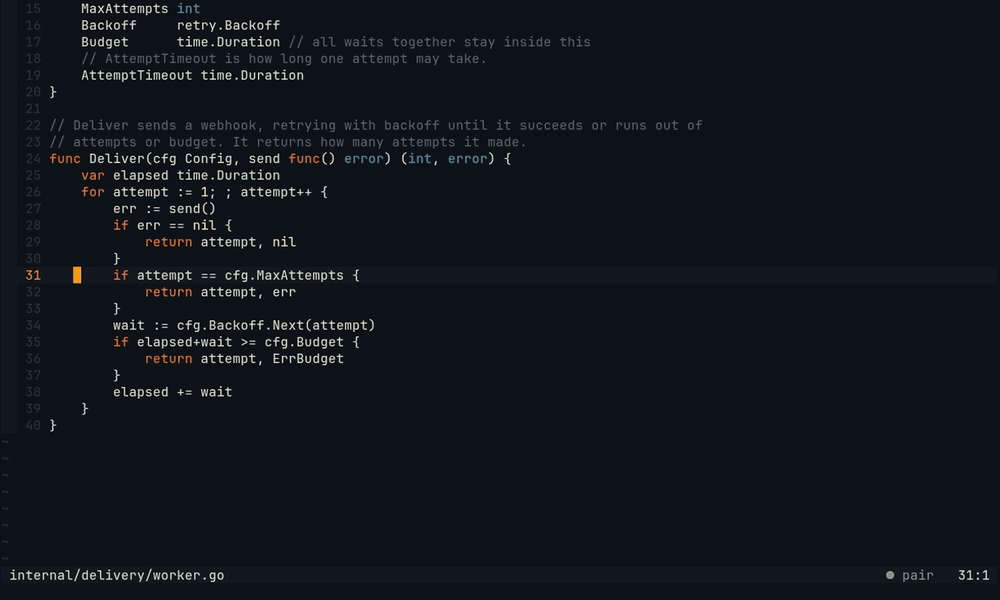

# Voice

Hold `Alt-t` in Neovim, ask aloud, let go: Pair answers under the line you asked on, and can answer aloud too.
Hearing and speaking run on your CPU with LFM3-Omni, one model for both, by default; whisper.cpp or OpenRouter can hear
instead. Voice is off until you set it up; this takes about five minutes and one 4.0 GB download.

## 1. Choose who hears you

- **LFM3-Omni, on your machine.** Nothing leaves it. It hears well (2% of words wrong on human speech) and reads
  answers aloud in a natural voice. It needs a 4.0 GB download that Pair makes only when you say so, 8.2 GB of disk in
  all, and up to 6 GB of memory while it speaks. It needs Python 3.12 to 3.14; Pair installs the rest itself.

- **whisper.cpp, on your machine.** Smaller (142 MB) and lighter, and it reads nothing aloud by itself. Build it once:

  ```sh
  git clone --depth 1 https://github.com/ggml-org/whisper.cpp ~/src/whisper.cpp
  cd ~/src/whisper.cpp
  cmake -B build -DCMAKE_BUILD_TYPE=Release -DBUILD_SHARED_LIBS=OFF
  cmake --build build -j --target whisper-cli
  sh models/download-ggml-model.sh base.en
  ```

- **OpenRouter.** No build: a transcription model hears the recording, and a speech model can read answers aloud.
  The recording leaves your machine, and each question costs one transcription. You need an OpenRouter key.

You also need a recorder: `pw-record`, `parec` or `arecord`, which most desktops have.

## 2. Add it to the config

For LFM3-Omni:

```jsonc
"voice": {}
```

Then, in Neovim, install it once:

```
:Pair voice on
```

Neovim says what comes and how big before it starts (`Voice: installing its Python packages (42 MB from PyPI, …),
then LFM3-Omni-2B, 4.0 GB from Hugging Face …`), then how far it is. It takes a minute or two on a fast line. The
packages go into the same venv as search by meaning's, by their pinned SHA-256. `:Pair voice off` stops it, or deletes the model
later.

For whisper.cpp:

```jsonc
"voice": {
  "model": "~/src/whisper.cpp/models/ggml-base.en.bin",
  "whisper": "~/src/whisper.cpp/build/bin/whisper-cli"
}
```

For OpenRouter (the key in a file, or `apiKeyEnv`, or `auth` after `pair auth login openrouter`):

```jsonc
"voice": {
  "openrouter": {
    "apiKeyFile": "~/.config/openrouter.key",
    "hear": "openai/whisper-large-v3-turbo",
    "speak": {"model": "x-ai/grok-voice-tts-1.0", "voice": "eve"}
  }
}
```

Short answers are read aloud only when you are away from the editor: LFM3-Omni does it by default, OpenRouter with
`speak`, whisper.cpp not at all.

## 3. Check it

```sh
pair doctor
```

The `voice` line says what records and what hears: LFM3-Omni and whisper.cpp hear a second of silence and say how long
it took, OpenRouter is asked whether the key and the models are taken. It records nothing, sends no audio and
downloads nothing; without LFM3-Omni's files yet, it says to run `:Pair voice on`.

## 4. Ask

1. In Neovim, on the line you want to ask about, hold `Alt-t`. A meter shows under the line: `listening   let go to ask`.

   

2. Say your question, and let go. The line says `hearing`, then the words Pair heard, then its answer in their
   place, with `M-j` when it points at a line. The whole answer is in the chat too.

   



The first question after the download takes about 15 s to hear, while LFM3-Omni packs its weights for your CPU, once.
From then on a short question is heard in about a second and a half.

If your terminal makes holding awkward, tap `Alt-t` instead: Pair listens until you press it again, and the line
says `M-t again to ask`. Or set
`listen_mode = 'toggle'` in the plugin's setup: press to start, press again to ask. `:Pair listen` works without the
key.

## 5. Talk with it

To hear every answer, not only when you are away, add `"talk": true`:

```jsonc
"voice": {"talk": true}
```

Ask aloud, and Pair answers aloud under your line: the first words come a few seconds after the answer. Ask the next
question the same way. Start typing, or press `Alt-t` again, and it stops at once. Only answers to what you asked are
ever spoken; Pair's own remarks stay quiet text, as rare as before.

## More

[Push-to-talk](../voice.md): every field, the key's timing, spoken answers, and what goes where.
