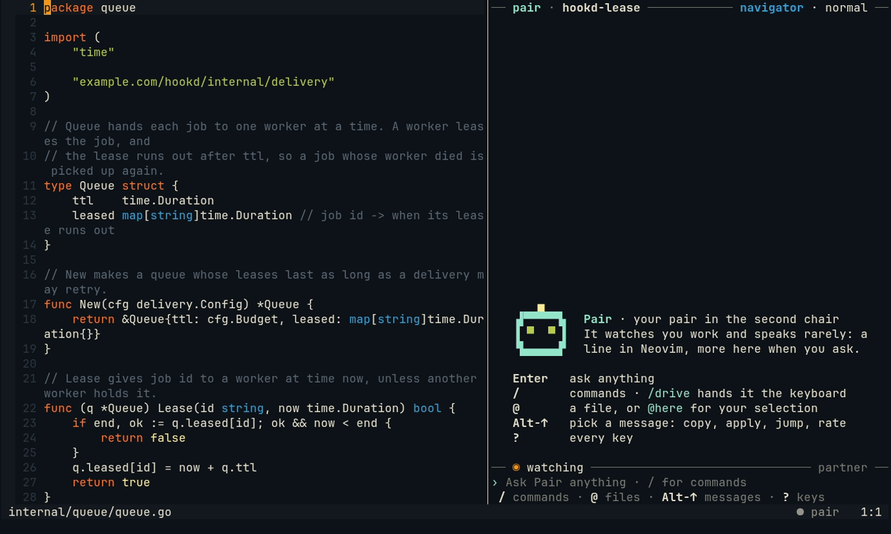

# Several worktrees

Two pieces of work in one repository at once: a fix on one branch, a feature on another. Give each a git worktree,
and each is a project of its own to Pair, with its own session, goal, chat and memory.

## 1. Make the worktree

```sh
cd ~/src/hookd
git worktree add ../hookd-lease -b lease-outlives-attempts
```

## 2. Open Neovim and the chat in it

Start a Neovim **in the worktree**, and its chat beside it: in herdr, a tab (or panes) of its own with `nvim` and
`pair` started there; without herdr, `:Pair chat` in that Neovim.

```sh
cd ~/src/hookd-lease && nvim
```

The project is the git root of the folder Neovim starts in, so this is a new session, with its own goal: the
chat's header names the worktree's folder.



## 3. Switch between them

Go to the Neovim started in the other worktree: its herdr tab or pane, or its terminal window. Each Neovim stays in
the project it connected in. `:cd` to the other worktree does not move its session there; open a Neovim in that
worktree instead. Several Neovims in one worktree share its session.

Everything stays apart: each session has its own goal, tests on save (a [`testOnSave`](../config.md#testonsave)
entry per worktree folder), remarks, ledger and debrief.

## Worktrees Pair makes for you

- **Board tasks** work in worktrees of their own. In `:Pair agents`, `t` opens a terminal in a task's worktree; a
  session opened in a task's worktree leaves that task out of its news ([board](board.md)).
- **`/gen scaffold --branch`** builds a scaffold in a worktree on a branch `gen/<n>`; open it as above and it gets
  its own session ([scaffold](gen-scaffold.md#4-on-a-branch-instead---branch)).

## A monorepo: sessionRoots

In a monorepo the git root is too big for one session. List the folders that are projects of their own in the
config, a folder ending in `/*` for each folder in it:

```jsonc
"sessionRoots": ["~/src/shop/packages/*", "~/src/shop/tools"]
```

Then start Neovim and `pair` in the package (or below it): a Neovim started in `~/src/shop/packages/api/src` pairs in
`~/src/shop/packages/api`. One started at the monorepo's root stays in the root's project.

## More

[Install and daily use](../install.md) (several projects, several Neovims) and
[session roots](../config.md#session-roots).
