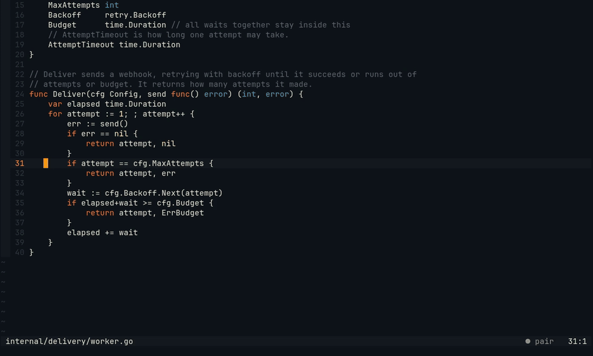
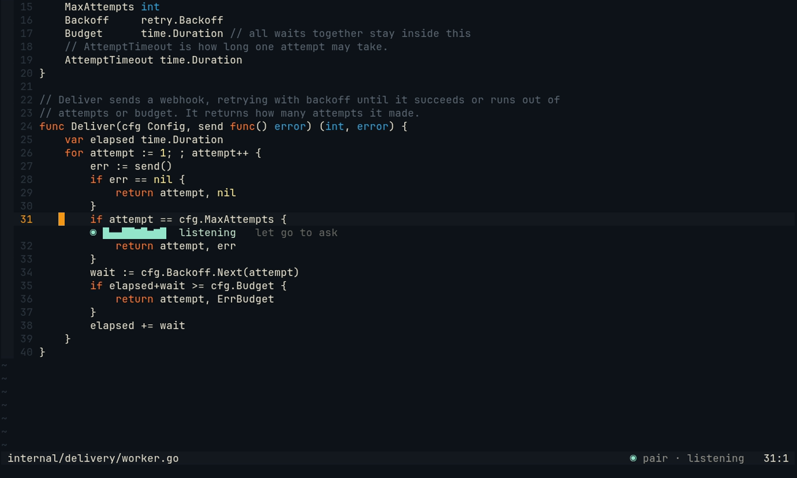
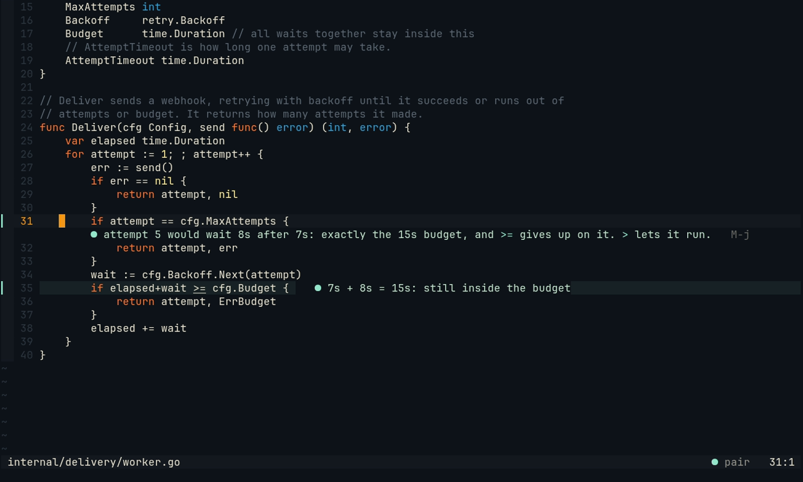

# Push-to-talk

Hold `Alt-t` in Neovim, say what you want to ask, and let go. Pair answers under the line you asked on. Your hands
and eyes stay on the code, and saying the problem out loud is rubber-ducking with a duck that answers.



*Recorded from [the push-to-talk tape](captures/tapes/push-to-talk.tape). The question is spoken by espeak-ng into
the recorder, and whisper.cpp hears it for real; only the Partner's answer is scripted.*

By default everything happens on your machine. [LFM3-Omni-2B](https://huggingface.co/litert-community/LFM3-Omni-2B-LiteRT),
one model that hears and speaks, writes down what you said and reads answers aloud, on the CPU through Google's
LiteRT: a four-second question is heard in about 1.4 s on a desktop CPU, and no GPU is used. It is the model
lfm-pixel runs for dictation, read-aloud and Talk. Its files (4.0 GB) come once, when you say so: `:Pair voice on`.
The audio stays in memory.

Or [whisper.cpp](#whispercpp) hears you instead (a 142 MB model you build and download yourself), or
[OpenRouter](#openrouter) does: a transcription model hears the recording, and a speech model reads answers aloud. With
OpenRouter the recording (or the words read aloud) leaves your machine.

## What you see

| Moment | Under your line | Statusline |
| --- | --- | --- |
| You hold the key | `◉ ▂▅▇▆▃▂▁▃▅▆  listening   let go to ask`: a meter of the last second | `◉ pair · listening` |
| You let go | `⠹ hearing` while LFM3-Omni (or whisper, or OpenRouter) works | `⠹ pair · hearing` |
| It is done | `› why does delivery give up one retry too early?`: your words, as heard | `⠹ pair · thinking` |
| Pair answers | Pair's words in place of yours, with `M-j` when it points at a line | `● pair` |





The question also goes to the chat pane, like a typed one, and the whole answer is there. Pair's words under your
line go with your next edit, as its other words do. It heard nothing (a cough, a key pressed by mistake)? The
line says `◌ heard nothing` for a moment and Pair is not asked. Pair could not answer (its model is down, say)?
The line says `◌ no answer · the chat says why` for a moment, and the chat pane says why. Pair could not hear you (no
microphone, LFM3-Omni is not downloaded yet, OpenRouter did not answer in time, refused the key or is out of credits)? Neovim says
`Pair could not listen: …` and the chat pane says `Pair could not hear you: …`, with what went wrong in plain words.

**Hold or tap.** A terminal sends no key-up, only the key again and again while you hold it. Pair counts the key as
let go when those repeats stop (about 0.2 s after the last one). A short press that does not repeat is a tap: Pair
then listens until you press the key again, and the line says `M-t again to ask`. `:Pair listen` works as a tap, and
`:Pair listen cancel` drops what is being recorded. A recording stops by itself after `maxSeconds`.

**When holding does not work for you.** Letting go is guessed from the repeats, so a terminal that waits long before
it repeats a held key (or does not repeat it at all) turns your hold into a tap. Two settings never guess
(see [the key](#4-the-key)):

- `listen_mode = 'toggle'`: press the key to start, press it again to ask. Holding the key does nothing more, however
  long your terminal waits before it repeats: a press that another follows within `listen_release_ms` is a repeat,
  not a second press. So the press that asks counts once that much time has gone by without a repeat (0.22 s), and
  holding it starts nothing new as long as its repeats begin within `listen_hold_ms`. The line says
  `M-t again to ask` from the start.
- `listen_silence_ms = 1200`: a recording you do not hold (a tap, `toggle`, `:Pair listen`) also asks once you have
  spoken and then paused that long; the line says `M-t again or pause to ask`. Pause counts from the meter: quieter
  than about -42 dB. Nothing is asked before you have said something.

A real key-up would be better, and the kitty keyboard protocol has one, but Neovim (0.12 included) drops key-release
events before a plugin can see them ([#55](https://github.com/makefunstuff/pairing-buddy/issues/55)).

**About the selection.** In Visual mode the key asks about the selected lines, as `:'<,'>Pair ask` does.

**Whisper hears your project's words.** It is told the file you are in and the session goal, which helps with names
it would otherwise mishear ("attempt five" rather than "a temp five"). LFM3-Omni and OpenRouter's models are not told:
LFM3-Omni hears best with the one instruction it was trained with ("Perform ASR in English."), and OpenRouter's
transcription API has no prompt that every model takes.

## Spoken answers, only when you are away

With LFM3-Omni (the default), a `speak` command or [an OpenRouter voice](#openrouter), the answer to a spoken question
is also read aloud, but only when you are away from the editor when it comes: Neovim has lost the focus (another
window, the browser), or herdr shows another workspace. At the editor you read it; nothing ever speaks at you while
you look at the code. Only the first sentence or two is read (up to 240 characters), without Markdown, with
`retry.c:42` read as "retry.c, line 42" (LFM3-Omni says "retry dot c"). Coming back to Neovim stops it, as does
typing or pressing the key again: every part of the `speak` command (a pipeline's player too), LFM3-Omni's speech
whether it is still being made or playing, or OpenRouter's audio whether it is still on its way or playing. When
reading aloud fails (the speech command fails, OpenRouter's error, no player), the chat pane says
`Pair could not read its answer aloud: …`. `"speak": false` reads nothing aloud.

LFM3-Omni makes speech a little slower than it lasts on a desktop CPU (1.15 s for a second of speech), so it reads a
part at a time: the first clause plays while the next is made. The first words come about 4 s after the answer.

## Talk: you ask aloud, Pair answers aloud

`"talk": true` makes voice a conversation: every answer to a question you asked aloud is read aloud, at the editor too,
in the same short form. Ask a follow-up the same way; the chat keeps the thread, and the whole answer is there.

You stay in charge, and Pair still speaks rarely:

- **Only what you asked.** Pair never says its unasked remarks aloud, in talk or not. They go through the speak gate,
  the talk budget and the wait for your break as always, and show as text. An answer to your own question is not a
  remark: you asked for it, so the gate does not hold it back and it does not count against the budget, spoken or not
  (as for a typed question).
- **Held to your break.** You asked, so you are listening; but if you start typing before the answer comes, it is
  not read aloud at all: it stays under your line and in the chat.
- **You take the word back.** Typing, the listen key, or switching away and back stops it at once.
- **Short.** The first sentence or two, as above; nothing is read twice.

```jsonc
"voice": {"talk": true}
```

Pair's answers come from its Partner, which knows your code; LFM3-Omni only hears and speaks. It can also answer
questions in speech by itself (lfm-pixel's Talk), but that answer would not know your project, so Pair does not use
it.

Away is told by the terminal's focus reports, which Neovim turns on by itself; herdr and most terminals send them.

## Setup

### 1. LFM3-Omni

Skip this step when [whisper.cpp](#whispercpp) or [OpenRouter](#openrouter) hears and something else reads aloud.

**Its Python.** LFM3-Omni runs in a small Python helper Pair starts, the same Python as
[search by meaning](meaning.md#turn-embeddinggemma-on)'s: Pair looks for a virtual environment in its data folder
first. Install once (Python 3.10 or later; Linux on x86-64 or ARM64, or macOS on Apple silicon):

```sh
python3 -m venv ~/.local/state/pairing-buddy/meaning/venv
~/.local/state/pairing-buddy/meaning/venv/bin/pip install litert-lm-api==0.19.0 ai-edge-litert==2.3.0 numpy==2.5.4 tokenizers==0.23.3
```

LiteRT-LM (`litert-lm-api`) hears; LiteRT (`ai-edge-litert`) runs the speech graphs; numpy and tokenizers serve the
model's own speech loop. `"meaning": {"python": "/path/to/python"}` names another Python that has them.

**The model, once.** In Neovim:

```
:Pair voice on
```

Neovim says first what comes and how big: `Downloading LFM3-Omni-2B for voice: 4.0 GB from Hugging Face
(litert-community/LFM3-Omni-2B-LiteRT, pinned, SHA-256 checked), once; :Pair voice off stops it and deletes it.`,
then how far it is every GB. It refuses to start when your disk has less room than the files and the packed
weights need (8.2 GB). The download goes to `voice/lfm3-omni/` in Pair's data folder, never to your project, and
`:Pair today` lists it. `:Pair voice off` stops a download under way and deletes the model.

Nothing else comes, ever, and nothing is downloaded until you say so: voice without the model says
`Pair could not listen: LFM3-Omni is not downloaded: :Pair voice on downloads it (4.0 GB from Hugging Face, once)`
before it opens the microphone.

### whisper.cpp

Instead of LFM3-Omni, whisper.cpp can hear: a smaller download (142 MB), and less memory. Any scratch folder will do.
Without GPU options, whisper.cpp builds for the CPU only, and Pair runs it with `--no-gpu` as well.

```sh
git clone --depth 1 https://github.com/ggml-org/whisper.cpp ~/src/whisper.cpp
cd ~/src/whisper.cpp
cmake -B build -DCMAKE_BUILD_TYPE=Release -DBUILD_SHARED_LIBS=OFF
cmake --build build -j --target whisper-cli
sh models/download-ggml-model.sh base.en      # 142 MB, into models/
```

`build/bin/whisper-cli` is the program (put it on your `PATH`, or name it in the config); `models/ggml-base.en.bin`
is the model. `base.en` is a good start for English; `small.en` hears better and takes about three times as long.
Your distribution may also package whisper.cpp (look for `whisper-cli` or `whisper-cpp`). With whisper.cpp, nothing is
read aloud unless you set `speak` (`"speak": "omni"` lets LFM3-Omni read).

### 2. A recorder

Pair records 16 kHz mono with the first of `pw-record` (PipeWire), `parec` (PulseAudio) or `arecord` (ALSA) it finds.
Most desktops have one. The daemon runs as your user, so it uses your default microphone. LFM3-Omni's speech plays with
the first of `mpv`, `ffplay`, `pw-play` and `aplay`.

### 3. The config

```jsonc
"voice": {}                       // LFM3-Omni hears, and reads answers aloud when you are away
"voice": {"talk": true}           // and reads every answer to a spoken question aloud, at the editor too
"voice": {"speak": false}         // LFM3-Omni hears; nothing is read aloud
"voice": {                        // whisper.cpp hears
  "model": "~/src/whisper.cpp/models/ggml-base.en.bin",
  "whisper": "~/src/whisper.cpp/build/bin/whisper-cli"   // default: whisper-cli on PATH
}
```

Save the config (the daemon takes it as you save it), then `pair doctor` checks it: it finds the recorder, and has
LFM3-Omni (or whisper) hear a second of silence to say how long it takes, in a helper of its own that stops after
(the first time after the download, that includes packing the weights: about 15 s). It downloads nothing and records
nothing.

```
✓ voice     pw-record records, LFM3-Omni-2B (int8) (revision a287b6e, SHA-256 checked) on LiteRT-LM 0.19.0 in ~/.local/state/pairing-buddy/meaning/venv/bin/python hears a second in 1.4 s on the CPU, and it reads answers aloud (female voice) through mpv when you are away
✓ voice     pw-record records, whisper.cpp hears a second in 0.4 s on the CPU
```

Without the model yet, the line says what `:Pair voice on` downloads, and the `pip install` line if a package is
missing; `:Pair voice on` says that line too, once the download is done. With LFM3-Omni downloaded but not used (voice
off, or whisper.cpp hearing and nothing else reading), the line says so, and that `:Pair voice off` deletes it.

All fields:

| Field | Default | What |
| --- | --- | --- |
| `model` | none: LFM3-Omni hears | a whisper.cpp model file: whisper.cpp hears instead |
| `whisper` | `whisper-cli` | the whisper.cpp program |
| `threads` | `4` | CPU threads LFM3-Omni or whisper uses |
| `language` | `en` | what you speak, and the language LFM3-Omni reads answers in (`de`, `fr`, `es`, `ja` and others; LFM3-Omni needs it named, so `auto`, for a multilingual whisper model, is English to it) |
| `record` | the first recorder found | a shell command that writes raw 16-bit little-endian mono at 16 kHz to stdout |
| `speak` | `"omni"` when LFM3-Omni hears, else none | `"omni"`: LFM3-Omni reads answers aloud; `false`: nothing is; or a shell command that reads the answer from stdin and says it |
| `talk` | `false` | `true`: every answer to a spoken question is read aloud, at the editor too ([Talk](#talk-you-ask-aloud-pair-answers-aloud)) |
| `omni.voice` | `"female"` | LFM3-Omni's voice, `"female"` or `"male"` |
| `play` | `mpv`, else `ffplay`, else `pw-play`, else `aplay` | a shell command that plays LFM3-Omni's (WAV) or OpenRouter's audio (MP3 or WAV) from stdin |
| `maxSeconds` | `60` | the longest recording |
| `openrouter` | none | hearing, reading aloud or both through OpenRouter ([below](#openrouter)) |

Some `speak` commands (any speech program that reads text on stdin works):

```jsonc
"speak": "espeak-ng"                                                          // robotic, everywhere
"speak": "piper --model ~/voices/en_US-amy-medium.onnx --output-raw | pw-play --raw --rate 22050 --format s16 --channels 1 -"
```

A neural voice such as Kokoro or Piper also runs on the CPU; wrap it in a small script that reads stdin and plays
the audio, and name that script.

### OpenRouter

Instead of whisper.cpp, or of a `speak` command, or both, voice can go through
[OpenRouter](https://openrouter.ai)'s audio APIs. Its key comes from one of `apiKeyFile`, `apiKeyEnv`, `auth` (an API key
stored by `pair auth login openrouter`; its sign-in does not serve voice) or `apiKey`, as in a [model entry](models.md):

```jsonc
"voice": {
  "openrouter": {
    "apiKeyFile": "~/.config/openrouter.key",
    "hear": "openai/whisper-large-v3-turbo",                      // a transcription model: instead of "model"
    "speak": {"model": "x-ai/grok-voice-tts-1.0", "voice": "eve"}  // a speech model and voice: instead of "speak"
  }
}
```

- **Hearing**: with `hear` set, the recording goes to OpenRouter's transcription API as a WAV file, with your
  `language`, and its text comes back. Neither LFM3-Omni nor whisper.cpp is needed (and `model` is not taken with it).
  Without `hear`, LFM3-Omni (or whisper.cpp, with `model`) hears as above. [OpenRouter's transcription models](https://openrouter.ai/models?output_modalities=transcription)
  include `openai/whisper-large-v3-turbo`, `openai/gpt-4o-mini-transcribe` and `google/gemini-3.5-transcribe`.
- **Reading aloud**: with `speak` set, the short answer (the same first sentence or two, without Markdown, as for a
  `speak` command, and only when you are away) goes to OpenRouter's speech API, and its audio plays with `mpv`, else
  `ffplay` (ffmpeg), or your `play` command. Each [speech model](https://openrouter.ai/models?output_modalities=speech)
  has its own voices: `x-ai/grok-voice-tts-1.0` has `eve`, `ara`, `rex`, `sal` and `leo`; `mistralai/voxtral-mini-tts-2603`
  has `en_paul_neutral`. A `speak` command and `openrouter.speak` cannot both be set.

| Field | Default | What |
| --- | --- | --- |
| `apiKeyFile`, `apiKeyEnv`, `auth`, `apiKey` | (one needed) | where the OpenRouter key comes from; `pair setup` stores an `apiKeyEnv` variable for the service |
| `hear` | none | a transcription model's id: it hears instead of whisper.cpp |
| `speak.model`, `speak.voice` | none | a speech model's id and one of its voices: it reads answers aloud instead of a `speak` command |
| `speak.format` | `"mp3"` | `"mp3"` or `"wav"`, what the player gets (some models make MP3 only) |
| `speak.speed` | the model's | how fast it speaks, like `1.2`, on models that take it |
| `timeoutMs` | `30000` | how long Pair waits for OpenRouter; then the pane says `OpenRouter did not answer in 30 s` |
| `baseUrl` | `https://openrouter.ai/api/v1` | where the API is |

`pair doctor` asks OpenRouter whether it takes the key, and whether `hear` and `speak.model` are among its
transcription and speech models; it looks for the player. It sends no audio and records nothing:

```
✓ voice     pw-record records, OpenRouter's openai/whisper-large-v3-turbo hears, and OpenRouter's x-ai/grok-voice-tts-1.0 (eve) reads answers aloud through mpv when you are away
```

Each spoken question costs one transcription, and each answer read aloud one speech request, at the model's price.
Nothing goes to OpenRouter while voice is off, or until you press the key: Pair records only while you hold it, and
sends only a recording that holds speech.

### 4. The key

`Alt-t` in Normal and Visual mode, mapped only where you have no mapping of your own. Change it with `listen_key`
in `setup` (`false` for none; `:Pair listen` works either way). How it works:

```lua
require('pair').setup({
  listen_key = '<M-t>',
  listen_mode = 'hold',     -- 'toggle': press to start, press again to ask
  listen_hold_ms = 650,     -- no repeat this long after the press: it was a tap
  listen_release_ms = 220,  -- no repeat this long: the key is up (in 'toggle': a press this close to another is a repeat)
  listen_silence_ms = false, -- a number: a recording you do not hold asks after a pause this long
})
```

With a terminal that is slow to repeat, a longer `listen_hold_ms` (its repeat delay and a little more) keeps your
holds holds; `listen_release_ms` must be longer than the time between two of its repeats. Both modes need that;
`toggle` needs nothing of the repeat delay but that `listen_hold_ms` is longer than it, for a held press that asks.

## LFM3-Omni: what runs, and what it costs

- **The model.** [litert-community/LFM3-Omni-2B-LiteRT](https://huggingface.co/litert-community/LFM3-Omni-2B-LiteRT)
  at the pinned revision `a287b6e6`: `LFM3-Omni-2B_int8.litertlm` (3.23 GB), its tokenizer, the three speech graphs
  speech needs (depth decoder, frame embedder, codec: 0.79 GB) and the model card's own speech loop (`runner/*.py`,
  Apache-2.0), 4,030,213,631 bytes in all. Each file is written to a `.part` file while its SHA-256 is taken, and kept
  only if it matches the pinned one; its checksum is noted beside it, so a start does not read 4 GB again, and a file
  changed since is not trusted. The runner is pinned like the weights, so the helper only runs code of that revision.
  None of it is committed or shipped with Pair. LFM Open License v1.0 for the weights.
- **Code from the download runs.** The speech loop is the model card's own Python (`runner/speech.py`,
  `runner/lm_graph.py`, `runner/prompt.py`, Apache-2.0, 33 KB), which the helper loads from `voice/lfm3-omni/runner/`
  and runs as you, so speech works exactly as the model's authors tested it. Only those files at the pinned revision,
  with their SHA-256 checked, are run, from their source, never a cached copy; they import json, pathlib, time, collections, numpy, tokenizers and LiteRT, and
  nothing that reaches the network. Read them there before you turn voice on, if you like.
- **Hearing** is the `.litertlm` on LiteRT-LM, a fresh engine for each recording (LFM3 carries state from one
  conversation to the next, LiteRT-LM issue #3165), told `Perform ASR in English.` (your `language`). Told
  only `Perform ASR.`, it heard a German question as English words, so it is always told the language.
- **Speech** is the same file's decoder with the speech graphs on LiteRT, in the model card's loop: a part at a time,
  stopped at its next 80 ms frame when you take the word back.
- **Packed weights.** XNNPACK packs the weights for the CPU on the first use of hearing and of speech (about 10 s
  each) and keeps them in `voice/lfm3-omni/cache-a287b6e6/` (4.2 GB), mapped from there each time after. Without that
  cache, hearing alone would take 17 GB of memory.
- **Memory.** The helper starts at the first recording and stops after three minutes without voice, which gives its
  memory back. Hearing holds about 0.8 GB of its own; once it has spoken, 3.6 GB of its own and 2.3 GB of the
  packed weights mapped from disk (the system can drop and read those again).

Measured on a Ryzen 5 9600X (6 cores, 4 threads for LFM3-Omni) with other work running, by
`test/live/omni.test.mjs` (`PAIR_LIVE_OMNI=1`):

| | |
| --- | --- |
| Hearing a question | 0.28 to 0.35 s per second of speech: a 4 s question in 1.1 to 1.5 s, the helper's start included |
| Words wrong, neural voice | 2.7%: five lines of the docs video's narration ("Pair" heard as "Pear" twice) |
| Words wrong, a human | 1.9%: the model card's 19 s recording of a 1986 address |
| Words wrong, espeak-ng | 14%: five coding questions in espeak-ng's robotic voice, as the push-to-talk tape speaks them ("fourth attempt" heard as "force of M", "should retry" as "shall we try") |
| Reading aloud | 1.15 s per second of speech; the first words 3.9 s after the answer, for a 13 s answer in three parts |
| The first time | 15 s to hear the first recording, and 13 s more for the first speech: packing the weights, once |
| Download, disk | 4.0 GB (83 s here), and 4.2 GB of packed weights |

## Limits

- In `hold` mode the key is held as long as the terminal repeats it. If your terminal waits longer than
  `listen_hold_ms` before it repeats a held key, a hold counts as a tap: press the key again to ask, or use
  `listen_mode = 'toggle'`. There is no real key-up: Neovim drops the kitty keyboard protocol's release events
  ([#55](https://github.com/makefunstuff/pairing-buddy/issues/55)).
- Voice is off until `voice` is in the config. Pair records only while you hold the key (or between two taps). When
  the Neovim that started a recording goes away (it quits or crashes), the recording stops at once and nothing is
  asked.
- With OpenRouter, the recording (and the words read aloud) go to OpenRouter and the model's provider. Turning voice
  off (or changing it) while OpenRouter hears stops that request, and nothing is asked. Hearing waits for the whole
  recording: there is no streaming as you speak.
- One recording at a time per project; pressing the key in another Neovim of the same project starts over there.
- LFM3-Omni needs 8.2 GB of disk and, while it speaks, about 6 GB of memory, which a small laptop may not have:
  whisper.cpp hears in far less (`model`), and `"speak": false` keeps it to hearing (0.8 GB). Its speech is a little
  slower than real time on a desktop CPU, so a long answer can pause between parts.
