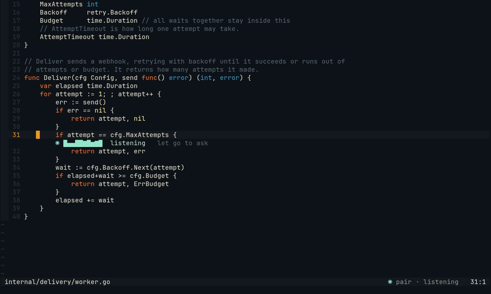
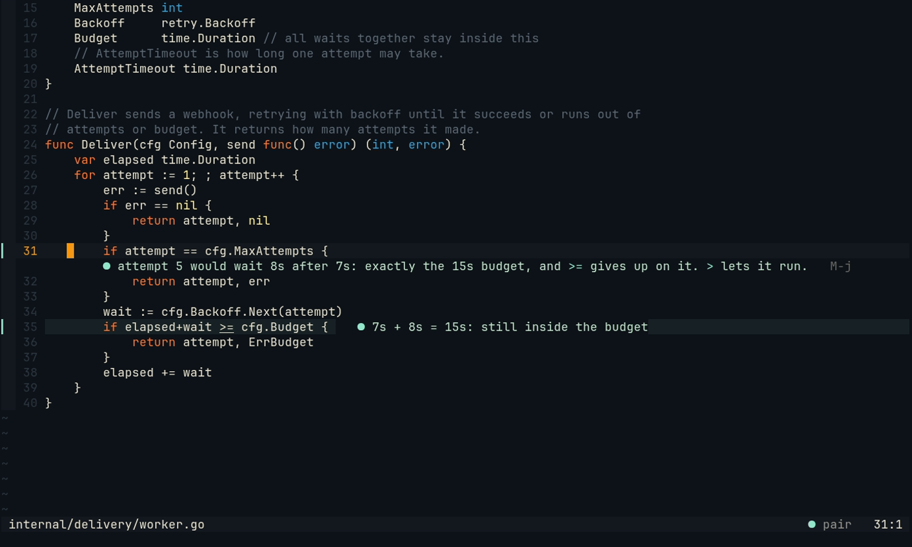

# Push-to-talk

Hold `Alt-t` in Neovim, say what you want to ask, and let go. Pair answers under the line you asked on. Your hands
and eyes stay on the code, and saying the problem out loud is rubber-ducking with a duck that answers.


*Recorded from [the push-to-talk tape](captures/tapes/push-to-talk.tape). The question is spoken by espeak-ng into
the recorder, and whisper.cpp hears it for real; only the Partner's answer is scripted.*

Everything happens on your machine. [whisper.cpp](https://github.com/ggml-org/whisper.cpp) writes down what you
said, on the CPU: with the `base.en` model a short question takes about half a second on a desktop CPU, and no GPU
is used. The audio is kept in memory and in a temporary file only while whisper reads it.

## What you see

| Moment | Under your line | Statusline |
| --- | --- | --- |
| You hold the key | `◉ ▂▅▇▆▃▂▁▃▅▆  listening   let go to ask`: a meter of the last second | `◉ pair · listening` |
| You let go | `⠹ hearing` while whisper works | `⠹ pair · hearing` |
| Whisper is done | `› why does delivery give up one retry too early?`: your words, as heard | `⠹ pair · thinking` |
| Pair answers | Pair's words in place of yours, with `M-j` when it points at a line | `● pair` |





The question also goes to the chat pane, like a typed one, and the whole answer is there. Pair's words under your
line go with your next edit, as its other words do. Whisper heard nothing (a cough, a key pressed by mistake)? The
line says `◌ heard nothing` for a moment and Pair is not asked. Pair could not answer (its model is down, say)?
The line says `◌ no answer · the chat says why` for a moment, and the chat pane says why.

**Hold or tap.** A terminal sends no key-up, only the key again and again while you hold it. Pair counts the key as
let go when those repeats stop (about 0.2 s after the last one). A short press that does not repeat is a tap: Pair
then listens until you press the key again, and the line says `M-t again to ask`. `:Pair listen` works as a tap, and
`:Pair listen cancel` drops what is being recorded. A recording stops by itself after `maxSeconds`.

**When holding does not work for you.** Letting go is guessed from the repeats, so a terminal that waits long before
it repeats a held key (or does not repeat it at all) turns your hold into a tap. Two settings never guess
(see [the key](#4-the-key)):

- `listen_mode = 'toggle'`: press the key to start, press it again to ask. Holding it does nothing more: its repeats
  are not a second press. The line says `M-t again to ask` from the start.
- `listen_silence_ms = 1200`: a recording you do not hold (a tap, `toggle`, `:Pair listen`) also asks once you have
  spoken and then paused that long; the line says `M-t again or pause to ask`. Pause counts from the meter: quieter
  than about -42 dB. Nothing is asked before you have said something.

A real key-up would be better, and the kitty keyboard protocol has one, but Neovim (0.12 included) drops key-release
events before a plugin can see them ([#55](https://github.com/makefunstuff/pairing-buddy/issues/55)).

**About the selection.** In Visual mode the key asks about the selected lines, as `:'<,'>Pair ask` does.

**Whisper hears your project's words.** It is told the file you are in and the session goal, which helps with names
it would otherwise mishear ("attempt five" rather than "a temp five").

## Spoken answers, only when you are away

With a `speak` command set, the answer to a spoken question is also read aloud, but only when you are away from the
editor when it comes: Neovim has lost the focus (another window, the browser), or herdr shows another workspace.
At the editor you read it; nothing ever speaks at you while you look at the code. Only the first sentence or two is
read (up to 240 characters), without Markdown, with `retry.c:42` read as "retry.c, line 42". Coming back to Neovim
stops it, every part of the `speak` command (a pipeline's player too). Pair never speaks its unasked remarks.

Away is told by the terminal's focus reports, which Neovim turns on by itself; herdr and most terminals send them.

## Setup

### 1. Build whisper.cpp (CPU only)

Any scratch folder will do. Without GPU options, whisper.cpp builds for the CPU only, and Pair runs it with
`--no-gpu` as well.

```sh
git clone --depth 1 https://github.com/ggml-org/whisper.cpp ~/src/whisper.cpp
cd ~/src/whisper.cpp
cmake -B build -DCMAKE_BUILD_TYPE=Release -DBUILD_SHARED_LIBS=OFF
cmake --build build -j --target whisper-cli
sh models/download-ggml-model.sh base.en      # 142 MB, into models/
```

`build/bin/whisper-cli` is the program (put it on your `PATH`, or name it in the config); `models/ggml-base.en.bin`
is the model. `base.en` is a good start for English; `small.en` hears better and takes about three times as long.
Your distribution may also package whisper.cpp (look for `whisper-cli` or `whisper-cpp`).

### 2. A recorder

Pair records 16 kHz mono with the first of `pw-record` (PipeWire), `parec` (PulseAudio) or `arecord` (ALSA) it finds.
Most desktops have one. The daemon runs as your user, so it uses your default microphone.

### 3. The config

```jsonc
"voice": {
  "model": "~/src/whisper.cpp/models/ggml-base.en.bin",
  "whisper": "~/src/whisper.cpp/build/bin/whisper-cli"   // default: whisper-cli on PATH
}
```

Save the config (the daemon takes it as you save it), then `pair doctor` checks it: it finds the recorder, and runs whisper on a second of silence to
say how long it takes.

```
✓ voice     pw-record records, whisper.cpp hears a second in 0.4 s on the CPU
```

All fields:

| Field | Default | What |
| --- | --- | --- |
| `model` | (needed) | the whisper.cpp model file |
| `whisper` | `whisper-cli` | the whisper.cpp program |
| `threads` | `4` | CPU threads whisper uses |
| `language` | `en` | what you speak (`auto` with a multilingual model) |
| `record` | the first recorder found | a shell command that writes raw 16-bit little-endian mono at 16 kHz to stdout |
| `speak` | none | a shell command that reads the answer from stdin and says it; without one nothing is read aloud |
| `maxSeconds` | `60` | the longest recording |

Some `speak` commands (any speech program that reads text on stdin works):

```jsonc
"speak": "espeak-ng"                                                          // robotic, everywhere
"speak": "piper --model ~/voices/en_US-amy-medium.onnx --output-raw | pw-play --raw --rate 22050 --format s16 --channels 1 -"
```

A neural voice such as Kokoro or Piper also runs on the CPU; wrap it in a small script that reads stdin and plays
the audio, and name that script.

### 4. The key

`Alt-t` in Normal and Visual mode, mapped only where you have no mapping of your own. Change it with `listen_key`
in `setup` (`false` for none; `:Pair listen` works either way). How it works:

```lua
require('pair').setup({
  listen_key = '<M-t>',
  listen_mode = 'hold',     -- 'toggle': press to start, press again to ask
  listen_hold_ms = 650,     -- no repeat this long after the press: it was a tap
  listen_release_ms = 220,  -- no repeat this long: the key is up (in 'toggle': a press this soon is a repeat)
  listen_silence_ms = false, -- a number: a recording you do not hold asks after a pause this long
})
```

With a terminal that is slow to repeat, a longer `listen_hold_ms` (its repeat delay and a little more) keeps your
holds holds; `listen_release_ms` must be longer than the time between two of its repeats.

## Limits

- In `hold` mode the key is held as long as the terminal repeats it. If your terminal waits longer than
  `listen_hold_ms` before it repeats a held key, a hold counts as a tap: press the key again to ask, or use
  `listen_mode = 'toggle'`. There is no real key-up: Neovim drops the kitty keyboard protocol's release events
  ([#55](https://github.com/makefunstuff/pairing-buddy/issues/55)).
- Voice is off until `voice` is in the config. Pair records only while you hold the key (or between two taps). When
  the Neovim that started a recording goes away (it quits or crashes), the recording stops at once and nothing is
  asked.
- One recording at a time per project; pressing the key in another Neovim of the same project starts over there.
